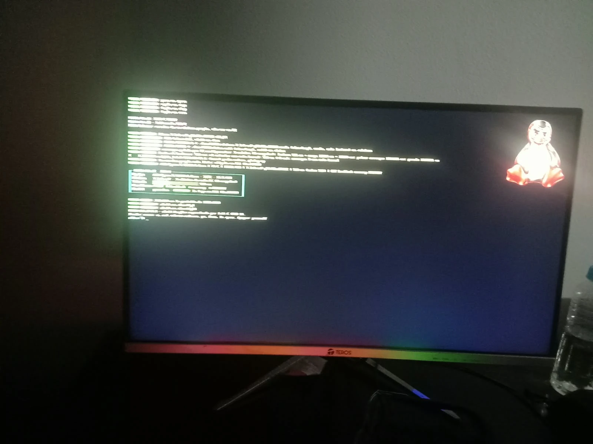
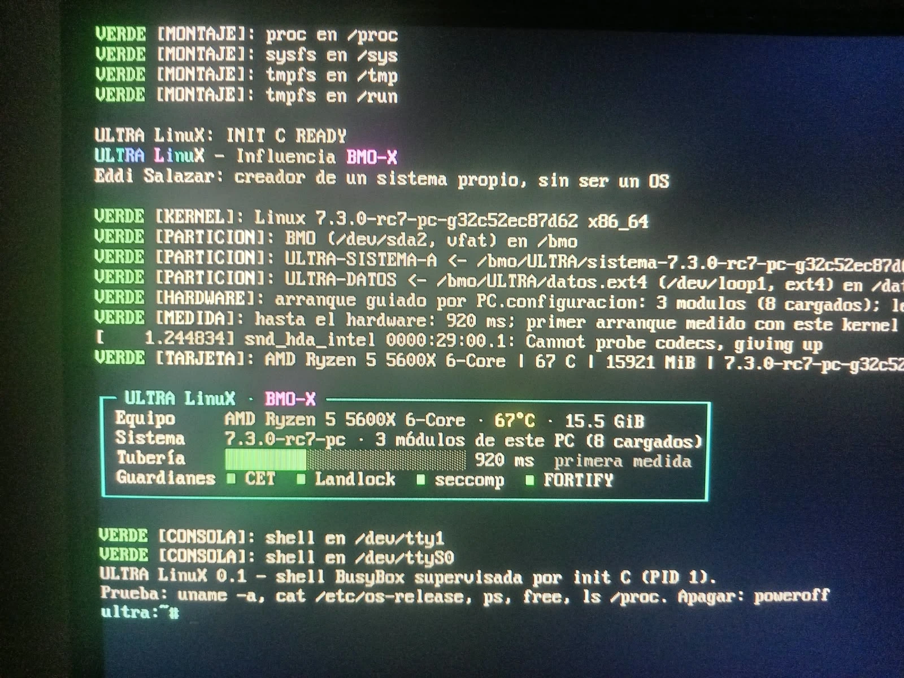

<p align="center">
  
</p>

<h1 align="center">ULTRA LinuX</h1>

<p align="center">
  <b>Influencia BMO-X</b> · Eddi Salazar: creador de un sistema propio, sin ser un OS<br>
  Kernel oficial de Linux · init en C con guardianes · arranque en 0,9 s en el metal
</p>

<p align="center">
  
</p>

# Linux Reconstruido

## ULTRA LinuX en el metal: de 2009 ms a 920 ms



ULTRA LinuX arrancando en el PC real (Ryzen 5 5600X, MSI A320M-A PRO MAX, RTX 3060), desde archivos en `A:\` con su propia entrada F11 y sin tocar Windows. La tarjeta lo dice todo: **67 °C** del sensor `k10temp` que ULTRA detectó solo, los cuatro guardianes en verde preguntados al kernel, y la **tubería: 920 ms** desde que arranca el kernel hasta que el hardware está listo.

| Arranque | Hasta el hardware | Qué cambió |
|---|---|---|
| Antes, con los dos kernels | **2009 ms** | La placa revisaba los puertos SATA uno por uno (arranque escalonado) |
| Kernel `pc` (Zen 3), guiado | **920 ms** | `libahci.ignore_sss=1`: los cuatro puertos a la vez. Módulos cargados en paralelo (17,4 → 12,5 ms) |

El logo de ULTRA (el pingüino rojo y metálico de `src/logo/ultra-tux.webp`) lo dibuja el propio init en la esquina de la pantalla, a través de `/dev/fb0` y sin modificar el kernel (`src/logo.c`, captura en `evidencias/pantalla-logo-ultra.png`). Está basado en Tux, de Larry Ewing (lewing@isc.tamu.edu), hecho con The GIMP.

Medido por el propio init en cada arranque, y confirmado en el `dmesg`: `Run /init` pasó de 2,27 s a 1,17 s, y desapareció la línea `parallel bus scan disabled`. Datos completos en [`evidencias/pc-real/`](evidencias/pc-real/). El camino hasta aquí (pantalla negra, el `dmesg` que delató al SATA, el primer intento con el nombre de parámetro equivocado) está en [PRUEBA-PC-REAL.md](docs/PRUEBA-PC-REAL.md), y Linux medido por categorías en [ANTI3M-LINUX.md](docs/ANTI3M-LINUX.md).

El [Museo viviente de C y sus guardianes](docs/MUSEO-UB.md) reune ejemplos estudiados,
alternativas validas, referencias y evidencia del campo de minas. Distingue UB de
otros comportamientos de C y deja visibles los casos aun sin prueba.

La [historia de C, UB y aislamiento hasta 2026](docs/HISTORIA-C-Y-SEGURIDAD.md)
conecta las fuentes originales con un [inventario de pendientes](docs/PENDIENTES-GUARDIANES.md)
para ampliar los guardianes sin confundir investigacion con cobertura demostrada.

Taller de **ULTRA LinuX**: kernel oficial + init C con guardianes + BusyBox, compilados con GCC. Plan, guardianes y fases en [docs/ULTRA-LINUX.md](docs/ULTRA-LINUX.md).

Laboratorio personal x86-64 para modificar el Linux oficial con C y GCC. Inspirado en el control de Arch. Perfil físico inicial: Ryzen 5 5600X y MSI A320M-A PRO MAX.

## Ruta elegida: QEMU y después metal

El taller es una máquina Arch Linux dentro de QEMU. Las fuentes, GCC y la compilación viven en su disco Linux. Windows solo ejecuta QEMU y los lanzadores; WSL no forma parte de esta ruta. WSL se instaló durante la preparación anterior, pero aquí no se utiliza y no se desinstala automáticamente.

La imagen Arch aporta el taller de trabajo; el kernel que reconstruimos es el original de Linus, conservado por separado. No confundir el kernel de la imagen Arch con el kernel experimental. El sistema final y sus decisiones de paquetes todavía están pendientes.

## Componentes

- `upstream/linux.git`: repositorio oficial de Linus, bare y superficial; no incluye todo el historial.
- `evidencias/origen-inicial.json`: commit original fijado, `32c52ec87d6245ee2d12ed5dd509e40062939b50`, Linux 7.3-rc7. Es una candidata, no una publicación estable.
- `evidencias/imagen-arch.json`: origen y SHA-256 de la imagen oficial del taller; no se afirma verificación de firma.
- `vm/`: imagen base, disco de trabajo de 64 GiB virtuales, configuración inicial y clave local. Todo excluido de Git.
- `scripts/taller_qemu.py`: prepara el disco y cloud-init, inicia QEMU y comprueba GCC/fuentes por SSH.
- `docs/PLAN.md`: etapas y criterios de avance.

La VM reserva 4 GiB de RAM y 4 CPU virtuales usando TCG con reloj por instrucciones (`icount`) y un hilo de emulación. Los primeros perfiles Q35/PC sin ese reloj fallaron al comprobar el temporizador; sus registros están en evidencias. No necesita WSL ni reiniciar Windows para usar ese emulador. Compilar un kernel completo con emulación puede ser lento. No se conectan discos físicos a la VM.

## Uso

```powershell
.\preparar-entorno.ps1 -Accion Preparar
.\preparar-entorno.ps1 -Accion Iniciar
.\preparar-entorno.ps1 -Accion Estado
.\conectar-taller.ps1
```

Preparar requiere la imagen y las herramientas locales ya descargadas. Iniciar rechaza puertos ocupados y discos ausentes. El primer arranque instala paquetes oficiales Arch y copia el repositorio original al disco Linux. Estado comprueba por separado la marca de finalización, herramientas, commit y ausencia de archivos borrados; muestra además el diagnóstico de cloud-init sin confundir un error histórico con una prueba aprobada. Revisar `vm/serial.log`, `vm/qemu.log` y `vm/http.log` ante fallos.

SSH se publica únicamente en `127.0.0.1:12222`, autenticado por la clave generada en `vm/`. El servidor local `127.0.0.1:18765` entrega solo la copia de las fuentes. QMP usa `127.0.0.1:14444`. El usuario `builder` tiene sudo en esta VM de laboratorio y no usa contraseña SSH. No reutilizar esta imagen/configuración como servidor público.

Dentro de la VM, las fuentes están en `/home/builder/linux-reconstruido/kernel`. Para apagarla limpiamente: `sudo poweroff`. El servidor local de fuentes puede seguir en marcha hasta cerrarlo mediante el PID registrado en `vm/session.json`; no se deben terminar procesos por nombre global.

## Ecosistema y guardianes

Objetivo: acceso amplio al ecosistema Linux, incluyendo aplicaciones gráficas, compiladores, herramientas, servicios, redes, sonido y juegos compatibles. Chromium será una prueba entre varias. No existe un paquete que incluya todo el ecosistema ni una promesa automática de compatibilidad universal.

Primero se preservan la ABI Linux x86-64 y las dependencias necesarias; después se miden cambios. POSIX se documentará por interfaces y pruebas. No se eliminarán componentes por antigüedad sin identificar sus usos.

ROJO: falla una condición obligatoria y se detiene ese avance. AMARILLO: comportamiento no medido o dependencia pendiente. VERDE: comprobación concreta aprobada, sin extrapolarla al sistema completo. Cada guardián debe explicar motivo, evidencia, acción y coste.

## Próximos hitos

1. Herramientas y fuentes verificadas dentro de QEMU.
2. Kernel oficial sin cambios compilado con GCC, configuración e informe reproducibles.
3. Arranque de ese kernel con initramfs y consola en otra prueba QEMU.
4. Entorno de usuario y pruebas de compatibilidad, gráficos, USB, red y sonido.
5. Arranque en el PC real conservando recuperación y las entradas actuales.

Todavía no se afirma que el kernel experimental haya compilado o arrancado. Los registros distinguen instalación de herramientas, compilación y ejecución.

## Licencias y procedencia

El kernel conserva `COPYING`, `LICENSES/` y los avisos por archivo. Los archivos originales del laboratorio se ofrecen bajo GPL-2.0-only; los componentes de terceros mantienen sus licencias. La licencia no se determina por usar C o GCC.

Fuentes oficiales:
- https://git.kernel.org/pub/scm/linux/kernel/git/torvalds/linux.git
- https://www.kernel.org/doc/html/latest/process/license-rules.html
- https://wiki.archlinux.org/title/Arch_Linux_on_a_VPS
- https://github.com/archlinux/arch-boxes
## Herramientas comprobadas

GCC 16.2.1 y GNU Make 4.4.1 se ejecutaron dentro de QEMU, y una prueba C17 compilada con avisos tratados como errores produjo `Linux Reconstruido: GCC C OK`. CMake 4.4.4 se instaló en Windows desde el MSI oficial de Kitware con SHA-256 y firma verificados. Abrir una terminal nueva para recoger su cambio de PATH.

El kernel usa Make/Kbuild y GCC; no usa CMake como sistema de construcción. No se instala un GCC MinGW de Windows para compilar este kernel: la cadena elegida vive en Linux dentro de QEMU. El taller incluye además CMake y Ninja para otros proyectos del ecosistema.

El despliegue usa `git worktree`: los clones locales de un origen superficial ignoran `--local` y rehacen el índice mediante transporte. Se conservaron los intentos incompletos en el disco virtual como diagnóstico. La copia del repositorio dentro de Linux ajusta symlinks, permisos y sensibilidad a mayúsculas; el origen Windows no se altera.
## Resultado de esta preparación

Taller QEMU iniciado; GCC, Make, CMake y Ninja ejecutados. Programa C17 compilado y ejecutado. Fuentes desplegadas con el commit esperado y sin archivos rastreados ausentes. No se ha compilado el kernel completo ni probado su arranque.

La cancelación de un clon inicial coincidió con el despliegue y dejó 25.870 archivos ausentes. Se restauraron únicamente desde el índice del repositorio verificado y se repitió la comprobación de archivos ausentes. El inicializador recuperado también se ejecutó correctamente. Cloud-init conserva el error histórico `scripts_user` del intento interrumpido: se registra como AMARILLO y no se certifica un arranque limpio del taller. El informe separa ese diagnóstico de las comprobaciones de herramientas y fuentes.

Antes de modificar código, la siguiente referencia debe incluir compilación del kernel sin cambios y su arranque QEMU. Esa prueba sigue pendiente. El kernel conserva también el ensamblador y los demás componentes de upstream: usar GCC y C como base no significa reescribir todo el árbol en C.
## Primera aplicación en C y GCC

La [guía de primer kernel](docs/PRIMER-KERNEL.md) describe la referencia mínima, el init propio, los guardianes y la secuencia para verla en QEMU. `construir-kernel.ps1` permite Compilar, Estado, Descargar y Ver. El kernel oficial y el init C ya compilan con GCC, y el arranque sin pantalla en QEMU/WHPX llega al prompt del init (ver la guía). El taller principal requiere ahora WHPX por defecto; TCG debe elegirse explícitamente.
