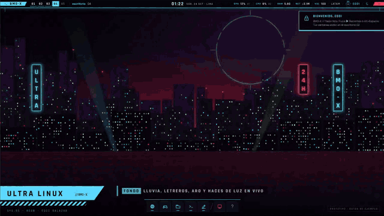
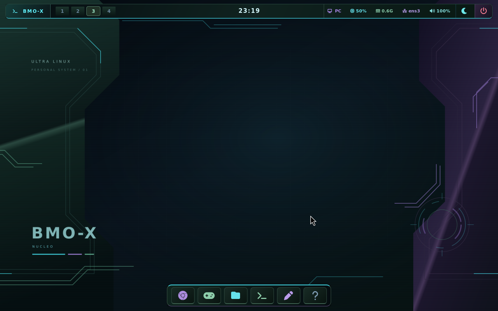
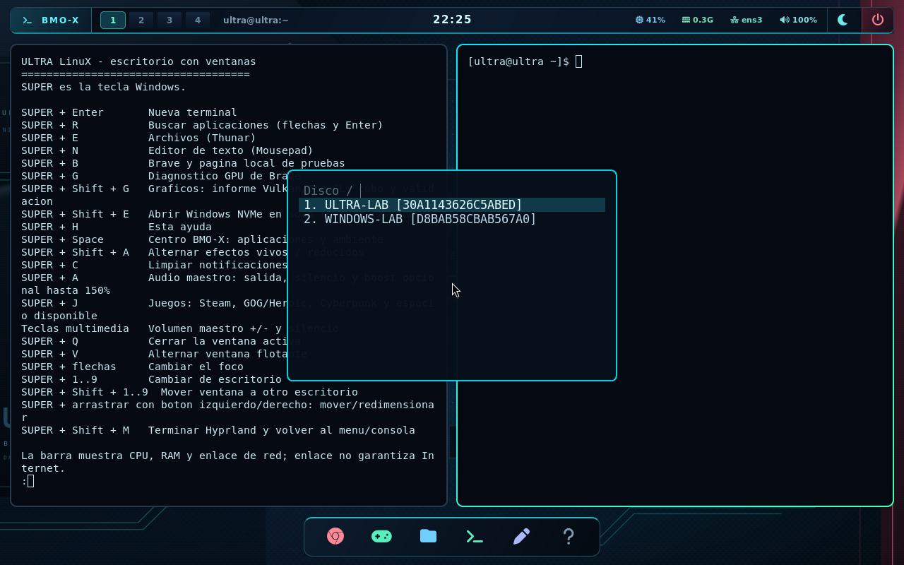
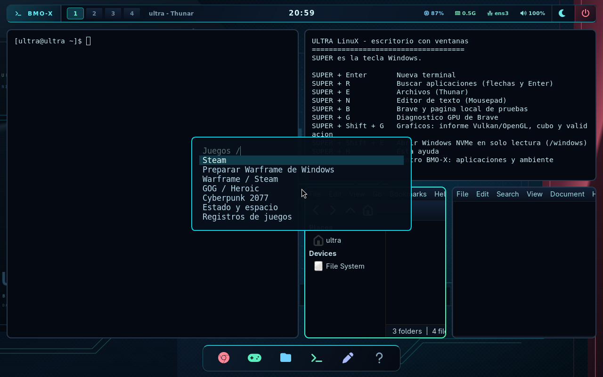
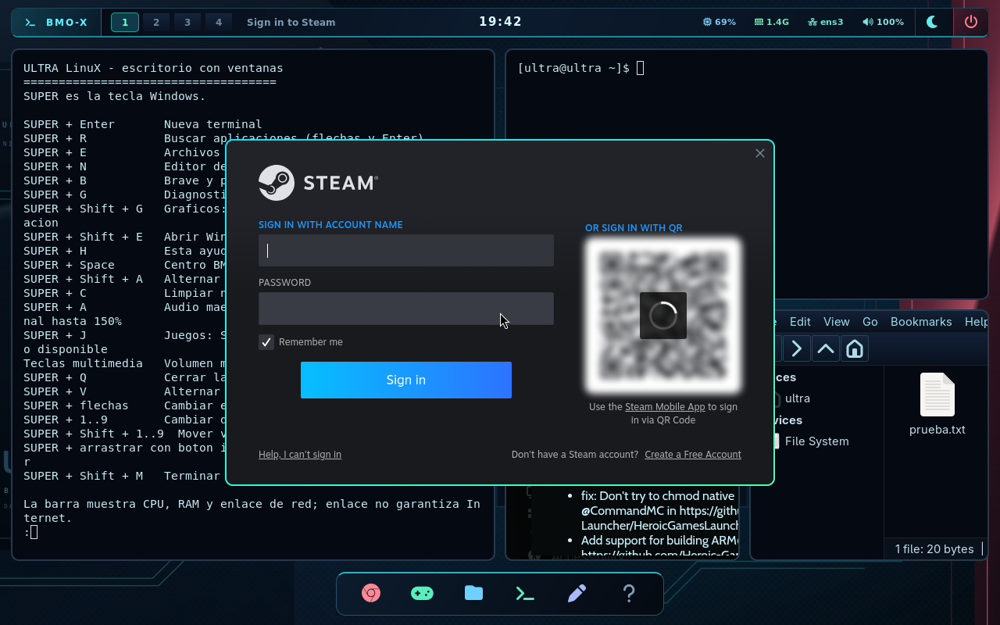

<p align="center">
  
</p>

<h1 align="center">ULTRA LinuX · BMO-X</h1>

<p align="center">Distribución personal y experimental para x86-64, creada e integrada por Eddi Salazar.<br>Linux + entorno Arch + init propio en C + escritorio Wayland con Hyprland.</p>

## Escritorio BMO-X // Neón

<p align="center">
  
</p>

<p align="center"><b>Neón</b>: negro, azul hielo, cyan y rojo, con estética cyberpunk original.<br>
Diseño y autoría: <b>Eddi Salazar</b>.</p>

- **Video de presentación** (53 s): [`recorrido.mp4`](docs/maquetas/png/neon/recorrido.mp4).
- **Prototipo interactivo**: [`vivo.html`](docs/maquetas/neon/vivo.html). Se abre en
  el navegador; Alt hace de Super.
- **Animaciones**: fondo con lluvia, letreros y el aro del autor; ventanas con
  borde hielo → rojo → cyan que gira; escritorios que se deslizan. También son
  animados el centro BMO-X, los avisos, Equipo en vivo, la captura, el modo juego
  con MangoHud y el bloqueo.
- **Intro de arranque**: el Tux del autor aparece en la pantalla del firmware con
  bloques de píxeles, glitch rojo y línea de escaneo, en 1,2 s y sin borrar la consola
  ([intro](docs/INTRO-ARRANQUE.md), [vista previa](docs/maquetas/png/neon/intro-arranque.mp4)).
- **Personalizar** (Super+Shift+P): perfiles de un toque (Neón hielo, Demonio, Sobrio, Minimal,
  Juego y los tuyos), fondo Demonio con tu Tux, fondo según la hora y 20 opciones de colores,
  ventanas, animaciones, barra, dock, avisos, letra y sonidos ([detalle](docs/TEMA-NEON.md)).
  **Fondo vivo**: lluvia, aro que gira y letreros que fallan, con tu acento o tu Tux, quieto en
  juegos ([Neón](docs/maquetas/png/neon/fondo-vivo-neon.mp4), [Demonio](docs/maquetas/png/neon/fondo-vivo-demonio.mp4)).
  **Un sonido propio por elemento** ([escuchar](docs/maquetas/sonidos-bmox.ogg)). Clic en CPU o RAM
  de la barra para cerrar o frenar lo que más consume. **Tu imagen, viva**: cualquier fondo tuyo
  (por ejemplo, los oficiales de Cyberpunk 2077 de GOG) con lluvia, barrido y glitch.
- **Ciudad 3D**: la cámara vuela por una avenida neón con edificios, reflejos, coches
  voladores, lluvia con profundidad y la esfera del autor: núcleo que late, malla 3D, órbitas
  con satélites, HUD y tu firma girando ([primer plano](docs/maquetas/png/neon/esfera-3d.mp4)). Se calcula una vez
  en tu PC y se queda quieta en juegos ([hielo](docs/maquetas/png/neon/ciudad-3d-hielo.mp4),
  [rojo](docs/maquetas/png/neon/ciudad-3d-rojo.mp4)).
- **ULTRA Carpetas** (Super+Ctrl+E), en Rust con Vulkan (wgpu): iconos donde tú quieras, como en
  el Windows antiguo, con rejilla, candado y deshacer; cada carpeta recuerda su orden y nunca
  toca tus archivos. Arquitectura como React + Redux con paleta de comandos como VS Code, y
  el núcleo es `no_std`: compila para bare-metal, listo para BMO-X ([detalle](docs/ULTRA-CARPETAS.md)).
  **Modo grafo como Blender y Houdini** (nodos, cables curvos, zoom, desplegar en el grafo, peso de
  cada carpeta para optimizar), **explorador** sincronizado e **iconos SVG** de VS Code (Material) o
  Lucide. Carriles aislados con **semáforo de rendimiento** (F12) y el disco en su propio hilo.
  **Grafo retenido en la GPU** (la CPU arma la geometría una vez; mover y zoom solo mandan la cámara
  al shader WGSL), **botones ▶** para `cargo run`, `make`, Python y scripts, y **terminal** abajo como
  VS Code, sin shell.
  **9 temas** (Neón BMO-X, TITAN Taller, Synthwave '84, Tokyo Night, Catppuccin, Rosé Pine, Kanagawa,
  Dracula, Nord) con contraste comprobado y panel de ajustes en Ctrl+, ([temas](docs/TEMAS-APPS.md)).
- **Tarjetas de equipo con eww** (Super+F9): CPU por núcleo, RAM, GPU, red, discos y
  temperatura, con anillos y gráficas en vivo ([captura con eww real](docs/maquetas/png/neon/tarjetas-eww.png)).
  La terminal sigue tu acento. **Modo juego automático**: con un juego en pantalla completa
  se apagan los efectos y los avisos, y al salir vuelven. **Portapapeles** (Super+Shift+V)
  con historial en RAM; **Super+Shift+N** recupera avisos cerrados. **Capturas**: Impr Pant,
  Super+Shift+S y Super+Impr Pant. **Incidentes** (Super+Shift+I):
  foto de lo que se cruzó cuando algo falla ([detalle](docs/INCIDENTES.md)).
- **Perfil del autor**: módulo **EDDI** en la barra, emblema propio
  ([`emblema-autor.svg`](src/rootfs/desktop/emblema-autor.svg)) y `/etc/ultra/AUTOR.txt`.

El tema real ya está en el código del escritorio: Hyprland, Waybar, fuzzel,
mako, GTK, foot, MangoHud, fondo, iconos y cursores. Las fuentes Rajdhani y
Chakra Petch (OFL) viajan con el proyecto.

El GIF y el video salen del prototipo en el navegador, no de una captura del
sistema. Falta reconstruir las imágenes y pasar las pruebas de arranque en QEMU
y en el PC. Hasta entonces, la última captura real es la de Núcleo:



[Tema Neón: uso, animaciones y verificación pendiente](docs/TEMA-NEON.md) ·
[Propuesta y maquetas](docs/PROPUESTA-ESCRITORIO.md) ·
[Tema Núcleo anterior](docs/TEMA-NUCLEO.md).

[Espacio y aplicaciones](docs/ESPACIO-Y-APLICACIONES.md): Super+Esc abre el
administrador para cerrar procesos y limitar CPU/RAM. El sistema distingue
cache recuperable, espacio ext4 y tamaño del contenedor de Windows, y evita
acumular generaciones antiguas de bibliotecas sin revision.

Actualización de bibliotecas y audio: detección Steam dentro de carpetas
elegidas, recuperación conservando capas anteriores cuando Windows actualiza
los juegos, acceso a importación GOG y volumen maestro opcional hasta 500 %.
Consulta [evidencia, límites y uso](docs/BIBLIOTECAS-AUDIO-2026-10-23.md).

[Juegos en vivo](docs/JUEGOS-EN-VIVO.md): Super+F10 muestra juegos detectados y
consumo CPU/RAM/GPU. MangoHud presenta FPS y tiempos de cuadro dentro del juego,
con registros CSV locales. El catálogo Steam/GOG se revisa durante toda la sesión.

[Diagnóstico de Warframe](docs/DIAGNOSTICO-WARFRAME.md): captura de dos minutos
con CPU, memoria, I/O y estados de hilos del juego, además de presión del sistema,
discos, red, GPU y eventos del kernel. Super+F11 inicia recursos;
Super+Ctrl+F11 abre el panel. Los tiempos de cuadro se registran aparte con
Shift izquierdo+F2, tras abrir «Warframe / diagnóstico» en Super+J.

[Cyberpunk de Personal en Heroic](docs/GOG-CYBERPUNK-2026-10-23.md): el perfil PC
registra sus archivos GOG ya montados al abrir GOG desde el menú, sin volver a
descargar el juego ni depender de elegir manualmente el disco Personal.

## ¿Es una distro?

**Sí: una distribución Linux personal y experimental.** Integra un kernel Linux
configurado y compilado, un sistema de usuario, paquetes, arranque, políticas,
escritorio e imágenes que se pueden ejecutar en una máquina real. La integración
propia incluye PID 1 en C, detección de hardware, perfiles, menú, guardianes,
informes, almacenamiento y herramientas de construcción y prueba.

El kernel procede de upstream Linux y buena parte del entorno de usuario procede
de Arch. Es una distribución basada en esos componentes, con identidad e
integración propias; no un kernel escrito desde cero. Todavía no tiene el proceso
de publicaciones, mantenimiento y soporte de una distribución de uso general.
El taller Arch que compila las imágenes es distinto del sistema ULTRA que arranca.

## Qué funciona y qué queda por confirmar

La primera comparacion del [lector C con Custodia](docs/RECURSOS-C-PRODUCCION.md)
midio menor coste que los bucles Bash anteriores: 7,23 ms a 0,51 ms por captura
en QEMU, con salida equivalente. Incorpora
limites, pruebas de fallos de asignacion e inspeccion HEX contrastada con ELF.
La mejora corresponde al observador; el ajuste de CPU/RAM/SSD y su impacto
en juegos requieren medicion nativa con los nuevos contadores.
La [ronda de analisis y PSI](docs/ANALISIS-RECURSOS.md) corrige la ausencia de
medicion de presion CPU/RAM/E/S en el kernel, calcula intervalos de VM/disco
y exige la auditoria HEX integrada antes de instalar. Esta version esta
instalada en los dos perfiles de A: tras 156 comprobaciones en generico y
157 en PC, cero fallos; conserva los datos y respalda los informes
en el proyecto Windows. La verificacion incluye los lectores finales O2 y
O3/LTO, ademas de las pruebas de laboratorio con sanitizadores.
PSI es instrumentacion: su impacto en FPS nativos no esta medido. Se conserva
en Windows la imagen de prueba anterior para volver atras o comparar.

El [gestor general de bibliotecas](docs/BIBLIOTECAS.md), accesible con
**Super+J > Elegir carpetas y discos**, permite seleccionar varias carpetas
en distintos discos. Reconoce bibliotecas Steam y carpetas independientes,
recuerda sus identidades y separa las escrituras en ext4. Las carpetas nuevas
se activan al volver a abrir el escritorio; cada juego mantiene sus requisitos
de compatibilidad. Al abrir Steam desde **Super+J**, ULTRA registra las bibliotecas
Steam activas automaticamente con el cliente cerrado, conservando su registro
anterior. Steam sigue realizando la comprobacion de archivos y compatibilidad.

El gestor paso [87 comprobaciones especificas](evidencias/bibliotecas-2026-10-21/README.md)
y esta instalado en ambos perfiles de A:, conservando los datos existentes.
La mejora de [registro automatico de Steam](evidencias/registro-steam/README.md)
paso otras 33 comprobaciones de arranque en generico y 36 en PC; el cliente real
abre y cierra conservando la biblioteca en el banco sin una cuenta autenticada.
El [informe fisico posterior](evidencias/sesion-steam-2026-10-22/README.md)
registra cinco juegos y el proceso Warframe bajo Wine. El usuario confirma que
su lanzador propio esta verificando archivos; aun no se acredita una partida.
Ese informe anterior termina con 2,8 GiB libres. Una inspeccion de mantenimiento sin red,
con el archivo en solo lectura, identifica 6,56 GiB en la capa Steam, incluidos
runtimes, cambios de Warframe, shaders y prefijos. Queda comprobar el progreso
del verificador sin suponer un fallo grafico. Un [informe mas reciente](evidencias/almacen-c-2026-10-22/README.md)
ya muestra el ext4 al 100 %. Se amplio una copia a 96 GiB en
`C:\Espacio para Linux\ULTRA-juegos.ext4`, con 80,63 GiB disponibles al comprobarla.
Ambos perfiles nuevos pasaron 18 pruebas cada uno de montaje, Brave y persistencia.
El original de D: y el respaldo del proyecto se conservan; la partida de Warframe
y el rendimiento del navegador en el PC aun deben confirmarse tras el arranque.

La [auditoria Ethernet](docs/RED-RENDIMIENTO.md) identifica que el otro extremo
del enlace anuncia 100 Mbps, mientras el PC anuncia 1 Gbps; Windows tambien
negocia 100 Mbps. El banco aislado favorece FQ-CoDel para latencia bajo congestion,
pero aun no se activo en el kernel ULTRA: se preparo un fragmento de laboratorio
y permanece pendiente su construccion. La [reutilizacion DHCP](evidencias/red-reutilizacion-2026-10-22/README.md)
evita repetir la preparacion cuando el supervisor sigue activo, conserva las
renovaciones y la reconexion e incluye el informe de red ampliado en ambos
perfiles. La evidencia registra pruebas sobre las imagenes construidas y su
instalacion en A:. No se atribuye una mejora de descarga a Steam o Warframe
sin medirla en el PC.



La [reconstrucción del 21 de octubre](evidencias/rebuild-2026-10-21/README.md)
actualiza los informes de montajes y audio USB, y permite consultar el estado
de juegos aunque falte el almacenamiento persistente.

La ampliación de [gráficos y NVMe](docs/GRAFICA-Y-NVME.md) incorpora diagnóstico
Vulkan/OpenGL, validación por proceso, corrección de la activación de portales
Wayland y acceso a Windows C: en solo lectura. El laboratorio C++ prueba EGL
y Vulkan con render por CPU, separado de la RTX y del escritorio.

La integracion de [Warframe y Steam con Windows](docs/STEAM-WINDOWS.md) agrega
opciones al menu Super+J para preparar su biblioteca, iniciarlo mediante Steam
y consultar discos, espacio, RAM, VRAM y registros. Reutiliza el juego de C:
con una capa de escritura en ext4 y conserva Windows en solo lectura. Importar
sus metadatos no acredita todavia el arranque de Warframe con Proton en el PC.

Esta [ronda de Steam y Warframe](evidencias/warframe-2026-10-21/README.md) paso
**286 comprobaciones**, incluidas las de arranque y escritorio de ambos perfiles.
Las imagenes estan instaladas en A: con hashes verificados y datos conservados.



| Área | Estado y evidencia |
|---|---|
| Arranque | UEFI, init C, consola BusyBox y perfiles genérico/PC; probado en QEMU y PC real |
| Escritorio | Hyprland, Waybar, Fuzzel, Foot, Thunar, Mousepad, Mako e iconos Papirus |
| NVIDIA | RTX 3060 detectada; Hyprland, EGL y Brave/WebGL registrados en el PC real |
| Navegador | Brave con Wayland y sandbox; página local de pruebas y diagnóstico GPU |
| Ethernet | Firmware Realtek, DHCP incluso con enlace tardío, DNS y HTTPS en el banco |
| Audio | USB/HDA, PipeWire y control maestro; USB emulado probado, audición del dispositivo físico pendiente |
| Juegos | Steam, Heroic/GOG y UMU; interfaces y persistencia probadas, Cyberpunk real aún sin validar |
| Seguridad | Casos concretos de CET, FORTIFY, seccomp, Landlock y detectores de UB; cobertura parcial documentada |

La ampliación gráfica del **21 de octubre pasó 283 comprobaciones**: 113 de
arranque en genérico, 114 en PC y 28 de audio/juegos/NVMe por perfil. Los
[resultados nuevos](evidencias/grafica-nvme-2026-10-21/README.md) conservan hashes,
capturas y límites. Las rondas de [reconstrucción previa](evidencias/rebuild-2026-10-21/README.md)
y [audio/juegos](evidencias/audio-juegos/README.md) permanecen como historial.
Los resultados virtuales no acreditan FPS, latencia de audio ni consumo físico.



Versiones de esta reconstrucción: Linux **7.3-rc7**, commit
`32c52ec87d6245ee2d12ed5dd509e40062939b50`; Hyprland **0.56.2-4**;
NVIDIA **615.78.08** y Heroic **2.22.4**. El kernel es una candidata experimental.
Los manifiestos `sistema-paquetes.txt` y `SHA256SUMS` de cada construcción describen
sus versiones y artefactos efectivos; no se promete que reconstruir más tarde
produzca los mismos bytes usando repositorios cambiantes.

## Controles del escritorio

Super es la tecla Windows. En la consola, `e` abre el menú con flechas y Enter.

| Teclas | Acción |
|---|---|
| Super + Enter | Terminal |
| Super + R | Buscar aplicaciones |
| Super + Space | [Centro BMO-X por categorias y colores](docs/MENU-CATEGORIAS.md), con panel de discos y revision automatica |
| Super + E / N | Archivos / editor |
| Super + B / G | Brave / diagnóstico GPU del navegador |
| Super + Shift + G | Informe OpenGL/Vulkan y cubo con validación opcional |
| Super + P | [Pantallas](docs/PANTALLAS.md): resolución, Hz, escala y recuperación del ajuste anterior |
| Super + Shift + E | Archivos de Windows en el NVMe, solo lectura |
| Super + A | Audio maestro, salida, silencio y boost opcional hasta 150 % |
| Super + J | Steam, Heroic, Cyberpunk y espacio |
| Super + Shift + A | Alternar efectos vivos y reducidos |
| Super + 1…9 | Cambiar de escritorio |
| Super + Q / H | Cerrar ventana / ayuda completa |
| Super + Shift + M | Terminar Hyprland y regresar a la consola |

El audio USB tiene prioridad; pavucontrol permite elegir otra salida y ajustar
cada aplicación. El arranque no fuerza amplificación. La recuperación con render
software sigue disponible si falla la ruta NVIDIA.

## Perfiles y almacenamiento

| Perfil | Uso |
|---|---|
| `generico` | Recuperación y compatibilidad, sin la pila NVIDIA del perfil PC |
| `pc` | Configuración Zen 3 para el Ryzen 5 5600X y módulos NVIDIA compilados para su kernel |

Los sistemas se empaquetan en EROFS de solo lectura. `A:\ULTRA\datos.ext4`
conserva el estado del arranque por separado. El archivo ordinario de 16 GiB
`D:\ULTRA-juegos.ext4` se conserva como copia anterior. El almacenamiento activo
se amplia a **96 GiB** en `C:\Espacio para Linux\ULTRA-juegos.ext4` y aporta
el home persistente en `/juegos/usuarios/ultra`,
las configuraciones, clientes, partidas y prefijos. Sin él, el escritorio puede
funcionar con un home temporal en RAM; los lanzadores de juegos evitan descargar allí.

Cyberpunk de Windows se presenta mediante una capa overlay: la instalación de
`D:\Cyberpunk 2077` se lee como base y las escrituras van al ext4 separado.
No se reparticionan discos. C: se monta de forma privada para escribir en el
contenedor; `/windows` y el selector de discos lo presentan con un bind de solo
lectura. Esto reemplaza la proteccion del dispositivo completo cuando el
contenedor esta en C:. El apagado desmonta overlay, ext4 y su NTFS en ese orden.
La imagen viva contiene datos personales: no se sustituye por una imagen
vacía durante una actualización ni se utiliza en las pruebas desechables.

El [cambio de almacenamiento](docs/ALMACENAMIENTO-C.md) responde a un informe
con `/juegos` al 100 %. Brave avisa si quedan menos de 256 MiB; los accesos a
Warframe y Cyberpunk se detienen por debajo de 2 GiB. Ese margen no garantiza
espacio para cualquier actualizacion. El acceso Warframe busca tambien las
bibliotecas del selector, sin exigir la carpeta antigua.

El **proyecto de Windows es la copia principal** de fuentes, informes y respaldos;
A: sirve para arrancar y probar. `privado/`, `build/` y `vm/` están excluidos de
Git. Las sesiones personales quedan fuera de los commits y de las imágenes
públicas. Steam puede requerir autenticación inicial en Linux; copiar sus datos
Windows no demuestra una sesión Linux válida.

## Construcción y pruebas

El taller se ejecuta con QEMU en Windows, WHPX por defecto y 4 GiB/4 CPU virtuales.
TCG es una alternativa explícita. No requiere WSL y no conecta discos físicos.
Las herramientas GCC/Kbuild y los paquetes se ejecutan dentro de Linux.

```powershell
.\preparar-entorno.ps1 -Accion Iniciar
.\construir-kernel.ps1 -Accion Compilar -Perfil generico
.\construir-kernel.ps1 -Accion Estado -Perfil generico
.\construir-kernel.ps1 -Accion Descargar -Perfil generico
```

Esperar a que finalice cada construcción antes de lanzar el otro perfil; repetir
con `-Perfil pc`. Los registros y manifiestos se guardan por perfil en `build/`.
El taller publica SSH solo en `127.0.0.1:12222` y fuentes en
`127.0.0.1:18765`; su usuario de construcción tiene sudo dentro de esa VM.

```powershell
python scripts/probar_arranque.py generico --bmo --brave
python scripts/probar_arranque.py pc --bmo --brave
python scripts/probar_audio_juegos.py generico --windows --banco-grafica
python scripts/probar_audio_juegos.py pc --windows --banco-grafica
```

Usar un Python 3 disponible y los bancos sintéticos preparados según
[Gráficos y NVMe](docs/GRAFICA-Y-NVME.md). Ejecutar las pruebas de arranque de
una en una: comparten puertos locales fijos. Audio/juegos usa puertos distintos
por perfil y cada VM reserva 4 GiB. Trabajan sobre copias de laboratorio,
sin cuentas personales ni el juego real. Descargar y comprobar hashes antes de probar.

Para instalar una imagen ya validada, el instalador verifica el destino FAT32
etiquetado BMO, conserva `datos.ext4` y respalda informes en el proyecto:

```powershell
.\instalar-en-A.ps1 -Accion Estado -Perfil pc
.\instalar-en-A.ps1 -Accion Copiar -Perfil generico
.\instalar-en-A.ps1 -Accion Copiar -Perfil pc
```

La letra de unidad por sí sola no identifica el disco correcto. Revisar el estado
antes de copiar y conservar las entradas de recuperación. No usar `-NuevosDatos`
en una actualización normal.

## Medición y guardianes

La tarjeta mide desde el comienzo del kernel hasta completar la preparación del
hardware, no desde el botón de encendido hasta el escritorio. Hubo una muestra
histórica de **920 ms**; una posterior con NVIDIA dio **3290 ms**. Los **10 ms**
mostrados junto a la flecha eran la diferencia respecto de 3300 ms, no el tiempo
total. Los perfiles cargan componentes distintos y no son una comparación equivalente.

El [informe del PC real](docs/PC-REAL-W3H.md) registra RAM estimada del sistema
entre 476,48 y 1057,08 MiB y VRAM total entre 1 y 236 MiB en aquella sesión.
Son extremos muestreados durante el arranque de aplicaciones, no consumo estable
ni mediciones actuales de Steam/Cyberpunk. No se suman PSS, RAM y VRAM.

Verde significa que pasó una comprobación concreta; amarillo, algo pendiente o
no medido; rojo, un requisito que falló. Los guardianes no aprenden C por sí solos
ni garantizan eliminar todo UB. El museo mantiene ejemplos, alternativas válidas,
referencias, pruebas y límites de cobertura. Optimizar requiere medir antes y
después, conservando compatibilidad y aislamiento.

## Documentación

- [Primera entrega C: cadenas acotadas y controles QEMU](docs/CADENAS-ACOTADAS.md)
- [Instalacion del guardian y auditoria completa de ronda 10](docs/GUARDIAN-INSTALACION.md)
- [Vida util con handles y primer banco ASM: ronda 11](docs/VIDA-UTIL-Y-ASM.md)
- [Prioridades C/C++/ASM/API y auditoria de choques de punteros](docs/PLAN-C-CXX-ASM-API.md)
- [Categorias de guardianes: Escritura, Caza UB, Fluidez y Custodia](docs/CATEGORIAS-GUARDIANES.md)
- [Primer prototipo C de Custodia y su inspeccion HEX](docs/CUSTODIA-PROTOTIPO.md)
- [Reglas de rendimiento: pendientes, medidas y criterios de aceptacion](docs/REGLAS-RENDIMIENTO.md)
- [Primer ahorro medido de Custodia: ticket inline y comparacion](docs/CUSTODIA-RENDIMIENTO.md)
- [CPU, RAM y SSD: investigacion y observador de recursos](docs/CPU-RAM-SSD.md)
- [Contratos HEX/ELF obligatorios en la construccion e instalacion](docs/ELF-PRODUCCION.md)
- [Reloj de Peru, formato regional y sincronizacion por internet](docs/HORA-PERU.md)
- [Plan de mejoras: C, ASM, C++, OpenGL, Vulkan, Proton y recuperacion](docs/PLAN-MEJORAS-SISTEMAS.md)
- [Escritorio BMO-X: aspecto y controles](docs/ESCRITORIO-BMO-X.md)
- [Audio, juegos, almacenamiento y límites](docs/AUDIO-JUEGOS.md)
- [Wayland y NVIDIA](docs/WAYLAND.md)
- [Vulkan, OpenGL, portales y Windows en el NVMe](docs/GRAFICA-Y-NVME.md)
- [Brave](docs/BRAVE-W3F.md) y [medición por perfil](docs/MEDICION-W3E.md)
- [Ethernet y banco de red](docs/RED-W3G.md)
- [Museo comun de C, C++ y ASM](Museo/README.md), [banco C y evidencias](docs/MUSEO-UB.md), [historia de C](docs/HISTORIA-C-Y-SEGURIDAD.md) y [pendientes de guardianes](docs/PENDIENTES-GUARDIANES.md)
- [Diseño de ULTRA](docs/ULTRA-LINUX.md) y [primer kernel](docs/PRIMER-KERNEL.md)

## Licencias y procedencia

Los archivos originales del laboratorio se ofrecen bajo GPL-2.0-only. Linux,
Arch y las aplicaciones conservan sus propias licencias; el repositorio no
cambia las condiciones de redistribución de NVIDIA, Brave, Steam o Heroic.
El logo se basa en Tux de Larry Ewing (lewing@isc.tamu.edu), creado con The GIMP.
El tema BMO-X es una integración propia inspirada en la organización de
[end-4/dots-hyprland](https://github.com/end-4/dots-hyprland); no instala ese
proyecto completo ni afirma ser su escritorio Quickshell.

Fuentes de los componentes: [Linux upstream](https://git.kernel.org/pub/scm/linux/kernel/git/torvalds/linux.git),
[licencias del kernel](https://www.kernel.org/doc/html/latest/process/license-rules.html),
[Arch Boxes](https://github.com/archlinux/arch-boxes),
[Hyprland](https://github.com/hyprwm/Hyprland) y
[Heroic](https://github.com/Heroic-Games-Launcher/HeroicGamesLauncher).
