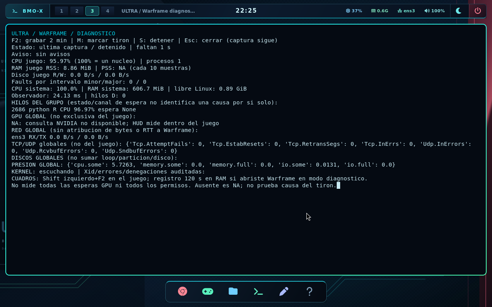

# Warframe: captura de recursos y cuadros

El modo de diagnostico permite investigar un pico durante la carga de un
escenario. No cambia Proton, archivos del juego, permisos, caches ni la red.
La captura añade trabajo: comparar tambien una pasada sin ella.

## Uso con teclado

1. Cerrar Steam completamente. Abrir **Super+J > Warframe / diagnostico**.
   Esto prepara MangoHud para registrar cada cuadro y activa el indicador de
   compilacion de DXVK/D3D11. No modifica las opciones guardadas de Steam.
2. Dentro del juego, justo antes de cargar el escenario, pulsar **Super+F11**
   para capturar recursos y **Shift izquierdo+F2** para capturar cuadros.
   Ambas capturas duran hasta 120 segundos; son inicios independientes.
3. **Super+Shift+F11** marca el momento de un tiron. La reaccion manual no
   identifica exactamente el cuadro afectado.
4. **Super+Ctrl+F11** abre el panel. Flechas y AvPag/RePag desplazan el contenido;
   F2 inicia captura, M marca, S detiene recursos y Esc cierra el panel.
5. En Super+J, **Warframe / capturas guardadas** abre los archivos. Cerrar
   Steam al terminar permite volver al perfil normal en el siguiente inicio.

El HUD debe estar cargado en el juego para registrar cuadros. La opcion
diagnostico lo solicita aunque el HUD normal estuviera desactivado. El modo
se hereda por Steam durante esa sesion: no abrir otros juegos desde ese Steam
si se quiere mantener la prueba exclusiva de Warframe.

## Que mide y que significa

| Ambito | Datos | Limites |
| --- | --- | --- |
| Grupo Steam 230410 | CPU, RSS, PSS, lectura/escritura, fallos menores/mayores | CPU puede superar 100% al usar varios nucleos; RSS suma paginas compartidas; PSS se consulta cada diez muestras |
| Hilos del grupo | CPU, estado, canal de espera disponible, hilos en D | Hasta 64 procesos y 512 hilos; muestra los ocho con mas CPU; una espera no demuestra una comprobacion de permisos |
| Juego con MangoHud | Tiempos de cuadro, percentiles p50/p95/p99, maximo y picos | CSV separado; su reloj empieza al iniciar ese registro; sensores mas lentos que los cuadros |
| Sistema | CPU, RAM, espacio libre, presion CPU/memoria/I/O y swap | Datos globales, no exclusivos de Warframe |
| GPU NVIDIA | Uso, VRAM, temperatura y potencia | Consulta global cada dos segundos aproximadamente; no atribuye toda la VRAM al juego |
| Almacenamiento | Bytes/s, operaciones pendientes, media de latencia y ocupacion aproximada | No sumar loop, particion y disco fisico: pueden representar el mismo trabajo |
| Red | RX/TX, errores y descartes por interfaz; cambios TCP/UDP | Global; no mide RTT ni bytes exclusivos de Warframe ni contenido de paquetes |
| Kernel | Nuevos Xid NVIDIA, OOM, errores de almacenamiento y seccomp auditado | Solo eventos que el kernel publique; no todas las denegaciones ni todas las esperas de GPU |

Los recursos se consultan aproximadamente cada segundo, con el intervalo real
en el registro. `observer_ms` permite observar el coste del recolector. Un dato
ausente queda como `null`/NA. La identidad usa PID y fecha de inicio para evitar
mezclar procesos cuando Linux reutiliza un PID. No se exportan lineas de
comando, variables de entorno, direcciones de red ni contenido de paquetes.

El lector del kernel tiene UID 0, `no_new_privs` y solo `CAP_SYSLOG`; publica
un JSON con categorias y numeros. El recolector, el panel y sus archivos se
ejecutan con UID 1000 sin capacidades. No existe un canal para enviarle
ordenes al lector privilegiado.

## Contadores del kernel para tirones (24 de octubre)

Para buscar la causa de los tirones en multijugador, cada muestra añade, solo
lectura:

| Dato | Para qué sirve |
| --- | --- |
| `compact_stall`, `compact_fail`, `thp_fault_fallback`, `allocstall_*` | Pausas del kernel al reorganizar memoria o al no conseguir páginas grandes |
| Frecuencia de la CPU (mínima, media, máxima) | Si el tirón coincide con una bajada de frecuencia |
| Softirq por segundo (NET_RX, NET_TX, TIMER, HRTIMER, SCHED, BLOCK) | Ráfagas de red o de temporizador durante el tirón |
| Cambios de contexto por segundo | Carga de planificación global |
| `expulsado/s` por hilo del juego | Cuántas veces el kernel le quitó la CPU a ese hilo sin que la soltara |

El resumen de cuadros añade el p99.9 y los **tirones relativos**: cuadros que
duran más del doble de la mediana (y al menos 8 ms más). Antes solo se contaban
los de más de 33 ms; a 75–144 FPS un tirón de 15–30 ms no aparecía.

Ningún contador demuestra la causa por sí solo. Sirven para ver qué coincide con
cada tirón y decidir qué probar después.

## Almacenamiento acotado

Los cuadros se escriben temporalmente en un tmpfs de **64 MiB**, con
`nosuid,nodev,noexec`. Al terminar una captura de recursos o salir normalmente
del escritorio se intenta archivar una instantanea de los CSV de Warframe.
No apagar de golpe: los cuadros que solo esten en RAM se perderian.

Cada sesion guarda hasta **16 MiB** de recursos y **32 MiB** de CSV, hasta
cuatro CSV. Se permiten **tres sesiones**, sin borrar automaticamente las
anteriores; retirar las innecesarias desde el explorador antes de otra prueba.
La carpeta persistente es:

```text
/juegos/usuarios/ultra/.cache/ultra/diagnostico-warframe/sesion-*/
```

`recursos.jsonl` contiene la serie temporal; `marcas.jsonl`, las marcas manuales;
`resumen.json`, la ultima muestra y estadisticas disponibles. El informe GPU
exportado al salir del escritorio incluye un resumen acotado de la ultima
sesion. Los CSV completos permanecen en la carpeta personal.

## Alcance de la verificacion

El perfil PC, compilacion #43, paso **172 comprobaciones de arranque y 12
pruebas de componentes**, sin fallos. Se instalo en A: y se verificaron los
hashes de kernel, sistema y conservacion de `datos.ext4`. El perfil generico
no se reconstruyo en esta revision.

[Evidencia y hashes](../evidencias/diagnostico-warframe/2026-10-23/resumen.json).



Las pruebas sinteticas comprueban contadores, reutilizacion de PID, limites,
filtrado de eventos y calculo de percentiles. El banco QEMU comprueba la
integracion con ULTRA y cuadros reales de un benchmark OpenGL por software;
no representa Warframe ni el rendimiento de la RTX 3060.

La causa del microtiron nativo sigue pendiente de una captura durante la
partida. Este monitor tampoco corrige por si solo el Xid 109 observado ni la
falta de espacio del almacenamiento personal.
