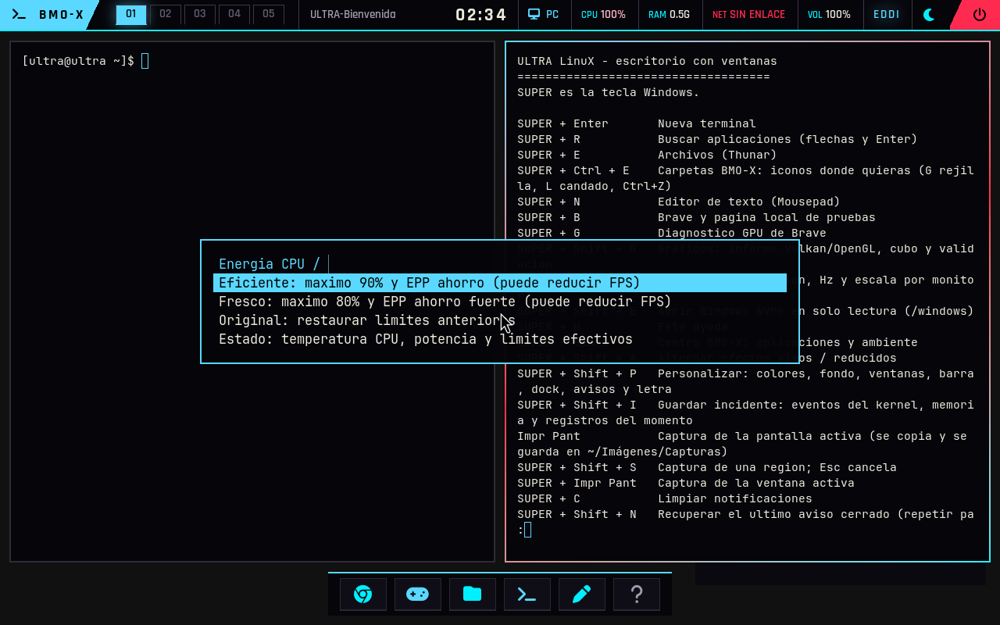

# Perfiles de eficiencia CPU y sensores separados

Responde a la lectura de 91 °C de CPU comunicada por el autor en MangoHud.
El objetivo es reducir trabajo y limitar rendimiento máximo de forma reversible;
la bajada de vatios, temperatura y FPS se confirma después en el PC físico.
No se fija una temperatura garantizada ni un ahorro del 50 %.

## Uso

**Super+F8** o **Super+Espacio → Sistema → Energía y temperatura CPU**.

| Perfil | Frecuencia máxima | Preferencia EPP si está disponible |
|---|---|---|
| Eficiente, predeterminado | 90 % del máximo previo a la sesión | `balance_power` |
| Fresco | 80 % del máximo previo a la sesión | `power` |
| Original | Restaurar los valores anteriores | Restaurar EPP anterior |

El porcentaje limita frecuencia, **no vatios**. Puede reducir los FPS de juegos
limitados por CPU. No cambia frecuencia mínima, voltaje, SMU, protección térmica
ni gobernador. Si falta la preferencia EPP conserva la anterior; si el rango no
permite el límite, rechaza el cambio. Si no hay cpufreq muestra `sin_soporte`.
No eleva límites que estuvieran reducidos antes. Original restaura lo guardado,
no valores de fábrica supuestos.

La selección se conserva en el home del usuario. El estado muestra el perfil
efectivo y los errores; solicitar un perfil no acredita que el hardware lo admita.
Al cerrar normalmente el escritorio se restauran los valores propios. Si otro
controlador cambió un valor mientras tanto, se conserva ese cambio externo y
se informa. Un SIGKILL, una caída del sistema o un rechazo del kernel no permiten
prometer restauración; reiniciar vuelve a la política inicial del arranque.

El ajuste se aplica a las políticas CPU del equipo durante la sesión, no solo
al proceso del juego. Elegir Original permite recuperar el rendimiento previo.

## Sensores y energía

Las tarjetas muestran CPU identificada (Tctl en k10temp cuando está disponible),
GPU y disco por separado. El NVMe más caliente ya no sustituye a la CPU. Se
conservan etiquetas Tdie/CCD en el estado. Un sensor desconocido se muestra como
no disponible; no se inventa desde su posición hwmon0.

El supervisor registra temperatura cada dos segundos y el máximo **muestreado**
de la sesión. No garantiza captar un pico más breve entre muestras.
Incluye `perf` y una lectura RAPL del paquete mediante un evento fijo, a 1 Hz.
Calcula julios del intervalo entre segundos monotónicos; no suma núcleo y paquete.
Las muestras inválidas, multiplexadas o antiguas se muestran como NA. En QEMU se
comprueba el caso sin medición física, no el consumo real del Ryzen.

El escritorio recibe un estado de solo lectura. El supervisor acepta tres nombres
fijos desde un archivo regular de UID 1000 y rechaza symlinks, FIFO, propietarios
distintos, contenido largo y perfiles desconocidos. No recibe comandos, rutas de
sysfs ni valores de frecuencia del usuario. Conserva como máximo 300 muestras
compactas en RAM, exportadas en el informe GPU al cerrar la sesión.
Esta ventana conserva los últimos diez minutos aproximadamente; el observador
GPU anterior puede corresponder al inicio de la sesión. No comparar sus medias
como si fueran simultáneas: usar los tiempos de cada ventana y una captura A/B
controlada. El analizador expone la ventana monotónica de energía CPU.

## Menos trabajo de fondo

- Al ocultar las tarjetas se detiene su daemon eww y sus lectores. Al entrar en
  modo juego se suspenden las tarjetas visibles y al salir vuelven si estaban
  abiertas. Se mantienen las pausas existentes de fondo vivo y efectos.
  El control reconoce tanto la configuración del sistema como la personal: al
  cambiar de tema no deja una instancia antigua abierta en otra ruta. Un bloqueo
  por sesión serializa las operaciones de abrir, cerrar y recargar.
  Eww 0.6.0 identifica su socket por la ruta canónica de configuración:
  [implementación de EwwPaths](https://github.com/elkowar/eww/blob/v0.6.0/crates/eww/src/paths.rs).
- Si se abren las tarjetas durante el juego, NVIDIA se consulta a un intervalo
  de diez segundos; fuera del juego, de dos. El hijo se termina al cerrar el lector.
- El hilo de disco de Carpetas espera pedidos cuando no vigila carpetas. Cuando
  sí vigila, revisa aproximadamente cada segundo; ya no despierta cada 250 ms.
  Los pedidos explícitos despiertan inmediatamente el hilo.

Esto aplica la idea de separar trabajo estable y cambiante. Se conservan las
cachés de Steam, Proton y shaders. No modifica ni memoiza la simulación interna
de Cyberpunk: un resultado solo puede reutilizarse mientras sus entradas sigan
siendo válidas. Cachear más también consume RAM y almacenamiento.

## Validación y límites

Entrega instalada y verificada en **A: FAT32, perfil PC**, el 25 de octubre.
Pasó **201 comprobaciones QEMU** con dos arranques, persistencia, menú energético,
apertura/cierre de tarjetas y cierre limpio del supervisor. Pasan las nueve pruebas
del controlador en Linux y las cinco del analizador. Carpetas mantiene 78 pruebas
del núcleo y 25 de la aplicación (un benchmark ignorado).

Se verificaron 371 fuentes contra los bytes del taller y el índice Git, permitiendo
exclusivamente la normalización CRLF→LF de Git. El kernel, sus seis ejecutables C
auditados y las versiones NVIDIA permanecen iguales; los datos de A: se conservaron
por SHA-256. Las partidas, juegos, prefijos y cachés nativas no se modificaron.
La lectura eww también se comprobó después de recibir datos del invitado, no solo
con sus valores iniciales de carga. Las capturas usan renderizado software en QEMU;
`sin_soporte`/NA en ese banco no diagnostica el Ryzen real.

[Evidencias y recibo de instalación](../evidencias/energia-cpu/perfiles-2026-10-25/).
La compilación conserva SHA-256 de EROFS
`3e07ac16807187bb092be2e6eb0b6b345c514ff4d6ecc959084f295fcb71069a`.

El banco `scripts/probar_energia_cpu.py` usa políticas y sensores simulados:
perfiles 90/80, restauración, fallos parciales, cambios externos, ausencia de EPP,
rango mínimo, peticiones no válidas, julios por intervalo y CPU/GPU/NVMe distintos.
No escribe en el cpufreq del anfitrión.

La prueba QEMU `--energia` comprueba el menú Super+F8, solicitudes desde UID 1000,
estado root de solo lectura, falta de vatios físicos y cierre limpio del
supervisor. Las pruebas existentes de Carpetas, tarjetas, modo juego y
personalización se conservan.

Después del arranque físico, comparar la misma escena y límite de FPS en
Original/Eficiente/Fresco: temperatura sostenida y pico muestreado, energía CPU,
GPU W y tiempos de cuadro p95/p99. Si sigue cerca de 91 °C, revisar también
refrigeración y flujo de aire: el software no demuestra el estado del disipador.
