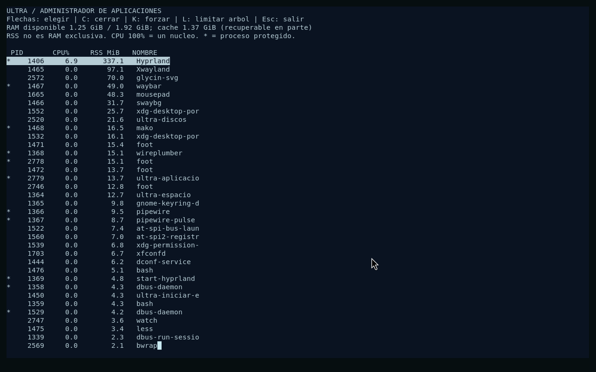

# Espacio y administrador de aplicaciones

## Diagnostico del 24 de octubre de 2026

El almacen ext4 personal no estaba lleno de datos fantasma: tenia 94 GiB
ocupados y unos 7 MiB disponibles al usuario. Una capa antigua de biblioteca
ocupaba unos 30 GiB; la capa activa contenia unos 49.5 GiB de Warframe mas
Proton, runtimes y shaders. La cache del usuario rondaba 248 MiB.

El archivo contenedor de Windows mide 96 GiB. Borrar dentro de ext4 aumenta
el espacio disponible en Linux; no encoge automaticamente ese archivo en
Windows. Parte del espacio libre de ext4 tambien esta reservada al sistema.
No se redujo esa reserva ni se cambio el tamaño del contenedor.

La capa antigua se respalda con tar y zstd, conservando propietarios, permisos,
ACL y atributos extendidos. Se compara el contenido del archivo comprimido
contra el original montado en solo lectura antes de autorizar su retiro.
El respaldo queda fuera de Git, en `build/respaldo-capa-20261024/`, para
recuperar archivos de la version anterior. No se mezcla automaticamente con
la capa activa: una restauracion debe hacerse primero en una carpeta aparte.

Resultado: se recuperaron **32.196.112.384 bytes (unos 30 GiB)** y quedaron
32.203.538.432 bytes disponibles al usuario. El respaldo comprimido mide
30.075.082.803 bytes (unos 28 GiB). Se verificaron 19.752 entradas, sus datos
y metadatos POSIX; el home y la capa activa conservaron sus metadatos y ext4
paso la comprobacion antes y despues del retiro.

## Prevencion de acumulacion

- Como maximo una generacion antigua por biblioteca; otra renovacion requiere
  revisar la anterior. No se borra automaticamente ninguna generacion personal.
- Antes de renovar una capa se compara espacio libre con el tamaño asignado
  de la capa previa mas 4 GiB. Si no cabe, se conserva la existente y se avisa.
  Es una estimacion preventiva, no una cuota ni una garantia sobre descargas futuras.
- Se rechazan nuevos lanzamientos desde el menu de juegos con menos de 4 GiB
  libres. Un cliente que ya estaba abierto aun puede descargar y llenar el disco.
- El escritorio avisa cuando queda poco espacio. No cambia montajes a solo
  lectura ni mata juegos durante una actualizacion.
- La limpieza automatica solo retira nombres conocidos de logs de ULTRA de
  mas de siete dias y mas de 1 MiB, tras comprobar descriptores abiertos del
  usuario. No recorre ni borra partidas, juegos, prefijos, shaders, cuentas o
  configuraciones. La comprobacion de uso es instantanea, no una prueba de
  que cualquier archivo no abierto sea prescindible.

La retencion automatica se ejecuta al iniciar el escritorio. El aviso de
espacio se revisa cada minuto; la accion manual usa la misma politica.

En **Super+Space > Sistema y ayuda > Limpiar registros ULTRA antiguos** se
puede ejecutar la misma politica. Los grupos de recursos vacios del
administrador se retiran sin terminar procesos activos.

## RAM y limites reales

La RAM disponible se obtiene de `MemAvailable`. La cache es parcialmente
recuperable y evita lecturas de disco; no se ejecuta `drop_caches`. RSS puede
contar paginas compartidas varias veces: no sumar todos los RSS como memoria
exclusiva. Los informes disponibles no prueban una fuga de memoria.

El perfil PC habilita `CONFIG_MEMCG`, `CONFIG_CFS_BANDWIDTH` y cgroups v2.
El supervisor crea un techo para la sesion de escritorio y reserva entre
512 MiB y 2 GiB segun la RAM total. La CPU queda libre por defecto. El techo
de procesos/hilos es 8192. Sus limites superiores pertenecen a root y el
usuario no puede ampliarlos desde el subarbol delegado.

El kernel puede reclamar memoria al superar `memory.high` y terminar un
consumidor al alcanzar `memory.max`. Esto no garantiza que nunca haya OOM ni
cubre toda la memoria del kernel o de GPU. La presion puede reducir rendimiento;
la reserva busca conservar margen para el sistema, no memoria infinita.

## Administrador: Super+Esc

Tambien disponible en **Super+Space > Sistema y ayuda > Administrador de
aplicaciones**. Solo muestra procesos de UID 1000 y corre sin capacidades.

- Flechas: elegir proceso; ordenado por RSS, con CPU por nucleo y RAM disponible.
- **C:** solicitar cierre con SIGTERM; la aplicacion puede ignorarlo.
- **K:** forzar SIGKILL, con confirmacion; se puede perder trabajo sin guardar.
- **L:** elegir limite RAM y CPU para el proceso y sus descendientes actuales.
  Los futuros hijos heredan el grupo. 100% de CPU equivale a un nucleo.
- **Esc:** salir.

Las señales usan pidfds y se comprueba identidad por PID y fecha de inicio.
El propio administrador, sus antecesores y servicios esenciales del escritorio
estan protegidos frente a estas acciones. El cierre actua sobre el PID elegido;
no promete cerrar todos los procesos que una aplicacion haya separado de su arbol.

Los limites usan cgroups del usuario, con un maximo adicional de 2048 hilos por
grupo. Solo pueden estrechar el techo del supervisor. La migracion de un arbol
en ejecucion es una instantanea: puede haber procesos que salgan o se creen
durante la operacion. La RAM ya cargada puede seguir contabilizada en el grupo
anterior; para aislamiento desde el primer byte hace falta iniciar la app ya
dentro de su grupo. Los ajustes duran esta sesion, no se escriben en Steam ni GOG.

Son controles de gestion, no un aislamiento frente a programas hostiles del
mismo UID: el usuario administra su subarbol y sus limites particulares. El
techo superior del supervisor permanece fuera de esa delegacion.

Referencia de los mecanismos:
[documentacion del kernel sobre cgroups v2](https://docs.kernel.org/admin-guide/cgroup-v2.html).

## Verificacion

El perfil PC #46 paso **185 comprobaciones de arranque y 5 pruebas de
componentes**. El banco mide cuota de CPU, comprueba pidfds y verifica un OOM
confinado a una hoja desechable de 64 MiB. Tambien comprueba la configuracion
de 512 MiB creada por el administrador; separa la prueba del limite duro del
freno gradual de `memory.high`, cuyo valor se redondea a paginas.

Las seis muestras nativas del informe inicial tenian hasta unos 0.76 GiB de
RAM usada estimada y al menos 14.79 GiB disponibles. No representan toda la
partida ni prueban ausencia de fugas en otros momentos.

[Evidencia de limpieza, limites e instalacion](../evidencias/recursos-espacio/2026-10-24/resumen.json).
