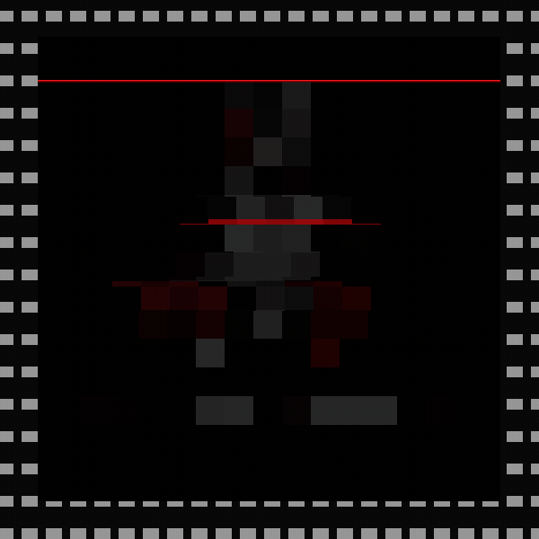

# Intro de arranque: el Tux del autor

2026-10-24, America/Lima. Diseño y autoría del Tux: **Eddi Salazar**.

El PID 1 en C dibuja una intro animada en `/dev/fb0` antes de la tarjeta del
perfil. No modifica el kernel ni usa programas externos.

| Momento | Qué se ve | Duración |
| --- | --- | --- |
| Entrada | El Tux sale de bloques de 32 px, como su venda pixelada, que bajan hasta 1 px | 18 cuadros × 40 ms |
| Glitch | Bandas desplazadas, algunas teñidas de rojo, y una línea de escaneo roja que baja | primeros 12 cuadros |
| Nítido | Tux con «ULTRA LINUX» y «BMO-X // EDDI SALAZAR» | 320 ms |
| Salida | Se desvanece y la pantalla vuelve a estar como antes, byte a byte | 5 cuadros × 30 ms |

En total son unos **1,2 s**, una sola vez y justo antes de `show_card()`. Corre
después de `prepare_system()`, así que no se repite si el perfil salta al kernel
afinado.

## Archivos

- `src/logo/ultra-tux-demonio.webp`: la imagen original.
- `scripts/convertir_intro.py`: genera `src/rootfs/etc/ultra-intro.bin` (419×421
  RGBA, formato `ULGO`, el mismo que el logo). El título usa Rajdhani y Chakra
  Petch (OFL).
- `src/logo.c`: `show_intro()`. Comparte con `show_logo()` la lectura acotada de
  la imagen y el mapeo de la pantalla; `show_logo()` hace lo mismo que antes.
- `scripts/probar-intro.sh` y `scripts/probar_intro.c`: incluyen `src/logo.c` y
  dibujan los cuadros reales en una pantalla falsa de 1920×1080, con ASan, UBSan y
  el guardián real de `memcpy`.

## Seguridad y límites

- Sin `/etc/ultra-intro.bin`, sin pantalla de 32 bits, sin memoria o con una
  pantalla menor de 515×517, la intro se omite con un aviso `AMARILLO [INTRO]`
  y el arranque sigue.
- La imagen se valida como el logo: cabecera, lado máximo de 1024 px y tamaño
  exacto del archivo.
- El glitch usa una secuencia fija (xorshift con semilla constante): es el mismo
  en cada arranque y no depende del reloj.
- Antes de dibujar se guarda la zona central de la pantalla, y al terminar se
  devuelve: la consola y los mensajes anteriores no se pierden.

## Verificación

- **Revisión de guardianes** (`-Werror`, `-Wconversion`, `-Wsign-conversion`,
  `-Wcast-align=strict` y `-fanalyzer` a -O0, más -O2): `logo.c` e `init.c` sin
  avisos.
- **Producción:** compila con FORTIFY 3, protector de pila, CET y trampas de UB.
  Se probó con GCC 13; `-fhardened` necesita GCC 14 y lo valida el taller.
- **`scripts/probar-intro.sh`:** 32 cuadros sin errores de ASan ni UBSan, y
  pantalla restaurada idéntica.
- **Pendiente:** el arranque en QEMU y en el PC.
  `probar_arranque.py` espera ahora `VERDE [INTRO]: 419x421, 23 cuadros`.

Para cambiar el tamaño del Tux: `python scripts/convertir_intro.py 280` (alto en
píxeles). Después hay que actualizar el texto esperado en `probar_arranque.py`.
