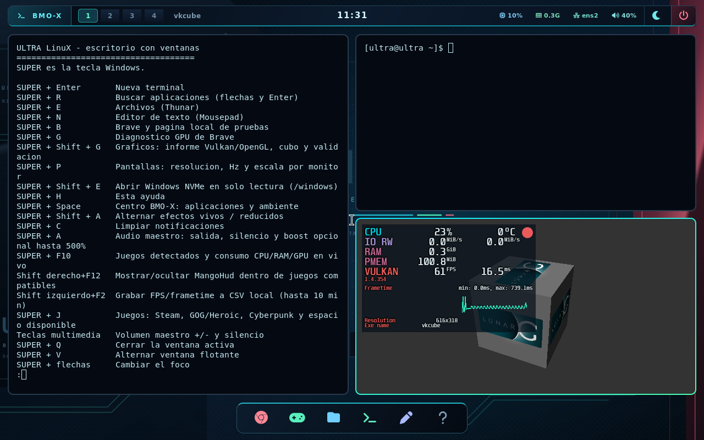

# Juegos, FPS y consumo durante la sesión

ULTRA integra MangoHud 0.8.4 de los paquetes oficiales Arch, en 64 y 32 bits,
y un observador de usuario propio. Ambos perfiles tienen las mismas funciones;
el proveedor gráfico y las métricas disponibles dependen del hardware.

## Uso

- **Super+F10** abre el panel de juegos y consumo en vivo. También aparece en
  Super+J y en Super+Espacio > Juegos.
  Usa flechas y PgUp/PgDn para recorrerlo y Esc para cerrar.
- **Juegos > FPS y HUD** permite activar/desactivar el HUD para los siguientes
  lanzamientos y abrir los registros. Está activado inicialmente.
- Abre Steam o Heroic desde los accesos de ULTRA. Sus juegos Vulkan heredan
  `MANGOHUD=1`; esto incluye juegos Proton que renderizan mediante DXVK/VKD3D.
  Si el cliente ya estaba abierto antes de cambiar el ajuste, ciérralo y ábrelo.
- En un juego con HUD, **Shift derecho+F12** muestra/oculta las métricas.
  **Shift izquierdo+F2** inicia/detiene una captura CSV local, limitada a diez
  minutos y una muestra por segundo. Se guarda en
  `~/.cache/ultra/rendimiento/`; no se habilitan subidas a Internet.
- Los lanzamientos directos UMU de ULTRA usan el envoltorio OpenGL/Vulkan.
  Un juego OpenGL iniciado dentro de Steam puede necesitar la opción de
  lanzamiento `mangohud %command%`. No se cambia globalmente `LD_PRELOAD`
  del compositor, Brave o los clientes.

## Qué mide cada parte

| Dato | Fuente y alcance |
| --- | --- |
| FPS, tiempo de cuadro y gráfica de fluidez | MangoHud, dentro del proceso que presenta los cuadros |
| CPU del sistema y RAM usada estimada | `/proc/stat` y MemTotal−MemAvailable, cada 5 segundos |
| Juego/procesos activos | Identidad Steam, Heroic GOG o lanzador ULTRA; procesos UID1000 |
| CPU por juego | Diferencia de tiempo CPU del grupo identificado; 100 % equivale a un núcleo lógico |
| RAM por juego | PSS sumada cuando todas las lecturas están disponibles; RSS separada, con posible doble conteo de memoria compartida |
| E/S de procesos | Diferencias `read_bytes` y `write_bytes` por segundo; no es la latencia del SSD |
| GPU, VRAM, temperatura y potencia globales | Consulta NVIDIA cada 30 segundos, cuando existe el dispositivo; otras métricas del controlador se ven en MangoHud |
| Bibliotecas | Manifiestos Steam y registro instalado de Heroic GOG, cada 30 segundos |

La primera muestra de una tasa y los datos ausentes se muestran como **NA**.
Un PID reutilizado no hereda las mediciones anteriores. Los FPS nunca se
infieren a partir de CPU, tiempo de actividad o frecuencia del monitor.
La memoria GPU global no se presenta como memoria exclusiva de un juego.
Los procesos sin identidad de juego pueden verse en la lista general.

## Actualización continua de bibliotecas

El observador vive durante todo el escritorio; ya no termina al minuto.
Registra el estado local en `~/.cache/ultra/juegos-vivo.json`. El panel de discos
indica que la revisión es continua. Detecta juegos añadidos o retirados en
bibliotecas activas y cambios de manifiesto aunque no cambie la carpeta elegida.

Cuando Steam está abierto, se espera para modificar su registro de bibliotecas.
Al cerrarlo se registra lo pendiente en la siguiente revisión. El catálogo de
ULTRA sigue leyendo mientras tanto. No se reescriben registros mientras el
cliente los está usando.

Para GOG se lee únicamente el registro de instalaciones de Heroic y los archivos
`goggame-*.info` dentro de vistas elegidas. Una carpeta GOG descubierta se marca
**importar en Heroic** hasta completar esa operación; tener archivos no acredita
la instalación en una cuenta. No se leen ni se exportan almacenes de sesiones.
Steam y Heroic conservan el control de las descargas y actualizaciones de juegos.
Esta revisión no actualiza por sí misma las versiones de esos clientes.

Las selecciones nuevas y los discos nuevos se montan al volver a entrar al
escritorio. La vigilancia no monta discos ni renueva una capa mientras se juega.
Las búsquedas tienen límites: 512 juegos, 1024 directorios GOG y 1024 procesos de
usuario por muestra; si se alcanza un límite el panel señala que es parcial.
No se ejecutan analizadores de disco completos ni se mide cada fotograma desde
Python. El observador termina junto con la sesión.

Fuentes: [MangoHud: uso y registro de FPS](https://github.com/flightlessmango/MangoHud),
[configuración 0.8.4](https://github.com/flightlessmango/MangoHud/blob/v0.8.4/data/MangoHud.conf),
[registro de instalaciones GOG en Heroic](https://github.com/Heroic-Games-Launcher/HeroicGamesLauncher/blob/main/src/backend/storeManagers/gog/electronStores.ts).

## Verificación del 23 de octubre

Genérico #54: 156 comprobaciones de arranque correctas. PC #40: 157 correctas.
La prueba de juegos del genérico pasó 19 comprobaciones: identidad del proceso,
CPU calculada, aparición y retirada de instalaciones Steam/GOG sin reinicio,
panel por teclado, observador UID1000 sin capacidades, bibliotecas HUD de
32/64 bits presentes y CSV con FPS positivos de Vulkan y OpenGL.
La prueba adicional PC pasó 9 comprobaciones centradas en OpenGL y el HUD.
Las bibliotecas de 32 bits se verificaron como ELF32; las aplicaciones gráficas
ejecutadas en el banco son de 64 bits.

La captura es real de QEMU con renderizado por software. Sus FPS, tiempos y
lecturas de CPU no representan un juego ni la RTX física. Los campos del HUD
que dependen de sensores pueden estar ausentes o indicar 0 °C en ese banco;
ese valor no es una temperatura física medida. El panel propio mantiene NA
cuando no dispone de un dato.

Los primeros intentos revelaron problemas del banco: límite de longitud de
la consola serie, identificación de una ventana Xwayland e indentación de
programas de prueba. Se corrigieron esos casos; OpenGL ya estaba renderizando.
Las ejecuciones finales de arranque y HUD terminan correctamente.

No se arrancaron juegos reales ni se usaron cuentas. Vulkan del perfil PC
necesita la GPU NVIDIA física; se verificó Vulkan en el genérico con lavapipe.
La validación de juegos, anticheat y métricas NVIDIA en hardware real queda
para la siguiente sesión del usuario. No se afirma una mejora de FPS por
instalar un medidor: la instrumentación también tiene coste.

Ambos perfiles se instalaron en A: y se verifican por SHA256. `datos.ext4`
conserva su huella previa. Los informes se respaldan en el proyecto Windows.
Resultados y alcance: [evidencia](../evidencias/juegos-vivo/2026-10-23/verificacion.json).
