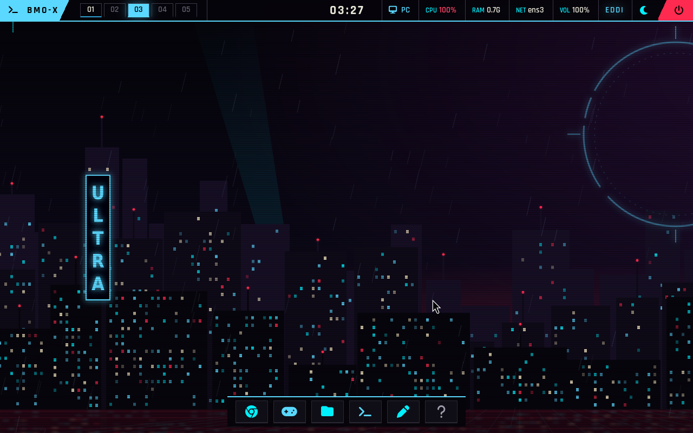

# Main reconstruido y limpieza del taller · 24/10/2026

El perfil **PC** se reconstruyó desde `0f330f1b7c38e2056ee0b5f97912f0ba88e453c8`
(merge de main con la intro del autor y el escritorio Neón), compilación **47**.
Se instaló en **A: FAT32**, sin formatear y conservando `datos.ext4` y el
perfil genérico de recuperación. Falta probar esta compilación en el PC físico;
las comprobaciones de esta entrega se hicieron en QEMU.

## Resultado comprobado

- Arranque, guardianes, escritorio, Brave, diagnóstico gráfico, juegos,
  menús y límites: **186 comprobaciones verdes, ninguna roja**.
- Seis bancos específicos: intro con ASan/UBSan, incidentes, personalización,
  capturas, portapapeles y modo juego; además, cinco pruebas del administrador.
- La prueba visual de foot ahora toma su color de la configuración real.
  El color fijo del tema anterior producía un falso fallo con Neón.
- Kernel y EROFS en A: tienen los mismos SHA-256 que los artefactos locales.
  El SHA-256 de `datos.ext4` es idéntico antes y después de instalar.
- El sistema EROFS mide 1.934.143.488 bytes: cabe en un archivo FAT32.
- Los avisos SRSO preexistentes del módulo NVIDIA siguen pendientes; esta
  limpieza no cambia el controlador ni demuestra rendimiento en la GPU física.



## Qué se limpia y qué se conserva

El inventario de `build`, `vm`, `privado`, `upstream` y `herramientas` baja
de **217,96 a 164,44 GiB**: **53,52 GiB netos liberados**, incluyendo la nueva
compilación conservada. Son tamaños lógicos de archivos, no una medida de la
ocupación física de NTFS. El taller pasa de **55,67 a 9,94 GiB** tras comprobar
su arranque; la copia compacta inicial era algo menor antes de ese arranque.

En Windows se retiraron imágenes redundantes de partición y de doble arranque,
el clon temporal de la prueba y discos sintéticos de pruebas de juegos.
Se conservan la imagen BMO final del perfil PC, la imagen genérica de recuperación,
los kernels, sistemas EROFS, módulos empaquetados, manifiestos y evidencias.

En el taller se retiraron objetos de compilación conocidos, árboles de montaje
de las imágenes ya empaquetadas, discos de prueba descargados y caché de paquetes
reinstalables. Se conservaron el repositorio del kernel, herramientas instaladas,
experimentos no reconocidos y paquetes fijados de NVIDIA, Hyprland y MangoHud.
Las configuraciones de kernel se respaldaron y se restauraron en sus rutas
originales, para que una reconstrucción no pierda opciones personalizadas.

El disco del taller admite `discard=unmap`; después de `fstrim` se convirtió a
QCOW2 comprimido con zstd. Se comprobaron ambas imágenes y se comparó todo su
contenido virtual antes de sustituirlo. El original temporal solo se retira
después de comprobar que el taller compacto arranca y conserva sus herramientas.
El resumen JSON registra las cifras finales y esas comprobaciones.

Los respaldos personales de 96 y 16 GiB y el archivo comprimido de unos 28 GiB
se conservan. Explican gran parte del espacio restante y no son objetos del
compilador. También se conserva una imagen antigua dentro de una carpeta de
respaldo: la revisión automática rechazó borrarla por pertenecer a un respaldo.

## Volver a construir

```powershell
.\construir-kernel.ps1 -Accion Compilar -Perfil pc
.\construir-kernel.ps1 -Accion Estado -Perfil pc
.\construir-kernel.ps1 -Accion Descargar -Perfil pc
```

La siguiente compilación vuelve a generar objetos y discos de pruebas.
`Estado` y `Descargar` distinguen ahora una caché limpiada de una compilación
fallida. Una compilación nueva borra ese marcador antes de empezar.

`scripts/limpiar-taller-compilacion.py` presenta un plan por defecto. Solo
`--aplicar` elimina las salidas enumeradas; requiere root en el taller identificado,
rechaza montajes y enlaces en sus destinos, y se niega a actuar durante una
compilación o transacción de paquetes. No es un recolector de archivos personales
ni decide que un juego deja de servir por llevar tiempo sin abrirse.

Las cifras y registros reproducibles están en
[`evidencias/limpieza-main/2026-10-24`](../evidencias/limpieza-main/2026-10-24).
