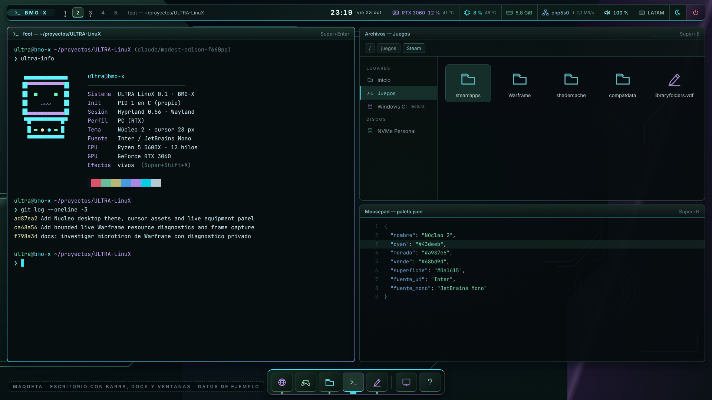
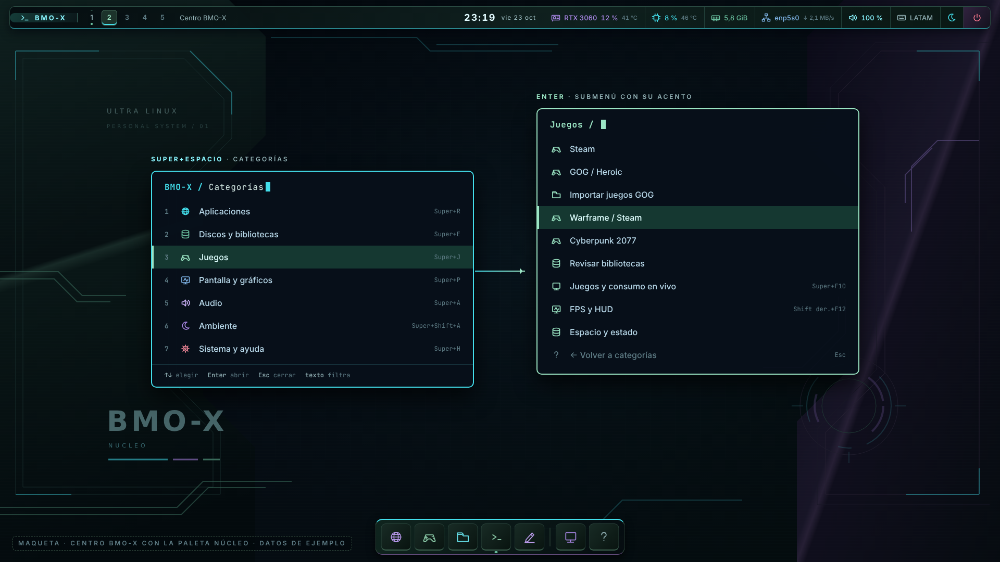
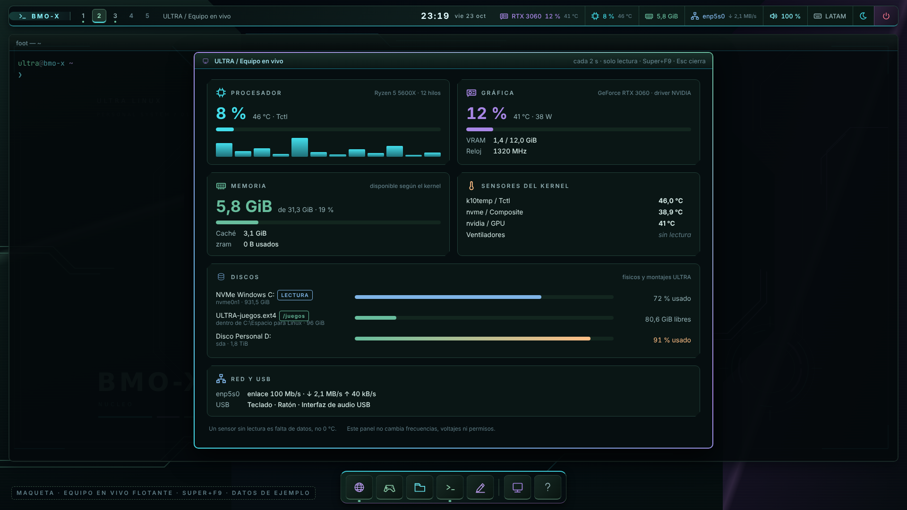
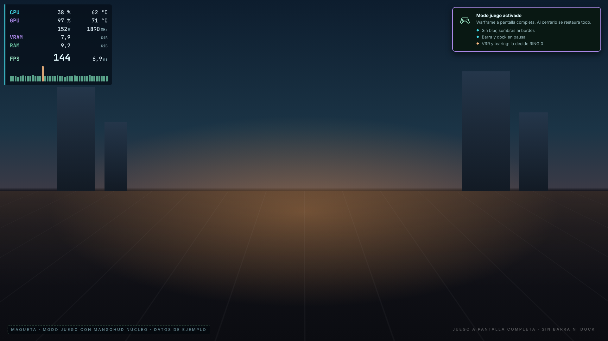
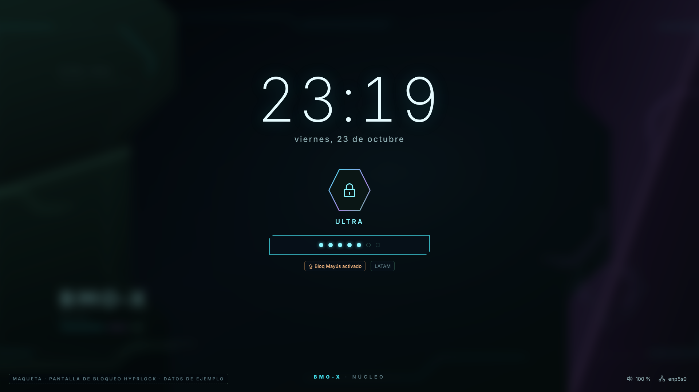
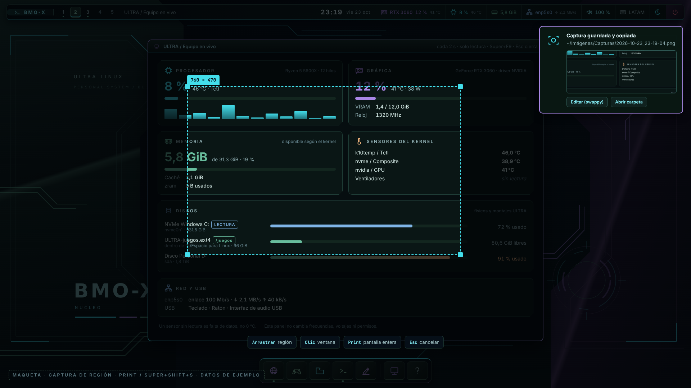
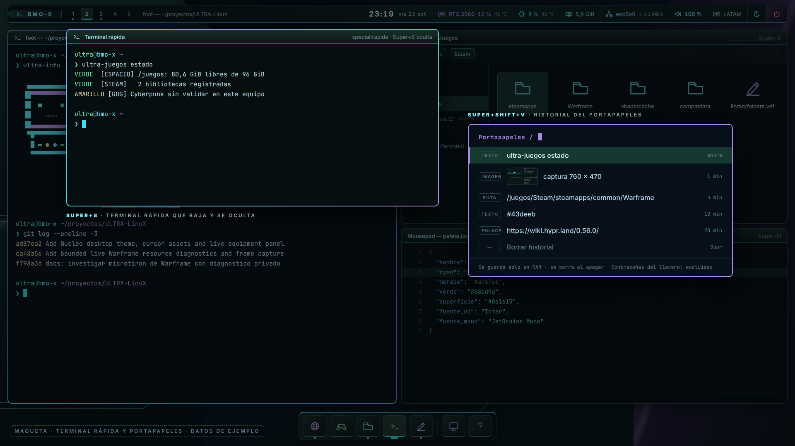
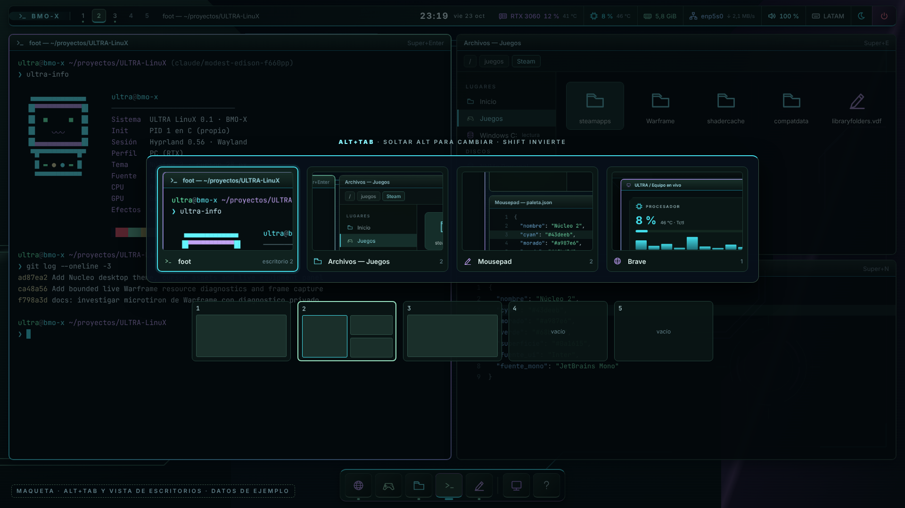
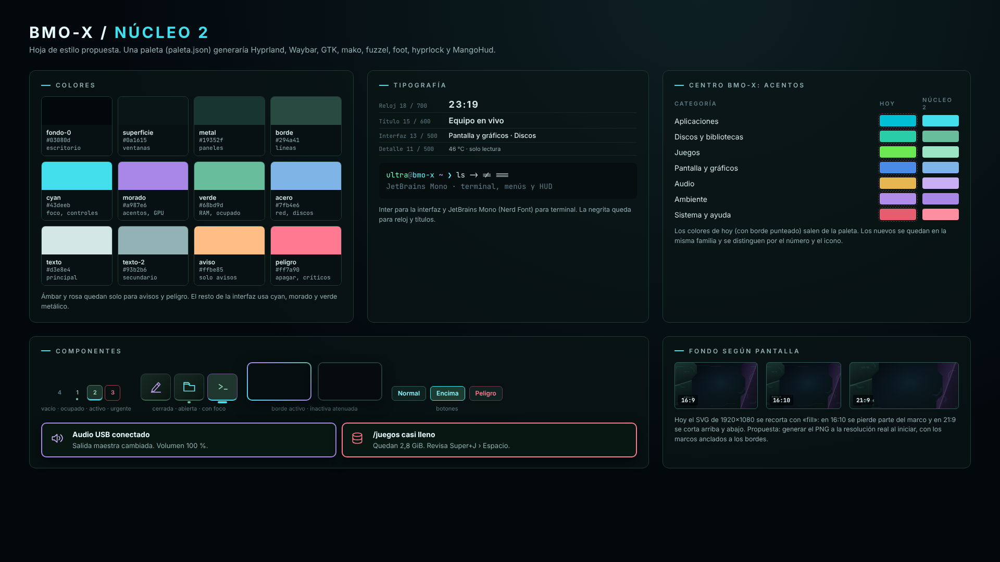

# Propuesta de escritorio BMO-X / Núcleo 2

2026-10-24, America/Lima. **Estado: propuesta con maquetas. No hay nada
instalado en ninguna imagen ni probado en QEMU ni en el PC.**

Esta página reúne la revisión del escritorio Núcleo y las ideas para mejorar su
apariencia y su uso diario. Cada idea lleva casilla para marcarla cuando se
implemente y se verifique con la evidencia habitual.

## Reparto del trabajo

| Área | Responsable | Alcance |
| --- | --- | --- |
| **RING 0**: rendimiento, seguridad y estabilidad | Eddi | Kernel, init C, guardianes, Custodia, perfiles, NVIDIA, red, E/S y todo lo que afecte a FPS o latencia |
| Apariencia y uso del escritorio | Esta propuesta | Paleta, fuentes, barra, dock, menú, paneles, atajos, bloqueo y maquetas |

Las ideas de la sección [Para RING 0](#para-ring-0-decide-eddi) son solo notas:
se aplican únicamente si RING 0 las aprueba. El perfil **genérico** queda
disponible como banco para probar primero lo visual, antes del perfil PC.

## Revisión del estado actual

Lo que funciona bien:

- La paleta es reconocible y el fondo deja libre el centro de la pantalla.
- Los efectos «vivos» y «reducidos» se cambian con Super+Shift+A.
- El centro Super+Espacio recuerda la última categoría.
- Los cursores y los iconos son originales y comparten estilo.

Lo que se ve flojo o incoherente:

- Los colores están copiados a mano en siete archivos: Hyprland, Waybar, GTK,
  mako, fuzzel, foot y el SVG del fondo.
- El centro usa acentos que no son de Núcleo (`76ff58`, `ffc857`, `5298ff`,
  `ff657a`).
- `waybar.css` conserva reglas de «Night Circuit» que el tema nuevo pisa. Por
  ejemplo, el borde del dock está definido dos veces.
- Toda la interfaz usa DejaVu Sans en negrita a 12 px, sin jerarquía.
- Los textos no llevan tildes («Resolucion», «Graficos», «Nucleo»).
- Equipo en vivo es `watch` dentro de foot, con la cabecera «Every 2.0s…» y la
  ventana en mosaico ocupando la pantalla.
- El título de ventana se corta a 18 caracteres.
- Cada inicio abre dos terminales (Bienvenida y otra vacía).
- La barra muestra 4 escritorios, pero los atajos llegan a 9.
- El fondo es un SVG de 1920×1080 con `fill`, que se recorta en 16:10 y 21:9.

## Maquetas

Las maquetas son HTML renderizado con Chromium a 1920×1080, en
[`docs/maquetas/`](maquetas/). Usan el fondo y los iconos reales de Núcleo.
Las cifras son de ejemplo y cada imagen lleva el sello «Maqueta · datos de
ejemplo». No son capturas del sistema.

Para regenerarlas:

```text
node docs/maquetas/renderizar.js            # todas
node docs/maquetas/renderizar.js 03 05      # solo algunas
```

### 1. Escritorio



- Barra con Inter y jerarquía: reloj y fecha en el centro; GPU, CPU con
  temperatura, RAM, red con velocidad, volumen y distribución de teclado.
- Escritorios con estado: vacío, ocupado (punto verde) y activo (subrayado cyan).
- Título de ventana de hasta 40 caracteres.
- Dock con iconos Núcleo y un punto bajo las aplicaciones abiertas (módulo
  `wlr/taskbar` o un script propio). Equipo en vivo y Ayuda van separados.
- La ventana activa lleva el degradado cyan → morado → verde. Las inactivas
  bajan un poco de brillo y saturación.

### 2. Centro BMO-X con la paleta Núcleo



- Cada categoría tiene icono, número, atajo y un acento de la familia Núcleo.
- El pie muestra las teclas: ↑↓, Enter, Esc y escribir para filtrar.
- Textos con tildes: «Pantalla y gráficos», «Volver a categorías».

### 3. Equipo en vivo flotante (Super+F9)



- Ventana flotante y centrada, con regla de Hyprland por título.
- Tarjetas: procesador (con barras por hilo), gráfica, memoria, sensores,
  discos con barras de ocupación, red y USB.
- El ámbar marca solo un disco casi lleno.
- Conserva las garantías actuales: solo lectura, y un sensor sin lectura es
  falta de datos, no 0 °C.
- Opción mínima sin GTK: `watch -t --color` y barras de texto (`▰▰▰▱▱`).

### 4. Modo juego



- MangoHud con la paleta Núcleo y JetBrains Mono: CPU cyan, GPU y VRAM
  morado, RAM verde, gráfica de tiempos de cuadro en verde y picos en ámbar.
- Un aviso breve al entrar en modo juego.
- Lo visual está en esta propuesta. VRR, tearing y escaneo directo los decide
  RING 0.

### 5. Pantalla de bloqueo (hyprlock)



- Fondo Núcleo desenfocado, reloj grande y fecha en español.
- Hexágono con el degradado del borde activo.
- Campo de clave con esquinas recortadas, igual que los marcos del fondo.
- Avisos de Bloq Mayús y de la distribución de teclado.
- Con hypridle: bloquear tras un tiempo sin uso y apagar la pantalla después.

### 6. Captura de pantalla



- `grim` + `slurp` + `swappy`:
  - Print: pantalla entera.
  - Super+Shift+S: región o ventana.
- Guarda en `~/Imágenes/Capturas/` y copia al portapapeles.
- El aviso trae miniatura y botones Editar y Abrir carpeta.
- La maqueta junta en una imagen la selección y el aviso posterior.

### 7. Terminal rápida y portapapeles



- Super+S: terminal rápida en un escritorio especial (`special:rapida`) que
  baja y se oculta.
- Super+Shift+V: historial con `cliphist` + fuzzel, marcado por tipo (texto,
  imagen, ruta, enlace).
- El historial vive solo en RAM y se borra al apagar. Las contraseñas del
  llavero quedan excluidas.

### 8. Cambiar de ventana y escritorios



- Alt+Tab con miniaturas, icono y número de escritorio. Shift invierte el orden.
- Debajo, el resumen de los cinco escritorios con su distribución.
- Opciones: `hyprswitch`, o un script con `hyprctl clients -j` y fuzzel si se
  prefiere no añadir paquetes.

### 9. Hoja de estilo Núcleo 2



Es la referencia para generar todos los archivos de tema desde un solo
`paleta.json`.

## Lista de trabajo

### A. Coherencia visual

- [ ] `paleta.json` como fuente única. Un script generaría `hyprland.lua`
      (colores), `waybar.css`, `gtk.css`, `mako.conf`, `fuzzel.ini`,
      `foot.ini`, `MangoHud.conf`, hyprlock y el SVG del fondo. Ver la maqueta 9.
- [ ] Acentos del centro BMO-X dentro de la paleta (`ultra-ambiente`) y tabla de
      [MENU-CATEGORIAS.md](MENU-CATEGORIAS.md) actualizada. Ver la maqueta 2.
- [ ] Limpiar `waybar.css`: quitar las reglas «Night Circuit» duplicadas.
- [ ] Fuentes: Inter para la interfaz y JetBrains Mono Nerd Font para la
      terminal, fuzzel y MangoHud. Negrita solo en reloj y títulos.
- [ ] Tildes y eñes en menús, ayuda (`AYUDA.txt`), avisos y barra.
- [ ] `ultra-tema` versión `nucleo-2`, con respaldo nuevo e igual de
      conservador que `nucleo-1`.

### B. Barra y dock

- [ ] Título de ventana a 40 caracteres.
- [ ] Escritorios: mostrar los ocupados, o persistir 1–5, y alinear con los
      atajos 1–9.
- [ ] Reloj con fecha corta al lado (`vie 23 oct`).
- [ ] Módulo GPU (uso, temperatura) solo si hay NVIDIA. Temperatura de CPU
      desde hwmon. Sin datos se muestra «sin lectura», nunca 0.
- [ ] Indicador de distribución de teclado.
- [ ] Dock con indicador de aplicaciones abiertas y foco.

### C. Paneles y ventanas

- [ ] Reglas de ventana: Equipo en vivo, Juegos en vivo, diagnóstico Warframe,
      pavucontrol y diálogos flotantes, centrados y con tamaño fijo.
- [ ] Equipo en vivo con tarjetas (maqueta 3), o como mínimo `watch -t` y barras.
- [ ] Ventanas inactivas con leve atenuación (`dim_inactive`, 0,05–0,08).
- [ ] Animación lenta del degradado del borde activo (opcional, solo en efectos
      vivos).

### D. Atajos y herramientas

- [ ] Super+F: pantalla completa.
- [ ] Alt+Tab: cambiar de ventana (maqueta 8).
- [ ] Super+S: terminal rápida (maqueta 7).
- [ ] Super+rueda: cambiar de escritorio. Super+Shift+flechas: mover ventana.
- [ ] Print / Super+Shift+S: capturas (maqueta 6).
- [ ] Super+Shift+V: portapapeles en RAM (maqueta 7).
- [ ] Super+L: bloquear con hyprlock (maqueta 5), y hypridle.
- [ ] Teclado: confirmar `latam` o `us` + `latam` con Alt+Shift.
- [ ] Actualizar `AYUDA.txt` con los atajos nuevos.

### E. Inicio y fondo

- [ ] Bienvenida solo en el primer inicio (marca en `~/.config/ultra/`) y sin
      la terminal vacía extra.
- [ ] Fondo a la resolución real: generar el PNG al iniciar desde el SVG, con
      los marcos anclados a los bordes. Variantes 16:10 y 21:9.
- [ ] Escala automática o 1,25 para monitores 1440p/4K (con `ultra-pantallas`).

## Para RING 0 (decide Eddi)

Solo notas. No se tocan desde esta propuesta.

- Modo juego automático: al abrir un juego, pasar a efectos reducidos, pausar o
  espaciar los módulos de la barra, y restaurar al cerrar.
- Reglas para juegos: sin blur ni sombras en pantalla completa; `immediate`
  (tearing) con `allow_tearing` si se acepta perder vsync.
- `misc.vrr = 2` (solo en pantalla completa) si el monitor tiene FreeSync o
  G-Sync.
- `misc.vfr = true` y `render.direct_scanout` para juegos a pantalla completa.
- `blur.new_optimizations` y no desenfocar ventanas a pantalla completa.
- Variables NVIDIA (`LIBVA_DRIVER_NAME`, `__GLX_VENDOR_LIBRARY_NAME`,
  `NVD_BACKEND`): comprobar qué aplica ya `ultra-preparar-nvidia`.
- El historial del portapapeles y el bloqueo de pantalla afectan a la
  seguridad: RING 0 decide su política (RAM, exclusiones, tiempo de bloqueo).

Ninguna de estas notas declara una mejora de FPS, latencia o consumo. Cada una
necesita medición nativa equivalente antes y después.

## Orden sugerido

1. A: paleta única, acentos, limpieza de Waybar, fuentes y tildes.
2. C: Equipo en vivo flotante y reglas de ventana.
3. D: atajos, capturas, portapapeles y bloqueo.
4. B y E: barra, dock, bienvenida y fondo adaptable.
5. Notas de RING 0, cuando Eddi lo decida.

Cada paso se probaría primero en el perfil genérico con QEMU y después en el
perfil PC, con capturas y comprobaciones en `evidencias/`.
