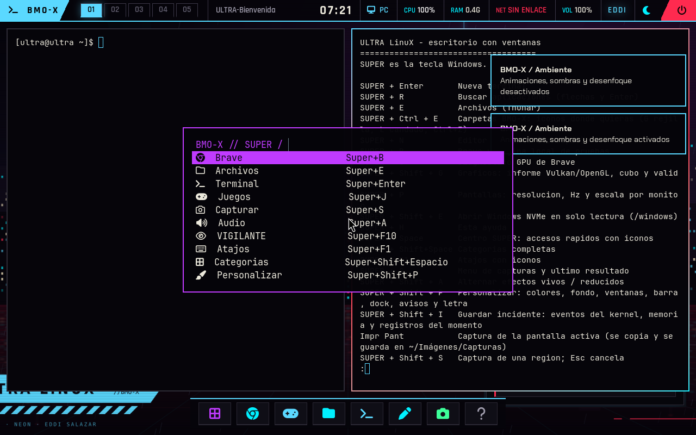
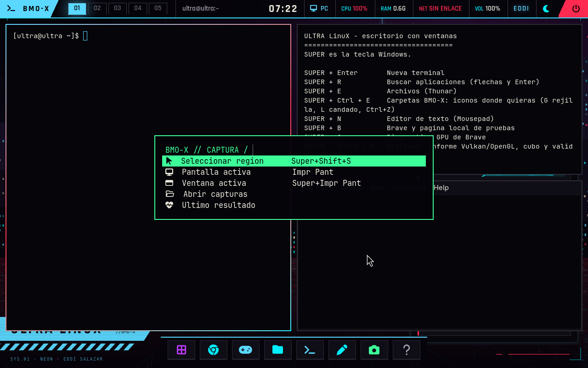

# SUPER: accesos, iconos y capturas

El centro compacto muestra acciones frecuentes con icono y atajo. Las categorias
completas conservan su propio acceso; buscar o seleccionar una etiqueta nunca
se interpreta como una orden de shell. El menu devuelve un indice comprobado
y se ejecutan exclusivamente argumentos definidos en el programa.

| Teclas | Accion |
|---|---|
| Super+Espacio | Centro compacto: navegador, archivos, terminal, juegos, captura, audio, VIGILANTE y personalizacion |
| Super+Shift+Espacio | Categorias completas |
| Super+F1 | Panel de atajos con iconos y acciones |
| Super+S | Menu de captura: region, pantalla, ventana, carpeta y ultimo resultado |
| Super+Shift+S | Seleccionar region; Esc cancela |
| Impr Pant | Pantalla activa |
| Super+Impr Pant | Ventana activa |

El dock conserva sus seis accesos y anade SUPER y captura. Cada boton tiene
un acento de hover breve (180-280 ms), sin cambiar su geometria ni introducir
otro bucle permanente. Los tres menus tienen namespaces distintos y entradas
popin/deslizar. El compositor desactiva estas entradas con animaciones reducidas
o modo juego; el tema generado elimina tambien las animaciones nuevas del dock.

## Captura y portapapeles son resultados separados

El flujo anterior ocultaba el stderr de grim bajo un mensaje generico y trataba
un timeout del portapapeles como si la captura no se hubiese guardado. Ahora:

- Se crea un nombre unico con permisos 0600, evitando sobrescribir otra captura
  hecha en el mismo segundo.
- Se verifica el PNG y se elimina el archivo incompleto si grim falla.
- Esc y el mensaje normal `selection cancelled` de slurp se tratan como
  cancelacion, sin archivo nuevo ni aviso rojo; otros errores se conservan.
- El PNG guardado se conserva aunque wl-copy falte o no responda. La notificacion
  distingue ese caso; el daemon de seleccion no hereda pipes de salida capturados.
- Se permite una carpeta de imagenes reubicada por el propio usuario. Todas las
  operaciones siguen ejecutandose con sus permisos, sin root.
- Se conserva un unico resultado JSON, acotado, en
  `~/.cache/ultra/captura-estado.json`. El informe GPU incluye metadatos del ultimo
  resultado, nunca el contenido de la imagen. El menu permite consultar el error.

Se declara una regla de screencopy para el binario exacto `/usr/bin/grim` usando
la sintaxis incluida con Hyprland 0.56.2. No se desactiva el sistema de permisos.
Sus cambios requieren reiniciar Hyprland, como explica la
[documentacion de permisos](https://wiki.hypr.land/configuring/core/advanced-configuration/permissions/).

## Comprobacion

Los bancos comprueban seleccion por indice, cancelacion e indices maliciosos;
capturas PNG validas, colisiones de nombre, fallo de clipboard, conservacion del
archivo, errores de grim y carpetas reubicadas; y personalizacion con efectos
reducidos. El banco `probar_arranque.py ... --super-ui` maneja el teclado y el
puntero virtual para probar los menus y capturar pantalla, ventana y una region
real, ademas de cancelar con Esc. Se ejecuta en una VM desechable, no sobre
pantallas ni archivos personales.

El error exacto observado por el usuario no estaba conservado en los informes
anteriores. Estas correcciones resuelven fallos identificados en el flujo y
aportan evidencia para distinguir cualquier fallo restante en NVIDIA fisica.

## Entrega verificada el 26 de octubre de 2026

Pasaron los cuatro tests de seleccion del menu, los bancos de captura y
personalizacion, y 171 comprobaciones de arranque FAT32/UEFI en QEMU. El banco
grafico produjo PNG reales de pantalla, ventana y region, comprobo el
portapapeles Wayland y cancelo con Esc sin avisos rojos. Hyprland 0.56.2 devuelve
`[""]` cuando no hay mensajes de configuracion: el banco acepta mensajes vacios
y sigue rechazando cualquier error con texto o formato inesperado.

Las fuentes probadas, resumen de arranque e instalacion estan en
`evidencias/super-ui/2026-10-26/`. Es una prueba con grafica virtual por software,
no una medicion de FPS ni una validacion de captura sobre la NVIDIA fisica.

Instalada en A: para el perfil PC, con kernel y EROFS verificados por SHA-256 y
`datos.ext4` conservado con el mismo hash anterior a la instalacion. La imagen
EROFS mide 2058080256 bytes y cabe en FAT32. Arrancar **ULTRA LinuX PC (Zen 3)**
para usar esta entrega; el perfil generico no se actualiza en esta ronda.

