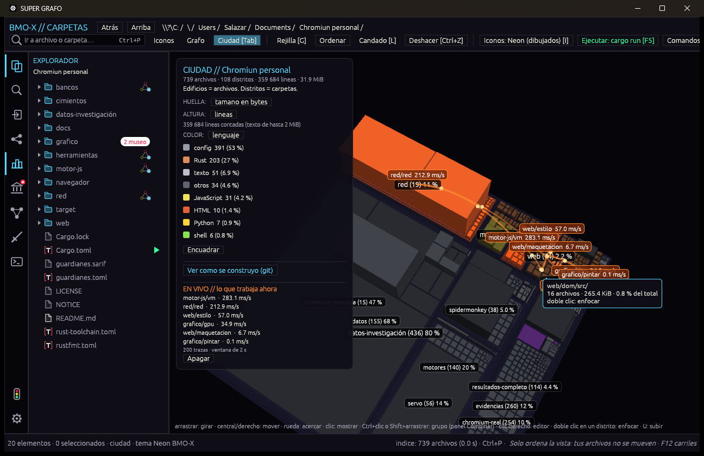

# SUPER GRAFO 4D: el tiempo y en vivo (4 de noviembre de 2026)

SUPER GRAFO (ULTRA Carpetas) crece una capa: después de 1D (archivos), 2D (nodos) y 3D (la
Ciudad), llega la **4D, el tiempo**, en dos sentidos: la historia del proyecto y lo que hace
ahora el programa que corre. Se desarrolló en la copia aislada para Windows,
`Documents\SUPER GRAFO`, probándolo sobre [QUIMERA](https://github.com/AndreeSalazar/QUIMERA),
y aquí vuelve a su sitio (`src/apps/carpetas-nucleo` y `src/apps/ultra-carpetas`).

  

*QUIMERA cargando YouTube, visto en vivo. `red/red` encendido (212 ms/s), el motor de
JavaScript (`motor-js/vm`) a 283 ms/s y el estilo a 57 ms/s. Los arcos son el tráfico entre
carpetas: dom → estilo → maquetación → pintar → GPU. Captura en Windows.*

## 4D · la historia

**«Ver cómo se construyó (git)»** en la Ciudad ya hacía nacer los edificios de hoy en orden.
Ahora la Ciudad mira **cualquier commit** tal como era:

- **La altura sigue las líneas de ese momento.** Una tercera lectura de git (`--numstat`)
  da las líneas que gana o pierde cada archivo en cada commit.
- **Fantasmas:** lo borrado aparece en su sitio, gris y bajito, desde el commit que lo borró.
  La ficha dice cuándo y con qué commit.
- **Naranja = cambiando ahora:** lo tocado en la ventana reciente (1/30 de la historia).
- La leyenda da archivos vivos, líneas, fantasmas y qué se estaba cambiando.

Lo calcula `carpetas_nucleo::cuatro` (no_std): la vida de cada archivo siguiendo sus cambios
de nombre, el momento de un commit y la comparación entre dos. En QUIMERA (66 commits) tarda
1 s, y las líneas reconstruidas del último commit dan 570 494 frente a 570 488 contadas en los
archivos.

**Consulta `tiempo`** (MCP): con `en` (índice, commit o AAAA-MM-DD), cómo estaba el proyecto;
con `desde` y `en`, qué creció, encogió, nació o murió.

## 4D · en vivo

El programa escribe en la raíz del proyecto `.super-grafo-vivo.jsonl`, una línea por tramo de
trabajo: `{"t":1234.5,"ruta":"web/estilo","us":5400,"desde":"web/dom"}`. QUIMERA lo hace con
`QUIMERA_VIVO`, y cualquier programa puede hacerlo. **«Ver en vivo (trazas)»** (o `--vivo`)
sigue el archivo mientras crece:

- enciende las carpetas que trabajan según sus ms por segundo (ventana de 2 s);
- dibuja **arcos de tráfico** `desde → ruta` con puntos que viajan;
- pone los ms por segundo sobre cada carpeta.

**Consulta `vivo`** (MCP): ms por segundo de cada carpeta y el tráfico de los últimos segundos.

## Lo demás que cambió

- **SARIF del proyecto:** si la raíz tiene `guardianes.sarif`, cada análisis marca sus hallazgos
  en sus archivos (`error` en rojo, el resto en amarillo, lo revisado con su motivo).
- **`.gitignore`:** lo que ignora la raíz no se indexa (carpetas y archivos, con `*` y `?`). En
  QUIMERA pasa de 4041 archivos a 848 y de 83 MB a 2 MB.
- **Banderas:** `--ciudad`, `--tiempo`, `--vivo` y `--mirar=carpetas` (encuadrar).
- **Windows:** lo exclusivo de Linux queda tras `cfg`: inotify (en Windows se mira cada poco),
  permisos e inodos (`plataforma.rs`), grupos de procesos (`taskkill /T`) y abrir archivos
  (`explorer`). Las pruebas que usan enlaces, `/proc` o `sh` siguen corriendo en Linux.
- La prueba de permisos de `archivo.rs` importa `PermissionsExt` por su cuenta.

## Validación y límites

- **Windows:** todas las pruebas de los dos crates pasan. Las que necesitan este repositorio o
  Unix se saltan allí, y aquí corren.
- **Linux:** `cargo check --target x86_64-unknown-linux-gnu --all-targets` sin errores ni avisos.
  **Falta compilarlo y probarlo en el taller QEMU** y en el escritorio real (Hyprland).
- En vivo va por carpeta (crate); más fino (archivo o función) si el programa lo traza.
- Las rutas de `compile_commands.json` en Windows aún se leen como en Unix.
