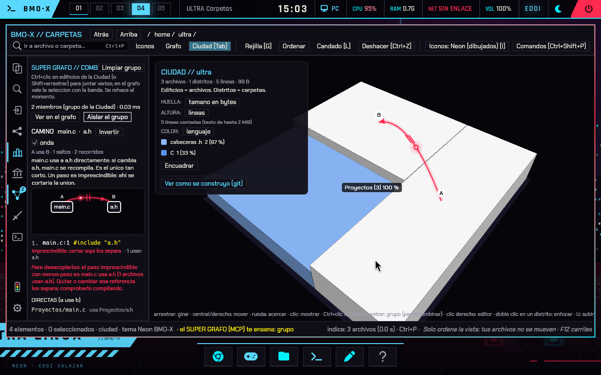

# SUPER GRAFO: revision e integracion en ULTRA

## Cambios recibidos

Base revisada: `0ef82d9`, merge de 26 commits posteriores a `0e042eb`.
El proyecto incorpora indice incremental, consultas MCP en vivo, dependencias de
`compile_commands.json`, revision con GCC/Clang, caminos de diagnosticos entre
archivos, cronologia Git y Ciudad fantasma. Se conserva la autoria de esos cambios.

## Correcciones de esta entrega

- **Opciones importadas del compilador:** se sustituye la aceptacion generica de
  `-f*` y `-m*` por una lista explicita de opciones semanticas. Antes se admitian
  `-fpass-plugin` de Clang y opciones capaces de escribir informes o modulos.
  El lector de perfiles de guardianes comparte el filtro. Las opciones desconocidas
  se descartan y se cuentan; un proyecto que las necesite puede dar diagnosticos
  incompletos. Este filtro no constituye una caja de aislamiento del compilador.
- **Clang en la imagen:** se incluye junto con GCC, tanto en la construccion base
  como en la actualizacion de main. El SUPER GRAFO puede usar el compilador que
  declara la base de compilacion, sin cambiar el compilador del kernel.
- **Entregas sin ejecutables viejos:** el instalador de Carpetas devuelve error si
  no puede compilar. Antes podia devolver exito dejando instalado el binario anterior.
- **MCP actualizado:** su lanzador consulta siempre la construccion incremental,
  usa `--locked`, respeta `CARGO_TARGET_DIR` y fija el directorio del toolchain.
  Un fallo de Cargo impide ejecutar la version anterior. No hace una recompilacion
  completa cada vez: Cargo reutiliza lo que sigue vigente.
- **Prueba portable de Clang:** se comprueba la regla `unix.Malloc`, la linea del
  acceso invalido y el paso por la cabecera; no una frase inglesa que cambio de
  «freed» a «released». El diagnostico ya existia: no se corrige un fallo del
  analizador ni se convierte cualquier aviso en un error.

Clang documenta la carga de bibliotecas mediante
[`-fpass-plugin`](https://clang.llvm.org/docs/ClangCommandLineReference.html#cmdoption-clang-fpass-plugin).

## Validacion

El nucleo pasa 110 pruebas en Linux y se construye tambien para `x86_64-unknown-none`.
La interfaz pasa 52 pruebas (una medida optativa ignorada). El lanzador MCP se
prueba con un Cargo simulado: revisa aun existiendo un ejecutable, conserva rutas
con espacios y no usa el binario antiguo cuando falla la compilacion.

El banco de arranque `--super-grafo` prueba el ejecutable instalado como UID 1000:
dependencias, cache incremental, GCC, Clang y cronologia en un proyecto sintetico.
Tambien abre Carpetas y solicita Ciudad a traves del puente MCP. La grafica de QEMU
es Vulkan por software: comprueba integracion y renderizado, no rendimiento RTX.
Los resultados finales y huellas de instalacion se conservan en
`evidencias/super-grafo-integracion/2026-10-25/`.

Resultado: **181 comprobaciones de arranque QEMU, ninguna fallida**, incluidas
las consultas del ejecutable instalado, Heronite, Ciudad con tres archivos y dos
miembros conectados, reinicio, persistencia y apagado limpio.

La imagen comprimida PC mide 2 057 101 312 bytes (1,92 GiB), unos 131 MiB mas
que la entrega anterior al incorporar esta integracion y las herramientas de Clang.
El tamano en disco no equivale a RAM residente: esas bibliotecas se cargan cuando
se usan. Sigue por debajo del limite de 4 GiB por archivo de FAT32.

## Informe fisico recibido

SHA-256: `4ef23bfd11553d442a7009d852c377a1b15f5ce88d7bea712b4abcf3721c746f`.
Ventana de observacion de unos 131 segundos; energia CPU entre los segundos
monotonos 17,289 y 149,382. El reloj civil salto unas cinco horas: no sirve para
calcular esa duracion.

- Paquete CPU: 33,621 W de media, maximo 59,251 W, 66 muestras RAPL.
- Temperatura CPU: maximo 55,6 C, 67 muestras.
- GPU: 24,977 W de media, maximo 45,3 W; VRAM maxima 665 MiB.
- Se observaron los perfiles Original y Eficiente.

No es una comparacion controlada con Cyberpunk ni con la sesion anterior. El grafo
del codigo no identifica por si solo la IA, fisica o sombreadores de un juego
cerrado. Estos cambios mejoran la herramienta y su entrega; no demuestran mas FPS
ni un porcentaje de ahorro de vatios.
