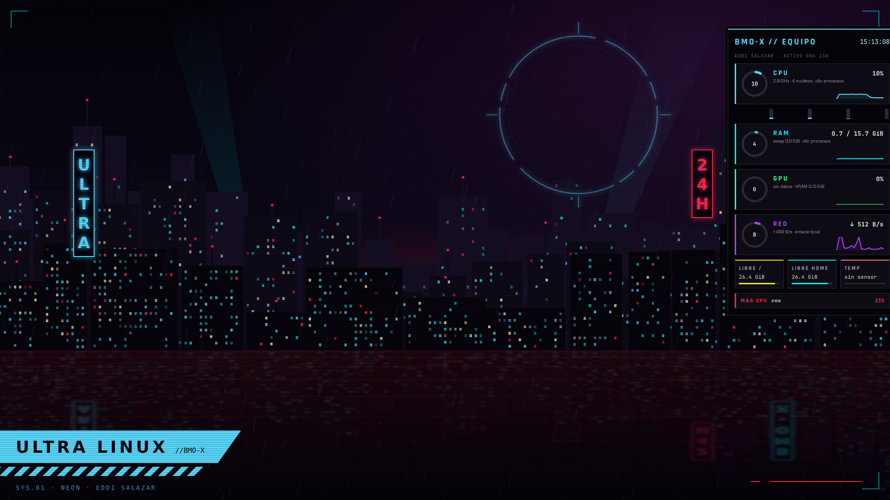

# BMO-X / Neón (acento hielo)

2026-10-24, America/Lima. Diseño y autoría: **Eddi Salazar**.

**Estado:** el tema está en el código del escritorio. Falta reconstruir las
imágenes y pasar las pruebas de arranque en QEMU y en el PC. Hasta entonces, las
imágenes y el video de Neón vienen del [prototipo](maquetas/neon/vivo.html) y no
son capturas del sistema.


## Colores

| Uso | Color |
| --- | --- |
| Fondo y paneles | `#06050a`, `#0f0e16`, líneas `#2a2733` / `#3b3747` |
| Acento principal (foco, acciones) | hielo `#5ad8ff`, claro `#bff3ff`, oscuro `#2b9fd0` |
| Datos (etiquetas de la barra, CPU en MangoHud) | cyan `#00f0ff` |
| Alertas, apagar, avisos críticos | rojo `#ff2a4f` |
| Texto | `#ece9dc`, secundario `#a19eae`, tenue `#625f70` |
| Acento alternativo | amarillo `#fcee0a` (categoría Ambiente) |

Categorías del centro BMO-X (Super+Espacio):

| Categoría | Color |
| --- | --- |
| Aplicaciones | hielo |
| Discos | cyan |
| Juegos | rojo |
| Pantalla | verde `#3dff9a` |
| Audio | violeta `#c03bff` |
| Ambiente | amarillo |
| Sistema | coral `#ff7a90` |

En cada categoría, la fila elegida se pinta con su color y el texto pasa a negro.

## Qué cambia en cada archivo

| Archivo | Cambio |
| --- | --- |
| `desktop/hyprland.lua` | `rounding = 0`; borde hielo → rojo → cyan; brillo hielo en la ventana activa; animaciones (abajo). Atajos sin cambios |
| `desktop/waybar.jsonc` | Barra pegada arriba; etiquetas CPU, RAM, NET y VOL; escritorios `01`–`05`; título de ventana a 40 caracteres; módulo **EDDI**; alerta de CPU al 80 % |
| `desktop/waybar.css` | Bloque BMO-X inclinado (degradado, GTK no tiene `clip-path`); escritorio activo relleno de hielo; apagar en rojo; dock negro con borde hielo |
| `desktop/fuzzel.ini`, `bin/ultra-ambiente` | Menús negros, borde y selección del color de la categoría, coincidencias en rojo, JetBrains Mono |
| `desktop/mako.conf` | Avisos negros con borde hielo, sin redondeo, Chakra Petch; críticos en rojo |
| `desktop/gtk.css`, `gtk-settings.ini` | GTK negro y hielo, sin redondeo, Chakra Petch |
| `desktop/foot.ini` | JetBrains Mono y paleta Neón |
| `desktop/MangoHud.conf` | Colores Neón; métricas, atajos y registro sin cambios |
| `desktop/wallpaper.svg` | Ciudad nocturna original con el aro del autor, de [`crear-fondo.py`](maquetas/neon/crear-fondo.py) |
| `desktop/AUTOR.txt`, `desktop/emblema-autor.svg` | Perfil del autor; el módulo EDDI de la barra abre `AUTOR.txt` |
| `crear-tema.py` | Iconos y cursores recoloreados; se puede ejecutar otra vez sobre una imagen existente. El nombre interno `ULTRA-Nucleo` se conserva por compatibilidad |
| `fuentes/` | Rajdhani y Chakra Petch con sus licencias OFL |
| `bin/ultra-tema` | Migración `neon-1` |
| `scripts/build-baseline.sh`, `scripts/actualizar-escritorio.sh` | `ttf-jetbrains-mono`, fuentes en `/usr/share/fonts/ultra-neon`, `fc-cache`, iconos y cursores también en la actualización rápida |

La migración `neon-1` funciona igual que `nucleo-1`, en el primer inicio:

- guarda los foot, fuzzel y GTK que ya tenga el usuario en
  `~/.config/ultra/tema-respaldo-neon-1/`;
- instala los nuevos;
- no vuelve a pisar los cambios que el usuario haga después.

## Personalizar (Super+Shift+P)

`ultra-personalizar` cambia el escritorio sin root. Se abre con **Super+Shift+P**,
con **Super+Espacio > Ambiente > Personalizar escritorio** o con clic derecho en
la luna de la barra.

| Opción | Valores |
| --- | --- |
| Acento | hielo, amarillo, cyan, rojo, verde, violeta, coral, blanco o un hex propio (`#RRGGBB`) |
| Fondo | Neón con el acento elegido, **vivo** o **vivo-demonio** (animados), **imagen-viva** (tu imagen animada), **Demonio** (tu Tux dentro del aro sobre la ciudad en rojo), **auto** (Neón de 7:00 a 19:00, Demonio de noche), Núcleo clásico, imagen propia (PNG, JPG o SVG de `~/Imágenes` o `~/Pictures`) o color liso |
| Efectos | vivos o reducidos |
| Borde de la ventana activa | gira o quieto |
| Huecos entre ventanas | compacto, normal o amplio |
| Grosor del borde | 1, 2 o 3 px |
| Tamaño del cursor | 24, 28, 32 o 48 px |
| Tamaño de la barra | compacta, normal o grande |
| Opacidad de ventanas inactivas | 100 %, 92 % u 85 % |
| Esquinas | rectas, suaves (6 px) o redondas (12 px) |
| Animación al abrir | emergente, deslizar o zoom |
| Velocidad de animaciones | rápida, normal o lenta |
| Desenfoque | ligero, fuerte o no |
| Posición de la barra | arriba o abajo (con la barra abajo, el dock sube) |
| Dock | visible u oculto |
| Reloj | 24 h, 12 h o con segundos |
| Posición de avisos | arriba a la derecha, arriba al centro o abajo a la derecha; esquivan barra y dock |
| Letra de la interfaz | Neón (Rajdhani y Chakra Petch), Chakra Petch, mono (JetBrains Mono) o clásica (DejaVu Sans) |
| Sonidos del sistema | sí, básicos o no |
| Tarjetas de equipo (eww) | visibles u ocultas |
| Modo juego automático | auto o no |

El acento también llega a la terminal: la selección y el cursor de foot cambian
en las terminales que abras después. El resto de tu `foot.ini` no se toca.

### Perfiles de un toque

**Super+Shift+P > Perfiles** cambia muchas opciones a la vez:

| Perfil | Qué cambia |
| --- | --- |
| Neón hielo | Todo al tema de fábrica |
| Demonio | Acento rojo, fondo Demonio, borde que gira, inactivas al 92 % |
| Sobrio | Efectos reducidos, borde quieto, sin desenfoque, animaciones rápidas |
| Minimal | Sin dock, barra compacta, huecos compactos, borde de 1 px |
| Juego | Efectos reducidos, borde quieto, sin desenfoque ni dock, avisos arriba al centro |

**Guardar el actual como…** crea un perfil tuyo en `~/.config/ultra/perfiles/`
(minúsculas, números y guiones, hasta 24 caracteres y 16 perfiles). Se valida
igual que `personal.json`: un perfil dañado vuelve a valores seguros. Por
terminal: `ultra-personalizar perfil aplicar|guardar|borrar NOMBRE`.

El fondo Demonio sale de `scripts/crear_fondo_demonio.py`, que genera
`src/rootfs/desktop/wallpaper-demonio.png` a partir de tu Tux.

El menú se agrupa en Perfiles y seis apartados: Colores y fondo, Ventanas, Animaciones y
efectos, Barra y dock, Avisos, letra y cursor, y Sonido y juegos.

Super+Shift+A sigue alternando los efectos. Con personalización guardada,
`ultra-ambiente` vuelve a aplicar tu desenfoque, esquinas y animaciones para el
modo elegido, en vez de pisarlos.

Cómo funciona:

- Las elecciones van a `~/.config/ultra/personal.json`.
- A partir de ellas se generan copias del tema en `~/.config/ultra/tema-personal/`:
  Waybar, mako, fuzzel y el fondo.
- Hyprland recibe los cambios en vivo con `hyprctl eval`; la barra, los avisos y
  el fondo se reinician solos.
- Al iniciar sesión, `ultra-iniciar-escritorio` vuelve a aplicar lo guardado.
- **Sin elecciones guardadas no se genera nada**: el escritorio usa `/etc/ultra`
  tal cual y las pruebas de arranque no cambian.
- Un `personal.json` dañado o editado a mano vuelve a valores seguros. Las imágenes
  deben ser archivos propios, no enlaces y de menos de 64 MiB.
- **Restablecer todo** borra solo esos archivos y vuelve al tema del sistema.

`scripts/probar_personalizar.py` prueba todo esto en un HOME temporal, con el tema
real y comandos de sesión falsos: generación, aplicación, rechazos, valores
dañados, menú y restablecimiento. El [prototipo](maquetas/neon/vivo.html) tiene el
mismo panel (Alt+U) para ver cada opción antes de construir la imagen.

## Capturas de pantalla

| Atajo | Captura |
| --- | --- |
| Impr Pant | Pantalla activa |
| Super+Shift+S | Región; el recuadro usa tu acento y Esc cancela |
| Super+Impr Pant | Ventana activa |

`ultra-captura` (grim, slurp y wl-clipboard) guarda en `~/Imágenes/Capturas/`,
copia la imagen al portapapeles y avisa con la miniatura. Valida la geometría
que devuelve `slurp` antes de usarla. `scripts/probar_captura.py` lo prueba con
herramientas falsas.

## Controles de la barra

| Clic | En CPU | En RAM |
| --- | --- | --- |
| Izquierdo | Los 15 procesos con más CPU (medida real en 0,6 s) | Los 15 con más memoria |
| Derecho | Administrador completo ordenado por CPU | Administrador ordenado por RAM |

Al elegir un proceso: **cerrar** (le pide salir, puede guardar), **forzar cierre**,
**limitar a 50 % de un núcleo** o **limitar a 2 GiB**. Cerrar y forzar piden
confirmación. Usa lo mismo que `ultra-aplicaciones` (Super+Esc): señales por
`pidfd`, que comprueban que el proceso sigue siendo el mismo, y límites con cgroups
en `ultra-usuario`. Los procesos del escritorio y los de root no aparecen. En el
administrador, **O** alterna el orden entre CPU y RAM. `scripts/probar_controles_barra.py`
lo prueba con un proceso real como UID 1000.

## Avisos y portapapeles

| Atajo | Qué hace |
| --- | --- |
| Super+C | Cierra todos los avisos |
| Super+Shift+N | Recupera el último aviso cerrado (`makoctl restore`); repetir trae más, hasta 10 |
| Super+Shift+V | Historial del portapapeles: elegir una entrada la vuelve a copiar; también borra todo |

`ultra-portapapeles` guarda hasta 200 copias con `cliphist` en `$XDG_RUNTIME_DIR`,
que está en RAM: el historial desaparece al cerrar la sesión o apagar y nunca
toca el disco. Las copias que una app marca como sensibles (por ejemplo, un gestor
de contraseñas) no se guardan. Las dos acciones también están en Super+Espacio >
Ambiente. `scripts/probar_portapapeles.py` lo prueba con herramientas falsas.

## Sonidos

Cada elemento del escritorio tiene un sonido propio, sintetizado por
`scripts/crear_sonidos.py` (sin muestras de terceros) y guardado en
`/etc/ultra/sonido-*.wav`. Escúchalos todos seguidos en
[`sonidos-bmox.ogg`](maquetas/sonidos-bmox.ogg), en el orden de esta tabla.

| Sonido | Cuándo | Cómo suena |
| --- | --- | --- |
| `inicio` | Al iniciar sesión | Tres notas que suben |
| `ventana-abrir` | Se abre una ventana | Chirrido corto que sube, con grano glitch |
| `ventana-cerrar` | Se cierra una ventana | El chirrido que cae |
| `escritorio` | Cambias de escritorio | Soplido de aire y un tic |
| `menu` | Centro BMO-X, Personalizar y clic en CPU/RAM | Arpegio digital de tres pasos |
| `aviso` | Llega un aviso normal | Ping de dos notas altas |
| `volumen` | Teclas de volumen | Tic seco |
| `portapapeles` | Recuperas algo del historial | Doble clic |
| `captura` | Guardas una captura | Obturador |
| `proceso` | Cierras o limitas un proceso, o borras el historial | Golpe grave con crujido |
| `error` | Algo falla en un menú | Zumbido cuadrado doble |
| `critico` | Aviso crítico | Dos pulsos graves |
| `juego` / `juego-salir` | Entras o sales del modo juego | Barrido que baja / que sube |

Los reproduce `ultra-personalizar sonar EVENTO` con `pw-play`. Los de ventanas,
escritorio, menú, volumen y portapapeles van más bajos (35–50 %); el resto al 60 %.

- **Sonidos: sí**: todos.
- **Sonidos: básicos**: solo los que avisan de algo (inicio, aviso, crítico,
  captura, proceso, error y modo juego); ventanas, escritorios y menús callan.
- **Sonidos: no**: ninguno.
- **En un juego**: solo suenan crítico, volumen, captura, proceso, error y modo juego.

Las ventanas y los escritorios suenan desde `ultra-modo-juego`, que ya escucha los
eventos de Hyprland; si se abren varias ventanas a la vez, suena una sola. Los
avisos suenan con `on-notify` de mako según su tipo.

## Fondo vivo

**Personalizar > Colores y fondo > Fondo: vivo** (ciudad Neón con tu acento) o
**vivo-demonio** (tu Tux). Vista previa:
[Neón](maquetas/png/neon/fondo-vivo-neon.mp4) y
[Demonio](maquetas/png/neon/fondo-vivo-demonio.mp4). Son la salida real del
generador, pero no una captura del sistema funcionando.

Es un bucle de 4 s a 12 cuadros por segundo:

- lluvia que cae (cada gota da 1, 2 o 3 vueltas por bucle, así nunca salta);
- el aro del autor gira un cuarto de vuelta y su brillo pulsa;
- los letreros 24H y BMO-X fallan como neón viejo;
- una línea de escaneo baja y, una vez por bucle, un corte glitch.

Cómo funciona:

- `ultra-fondo-vivo` lo genera **en tu PC** la primera vez (unos 5–10 s) con
  Pillow, a partir del fondo estático y tu acento, y lo guarda en
  `~/.cache/ultra/fondo-vivo/` (unos 16–18 MB). No va en el repo ni en la imagen.
- Mientras se genera queda el fondo estático; cuando está listo, `awww` (antes
  `swww`) lo reproduce y se cierra `swaybg`.
- **En un juego** se cambia por su primer cuadro, quieto, y vuelve a moverse al salir.
- Cambiar de acento genera otro bucle; elegir otro fondo para `awww`.
- **Sin awww ni swww** se queda el fondo estático, sin error. Los scripts de
  build intentan instalar `awww` y luego `swww`; no pude confirmar cuál está hoy
  en los repositorios oficiales, así que el build avisa en amarillo si no hay ninguno.

**Sin medir:** el coste en CPU y GPU no está medido. `awww` guarda los cuadros
ya decodificados, pero Hyprland recibe una imagen nueva 12 veces por segundo
mientras estás en el escritorio. Compáralo con `ultra-diagnostico-juego` con el
fondo `neon` y con `vivo`. `scripts/probar_fondo_vivo.py` comprueba que el bucle
cierra sin salto, la caché por acento, la pausa y el caso sin awww.

### Tu imagen, viva

**Fondo: imagen-viva** anima una imagen tuya (PNG, JPG, WEBP o SVG en `~/Imágenes`
o `~/Pictures`): lluvia de tu acento, un barrido de luz que la cruza, la línea de
escaneo y el corte glitch. El aro y los letreros no se dibujan, porque no sabemos
dónde caerían en tu imagen. Se recorta al centro a 1920×1080 sin deformarla. Se
guardan hasta 6 imágenes animadas (unos 100 MB); las más viejas se borran solas.

Por terminal: `ultra-personalizar poner imagen-viva ~/Imágenes/mi-fondo.jpg`.

### Dónde conseguir buenos fondos

No van en el repo: son de sus autores. Para uso personal:

| Fuente | Qué hay | Licencia |
| --- | --- | --- |
| [GOG: colección Goodies de Cyberpunk 2077](https://www.gogdb.org/product/1774891642) | Fondos oficiales de CD Projekt, incluidos los de Phantom Liberty (unos 1 GB). Gratis con cuenta de GOG | Uso personal; las [normas de contenido de fans](https://cdn1.epicgames.com/eulatracking-download/cp2077/en/v1/r2/ebdad01b0f2e8388d23b5750ca18a3ac.pdf) no permiten venderlos |
| [Neoncityhub](https://neoncityhub.gumroad.com/l/ejlbx) | Ciudades neón en 4K a 0 $ | No indica licencia |
| [404static](https://404static.gumroad.com/l/rmjqt) | 50 fondos cyberpunk por 9,99 $ | Incluye licencia comercial |
| [Wallpapers.com: Night City](https://wallpapers.com/night-city) | Mucha variedad | No indica licencia; revisa cada imagen |
| Los tuyos | Neón (con cualquier acento) y Demonio, de `ultra-crear-fondo` y `crear_fondo_demonio.py` | Tuyos (GPL-2.0) |

Guarda el que elijas en `~/Imágenes` y elígelo en **Fondo: imagen-viva**.
Quedan mejor las imágenes oscuras con cielo despejado arriba: la lluvia y el
barrido se ven sobre zonas oscuras.

## Tarjetas de equipo (eww)



La captura es de eww 0.6.0 real con estos mismos archivos, en una pantalla
virtual X11 (Xvfb) del entorno de desarrollo, no en Hyprland. Por eso la GPU
dice «sin datos» y no hay sensor de temperatura.

Panel a la derecha, debajo de la barra, en la capa del escritorio: las ventanas
lo tapan. **Super+F9** lo oculta o lo muestra, con un deslizamiento lateral.

| Tarjeta | Qué muestra | Clic |
| --- | --- | --- |
| CPU (acento) | Anillo de uso, GHz, gráfica de 90 s y una barra por núcleo (en rojo sobre 85 %) | Los procesos que más CPU usan |
| RAM (cyan) | Usada / total, swap y gráfica | Los que más memoria usan |
| GPU (verde) | Uso, VRAM, temperatura y nombre (NVIDIA con `nvidia-smi`; AMD por `/sys`) | Gráficos |
| RED (violeta) | Bajada y subida, con escala que se adapta | — |
| Libre /, libre home, temperatura | Espacio libre y la temperatura más alta de los sensores | — |
| MÁS CPU | El proceso tuyo que más CPU usó en los últimos 2 s | Los procesos que más CPU usan |

- El panel respira con un brillo de tu acento.
- Una tarjeta sobre el 85 % (o un disco sobre el 90 %) late en rojo.
- En modo juego el borde se pone rojo y los datos se leen cada 10 s en vez de 2.

Cómo funciona:

- `ultra-tarjetas datos` lee `/proc`, `/sys` y, si existe, `nvidia-smi`. Usa
  un solo `nvidia-smi -l 2`, no uno nuevo cada vez. Escribe un JSON por línea
  que eww escucha (`deflisten`).
- `eww.yuck` y `eww.scss` van en `/etc/ultra`. Personalizar genera una copia
  con tu acento y tu letra; con efectos reducidos, el panel deja de respirar.
- **Personalizar > Barra y dock > Tarjetas de equipo**: visibles u ocultas.
- **Sin eww**, Super+F9 abre la versión de texto de siempre.

**eww no está en los repositorios oficiales de Arch** (solo en AUR).
`scripts/instalar-eww.sh` lo compila en el taller, sin AUR:

- clona la etiqueta `v0.6.0` y comprueba que apunta al commit
  `d87c2fdbfdc012e76d229e4e9ea3325bc0f23e89`;
- compila solo con Wayland (`--no-default-features --features wayland`, Rust 1.76.0
  según su `rust-toolchain.toml`);
- comprueba con `ldd` en la imagen que no falta ninguna biblioteca.

En la imagen van `gtk3`, `gtk-layer-shell` y `libdbusmenu-gtk3`. Si algo falla al
compilar, el build avisa en amarillo y sigue sin tarjetas.

`scripts/probar_tarjetas.py` prueba las lecturas con `/proc` y `/sys` falsos. También
comprueba que cada dato que usa `eww.yuck` existe en el JSON real y en el inicial, y
el abrir, ocultar y la versión de texto. La prueba de arranque acepta las dos formas
de Super+F9: con eww y sin eww.

**Sin medir:** eww redibuja el panel cada 2 s y mientras respira. Si quieres el
escritorio sin ese coste, ocúltalo con Super+F9 o en Personalizar.

## Barra con vida

- El escritorio activo late con un brillo de tu acento.
- **EDDI** brilla y se apaga despacio.
- La línea de la barra pasa de tu acento al cyan y vuelve, como el borde de las ventanas.
- CPU y RAM se iluminan al pasar el ratón, porque se pueden clicar.
- Los botones del dock brillan al pasar el ratón.

Con **Efectos: reducidos** en Personalizar la barra se queda quieta; solo
parpadean las alertas (CPU al 80 % y escritorio urgente). GTK redibuja la barra
mientras haya animaciones; en pantalla completa Hyprland la tapa.

## Modo juego automático

`ultra-modo-juego` arranca con la sesión y escucha los eventos de Hyprland. Cuando
la ventana activa es un juego en pantalla completa (clase `steam_app_N` de Proton,
un `.exe` de Wine o Heroic, o `gamescope`):

- apaga animaciones, desenfoque, sombras y el borde que gira (`ultra-personalizar juego entrar`);
- deja quieto el fondo vivo;
- pone mako en no molestar: los avisos normales se guardan en el historial y los
  críticos se siguen viendo;
- el fondo automático espera a que termines para cambiar.

Al cambiar de ventana, quitar la pantalla completa o cerrar el juego, todo vuelve
al modo que tenías (vivo o sobrio). La barra no se toca: en pantalla completa
Hyprland ya la tapa. Se apaga en Personalizar > Sonido y juegos > Modo juego: no.
`scripts/probar_modo_juego.py` lo prueba con un Hyprland falso que emite eventos.

**Sin medir todavía**: no hay datos de que esto suba FPS o quite tirones. Lo que sí
hace es dejar al compositor sin trabajo de efectos mientras juegas. Para saber si
ayuda, compara con `ultra-diagnostico-juego` con el modo en `auto` y en `no`.

## Iconos de apps

`crear-tema.py` dibuja iconos propios en el mismo estilo para Steam, Heroic/GOG,
Cyberpunk 2077, discos, tema, cámara y aviso. Antes Steam y GOG compartían el
mando genérico.

## Rust

La imagen incluye `rustup`, `gcc` (Rust lo usa para enlazar), `git` y `pkgconf`.

- **Primera vez:** en una terminal, `rustup default stable`. Descarga unos 300 MB
  al home.
- **Dónde queda:** con almacenamiento persistente se conserva; con el home en RAM
  se pierde al apagar.
- **Versión por proyecto:** los proyectos con `rust-toolchain.toml`, como BMO-X,
  eligen su propia versión solos.
- **PATH:** `~/.cargo/bin` ya está incluido para lo que instales con `cargo install`.

## Animaciones del sistema real

| Animación | Configuración |
| --- | --- |
| Ventana nueva y cierre | `windows` popin 90 % (0,4 s) y `windowsOut` popin 94 % (0,2 s), curva `0.16,1,0.3,1` |
| Reacomodo | `windowsMove` 0,35 s |
| Escritorios | `workspaces` slide 0,4 s; `specialWorkspace` slidevert |
| Barra, menús y avisos al aparecer | `layers` slide 0,25 s |
| Borde que gira | `borderangle` en `loop`, 6 s por vuelta |
| Alerta de CPU y escritorio urgente | `@keyframes` de GTK CSS en Waybar |

Super+Shift+A (efectos reducidos) apaga todas las animaciones, el desenfoque y
las sombras, igual que antes.

Lo que solo existe en el prototipo:

- el corte glitch al abrir ventanas;
- la barra de tiempo de los avisos;
- el corte glitch en Equipo en vivo.

## Para RING 0

- **Borde que gira:** obliga a Hyprland a redibujar mientras haya un borde visible.
  En pantalla completa no hay borde. Si se prefiere un escritorio quieto, basta
  con quitar la línea `borderangle` de `hyprland.lua`.
- **Fondo vivo**: opcional y apagado de fábrica (el fondo por defecto sigue
  siendo el SVG fijo con `swaybg`). Se queda quieto en juegos. Su coste está sin medir.

## Verificación pendiente

1. En el taller: `scripts/actualizar-escritorio.sh generico completo`.
2. Arranque en QEMU con las pruebas de escritorio y `--tema-nucleo`. Las pruebas
   se actualizaron así:
   - colores nuevos por categoría, comparados contra una captura sin menú,
     porque el fondo Neón ya contiene esos colores;
   - ruta del respaldo `neon-1`.
3. Comprobar en el registro de Hyprland que acepta `shadow.color_inactive` y las
   animaciones `layers`, `specialWorkspace` y `borderangle`. La configuración
   Lua se ejecutó sin errores con una API simulada, pero solo Hyprland 0.56.2
   valida los nombres.
4. Comprobar en Waybar las etiquetas con formato Pango y la clase `alerta` de la CPU.
5. Repetir en el perfil PC, con capturas y hashes en `evidencias/`.

## Volver al amarillo

```text
python3 docs/maquetas/neon/crear-fondo.py --acento amarillo > src/rootfs/desktop/wallpaper.svg
```

En los demás archivos, cambia `5ad8ff` por `fcee0a`, `2b9fd0` por `c9be08` y
`bff3ff` por `fff36b`.
