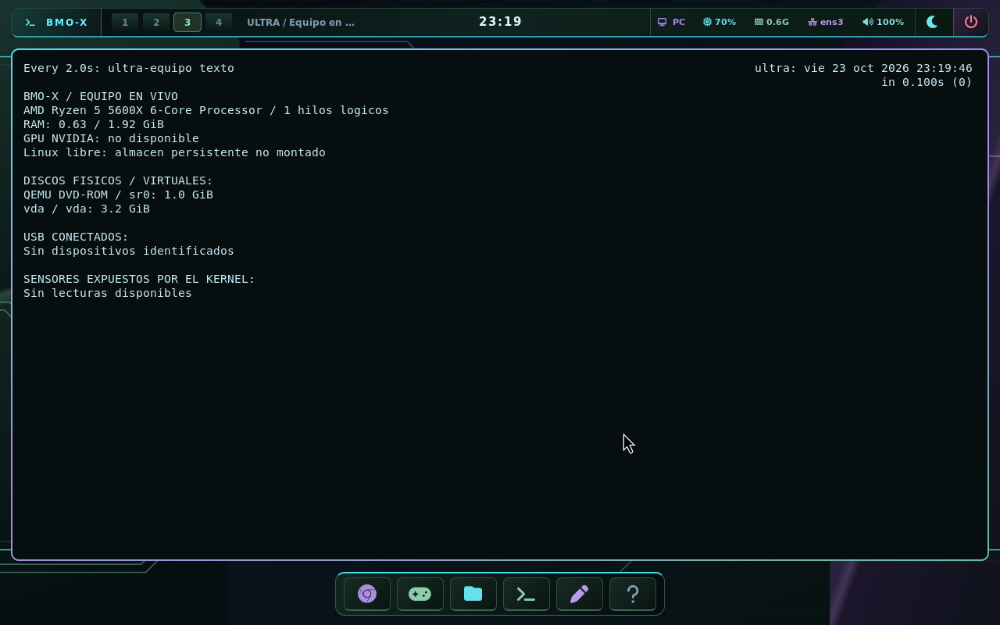

# BMO-X / Nucleo

Escritorio personal con cyan, morado y verde metalico oscuro. Toma de la
referencia visual las lineas tecnicas y los marcos recortados; deja el centro
del fondo despejado para trabajar. El fondo es SVG estatico: los circulos y
trazos son decoracion, no indicadores de actividad ni porcentajes inventados.

- Cyan: foco, controles e iconos principales.
- Morado: acentos, borde activo y detalles secundarios.
- Verde metalico oscuro: superficies, carpetas, dock y paneles.

La barra conserva CPU, RAM, red, audio, hora de Peru y escritorios. El boton
**PC** abre **Equipo en vivo**, tambien disponible con **Super+F9** o en
**Super+Space > Sistema y ayuda > Equipo en vivo**. Su tooltip se actualiza
cada diez segundos; el panel, cada dos. Muestra modelo de CPU, hilos logicos,
RAM, GPU NVIDIA identificada, discos, espacio Linux, USB y sensores que el
kernel permita leer. Ausencia de sensores significa falta de datos, no cero
grados. El panel no cambia frecuencias, voltajes ni permisos de dispositivos.

El tema incluye diez iconos SVG originales para categorias comunes y once
cursores XCursor en 24, 28, 32, 48 y 64 pixeles: flecha, enlace, texto,
precision, espera, prohibicion, mover y redimensionar. El tamaño normal es
28 px. Los iconos no cubiertos heredan Papirus-Dark/Adwaita. Algunas aplicaciones
como Steam, juegos y navegadores dibujan partes de su propia interfaz y pueden
conservar su estilo o sus cursores.

Hyprland usa el camino XCursor para este tema; GTK y XWayland reciben el mismo
nombre y tamaño. Es compatible con la
[configuracion de cursor de Hyprland 0.56](https://wiki.hypr.land/0.56.0/Hypr-Ecosystem/hyprcursor/).

En el primer inicio se actualizan las configuraciones de foot, Fuzzel, GTK3 y
GTK4, guardando los archivos anteriores existentes en:

```text
~/.config/ultra/tema-respaldo-nucleo-1/
```

Es una migracion unica: los cambios personales posteriores no se sobrescriben
en cada inicio. No se copian cuentas, llaveros ni datos de juegos. Los ajustes
de Waybar, notificaciones y Hyprland siguen procediendo de la imagen del sistema.

El fondo no requiere una animacion permanente ni sondeo. Las animaciones
habituales y los efectos reducidos siguen disponibles en Ambiente.

## Verificacion del 23 de octubre de 2026

El perfil PC #45 paso **180 comprobaciones de arranque**, incluidas las del
tema, aplicacion del cursor por IPC, respaldo de ajustes y diagnostico de
Warframe. Las capturas son de QEMU, no de la RTX fisica. El perfil generico
no se reconstruyo en esta revision.




[Evidencia y hashes](../evidencias/tema-nucleo/2026-10-23/resumen.json).
