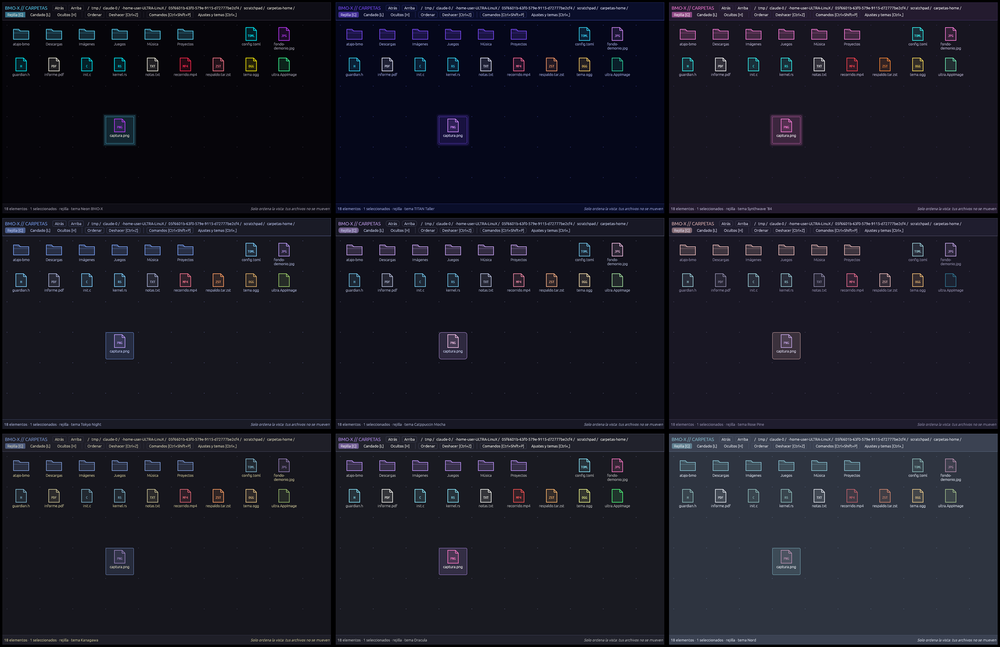
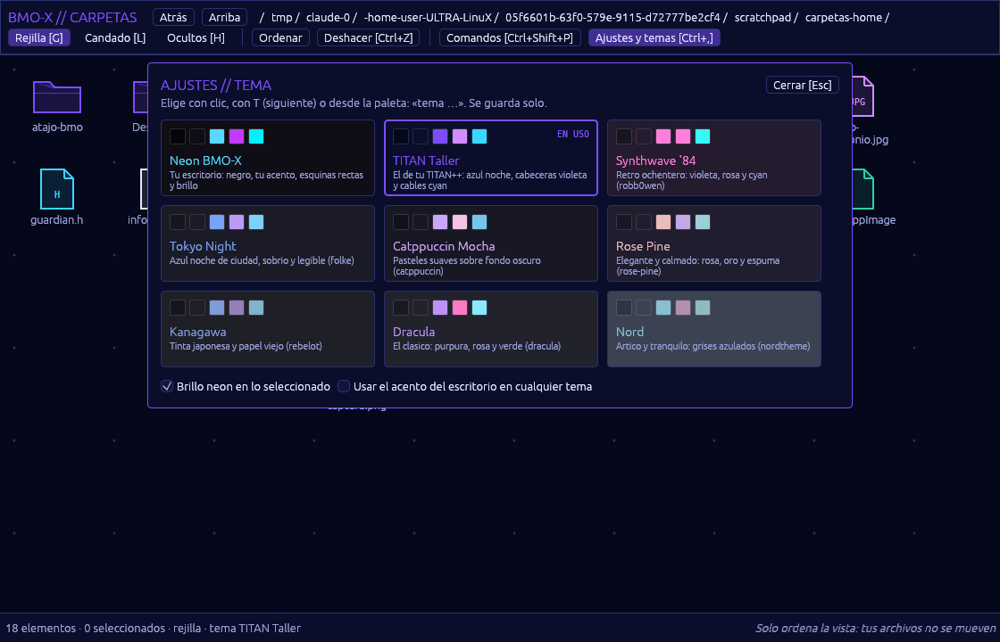

# Temas para las apps de BMO-X (ULTRA Carpetas hoy, TITAN mañana)

2026-10-24, America/Lima. Idea: **Eddi Salazar**.

Captura real de ULTRA Carpetas con cada tema, dibujada con Vulkan por software en una
pantalla virtual (no en Hyprland). De izquierda a derecha y de arriba abajo: Neón BMO-X,
TITAN Taller, Synthwave '84, Tokyo Night, Catppuccin Mocha, Rosé Pine, Kanagawa,
Dracula y Nord.

## Cómo se elige

| Dónde | Cómo |
| --- | --- |
| Panel de ajustes | **Ctrl+,**: cada tarjeta se pinta con los colores de su propio tema |
| Paleta | **Ctrl+Shift+P** y escribe «tema drac», «tema tok»… |
| Teclado | **T** pasa al siguiente tema |
| Opciones | Brillo neón en lo seleccionado; usar el acento del escritorio en cualquier tema |

Se guarda solo en `~/.config/ultra/carpetas/ajustes.json`. Un tema desconocido o un
archivo dañado vuelve a Neón BMO-X.

## Los temas

| Tema | Carácter | Origen de los colores |
| --- | --- | --- |
| **Neón BMO-X** | Negro, tu acento de Personalizar, esquinas rectas, brillo | Propio |
| **TITAN Taller** | Azul noche, cabeceras violeta, cables cyan, como tu TITAN++ | Propio, sacado de tu captura |
| **Synthwave '84** | Retro ochentero: violeta, rosa, cyan, con brillo | [robb0wen/synthwave-vscode](https://github.com/robb0wen/synthwave-vscode) |
| **Tokyo Night** | Azul noche de ciudad, sobrio | [folke/tokyonight.nvim](https://github.com/folke/tokyonight.nvim) (night) |
| **Catppuccin Mocha** | Pasteles suaves, esquinas redondas | [catppuccin/palette](https://github.com/catppuccin/palette) |
| **Rosé Pine** | Elegante: rosa, oro, espuma | [rose-pine/neovim](https://github.com/rose-pine/neovim) (main) |
| **Kanagawa** | Tinta japonesa y papel viejo | [rebelot/kanagawa.nvim](https://github.com/rebelot/kanagawa.nvim) |
| **Dracula** | El clásico púrpura, rosa y verde | [dracula/visual-studio-code](https://github.com/dracula/visual-studio-code) |
| **Nord** | Ártico, grises azulados | [nordtheme/nord](https://github.com/nordtheme/nord) |

Cada tema define:

- **Superficies:** fondo, panel, superficie y línea.
- **Texto:** texto, tenue y el texto que va sobre el acento.
- **Colores:** acento, error y un color por tipo de archivo.
- **Forma:** radio de esquinas y si lleva brillo.

**Legibilidad comprobada:** una prueba exige contraste WCAG sobre el fondo y los paneles:

- texto, 7:1 (AAA);
- texto secundario, 4,5:1 (AA);
- texto sobre el acento, 4,5:1.

Por eso el texto secundario usa el gris de texto oficial de cada paleta (`fg_dark`,
`subtext0`, `subtle`, `oldWhite`) y no el de comentarios, que no llegaba. Dracula no
trae un gris medio: su texto secundario es su FG al 70 % sobre su fondo. Y por eso el
violeta de TITAN Taller es `#7c4dff`: con el `#8b5cf6` inicial, el texto blanco
encima quedaba en 4,2:1.

## Mismo código en BMO-X

Los temas son datos en el núcleo `no_std` (`src/apps/carpetas-nucleo/src/tema.rs`).
`TEMAS`, `Tema`, `Ajustes` y la vista previa no usan `std` y compilan para
`x86_64-unknown-none`. TITAN puede usar la tabla tal cual: `Ajustes::tema(acento)`
devuelve los colores, y tu pintor del framebuffer los usa.

## Para el grafo de TITAN: lo que hace legible un editor de nodos

Lo que coinciden en decir los equipos de Blender y la comunidad de ComfyUI (opiniones
de desarrolladores y usuarios, no estudios formales):

1. **Una sola dirección de flujo**, de arriba a la izquierda hacia abajo a la derecha.
   Tu grafo ya baja de `TITAN.TOML` a `main` y a sus hijos: mantenlo así siempre.
2. **Cables curvos**: Blender pasó a curvas porque se leen mejor con muchas entradas.
   Los tuyos ya son curvos. Dales el color del tipo de dato, no uno fijo.
3. **Color por categoría de nodo**, con los colores del tema: TITAN con el acento,
   SISTEMA con el cyan de código, GPU con el verde de programas y TOML con el violeta
   de imágenes. Así, al cambiar de tema cambia todo junto.
4. **Etiquetas en los conectores**: saber qué entra y qué sale sin abrir el nodo.
5. **Agrupar y plegar**: marcos con nombre para `physics/` y nodos que se pliegan a
   una línea. Un grafo pequeño se lee y falla menos.
6. **Notas** como nodos de texto, y un **minimapa** cuando el grafo no cabe.

Fuentes:
- [Readable Nodes for ComfyUI](https://scrapbox.io/work4ai/%F0%9F%A6%8AReadable_Nodes_for_ComfyUI)
- [Blender: legibilidad de cables discontinuos](https://projects.blender.org/blender/blender/pulls/114716)
- [Blender: diseño del editor de shaders](https://devtalk.blender.org/t/shader-editor-node-design/5388)
- [Blender: propuesta del editor de nodos](https://wiki.blender.jp/Dev:Ref/Proposals/UI/Blender_Node_Editor_-)
