# ULTRA Carpetas

2026-10-24, America/Lima. Idea y diseño: **Eddi Salazar**.

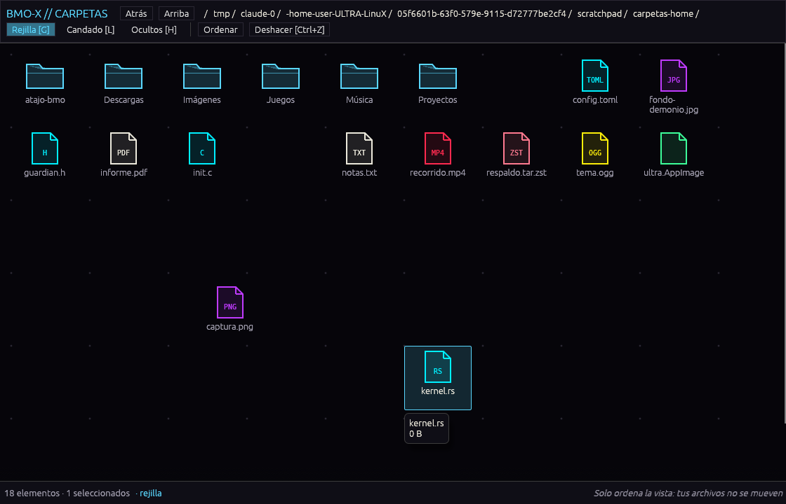

Las capturas son del programa real, dibujado con Vulkan por software (lavapipe de
Mesa) en una pantalla virtual X11 del entorno de desarrollo, no en Hyprland. Con
un ratón y un teclado simulados se hizo esto:

1. Se activó la rejilla desde la paleta.
2. Se arrastró `captura.png`, que encajó en su celda.
3. Una banda seleccionó 13 iconos.

Gestor de carpetas inspirado en el escritorio del Windows antiguo: **cada icono va
donde tú lo dejes y cada carpeta recuerda su orden.** Con control:

| Tecla o botón | Qué hace |
| --- | --- |
| Arrastrar | Mueve el icono, o todos los seleccionados |
| Arrastrar sobre el fondo | Banda de selección; Ctrl suma a la selección |
| Doble clic / Enter | Abre la carpeta, o el archivo con su programa (`xdg-open`) |
| **G** — Rejilla | Muestra puntos y, al soltar, encaja cada icono en su celda |
| **L** — Candado | Nada se mueve hasta quitarlo |
| **Ctrl+Z** — Deshacer | Vuelve atrás los movimientos (hasta 64) |
| Ordenar | Por nombre, tipo o tamaño, en rejilla (se puede deshacer) |
| **H** — Ocultos | Muestra u oculta los archivos que empiezan por punto |
| Retroceso, Atrás, Arriba y la ruta | Navegar; cada parte de la ruta es un botón |
| Ctrl+A, Esc, F5 | Seleccionar todo, quitar la selección, ejecutar (play) o volver a leer |
| **Clic derecho**, **F8** | Editor de código en el error / siguiente error ([en vivo](#en-vivo-procesos-errores-atrapados-en-los-nodos-y-editor-clic-derecho)) |
| **Ctrl+F**, **Ctrl+H**, **Ctrl+Tab**, **Ctrl+W** | En el editor: buscar, reemplazar, cambiar de pestaña, cerrarla ([pestañas](#pestañas-y-buscar-y-reemplazar)) |
| **Ctrl+Shift+P** | Paleta de comandos |
| **Ctrl+,** | Ajustes: temas con vista previa ([guía](TEMAS-APPS.md)), iconos y dirección del grafo |
| **Tab** / **Ctrl+B** | Iconos ↔ grafo / mostrar u ocultar el explorador |
| **D**, **Inicio**, **I**, **F12** | Blender ↔ Houdini, encuadrar, estilo de iconos, carriles |
| **T** | Siguiente tema |
| Alt+Izquierda | Volver a la carpeta anterior |

Se abre con **Super+Ctrl+E**, en **Super+Espacio > Aplicaciones > Carpetas BMO-X** o
con `ultra-carpetas [carpeta]`. Thunar sigue en Super+E para copiar, mover o borrar.

### Paleta de comandos (como VS Code)

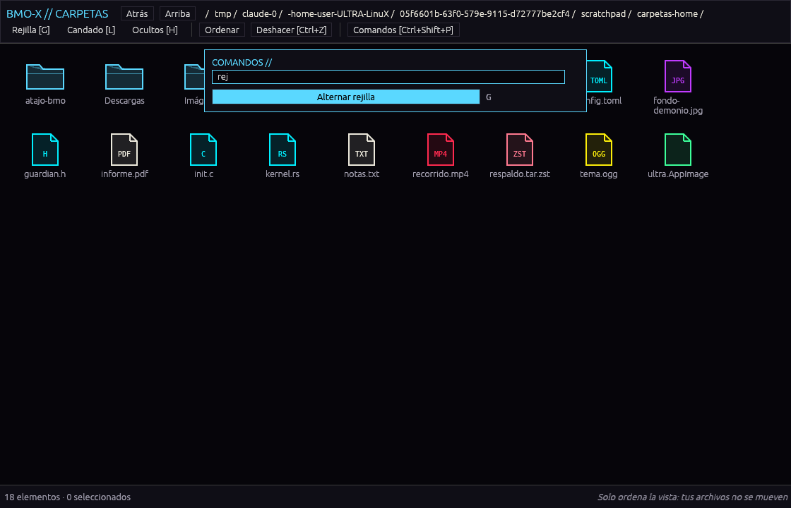

**Ctrl+Shift+P** abre la paleta. Escribe unas letras en orden ("rej" encuentra
*Alternar rejilla*, "ordtam" encuentra *Ordenar por tamaño*), muévete con las
flechas y ejecuta con Enter; Esc cierra. Busca también por id (`carpetas.candado`).
Cada botón, atajo y fila de la paleta es el mismo **comando**: una sola tabla
(`COMANDOS` en el núcleo) con id, título y atajo.

## Tres modos que se combinan: explorador, iconos y grafo

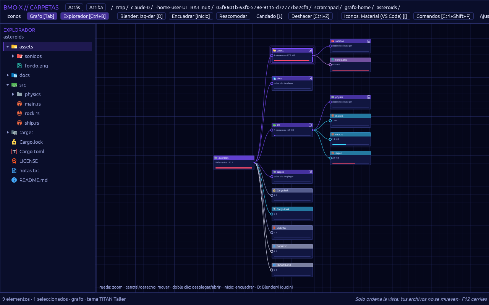

*Captura real: tema TITAN Taller, iconos Material, grafo Blender con `assets` y `src`
desplegados con doble clic. El explorador de la izquierda se abrió solo.*

- **Explorador** (Ctrl+B): árbol lateral como el de VS Code y el de tu TITAN. El
  triángulo despliega, el clic selecciona y el doble clic abre. Comparte las carpetas
  desplegadas y la selección con el grafo: lo que abres en uno se abre en el otro.
- **Iconos** (por defecto): iconos libres donde tú los dejes, con rejilla y candado.
- **Grafo** (Tab): cada carpeta y archivo es un nodo, como en Blender y Houdini.
  - **Dirección** (D o Ajustes): **Blender**, de izquierda a derecha, o **Houdini**, de
    arriba abajo. Al cambiarla se vuelve al acomodo automático.
  - **Nodos:** cabecera del color de su tipo (el tema decide), conectores de entrada y
    salida, y cables curvos como los *noodles* de Blender. El botón `+`/`-` o el doble
    clic despliega la carpeta en el propio grafo.
  - **Peso:** cada nodo dice cuánto ocupa (sumando lo ya leído debajo). Su barra es la
    parte de su carpeta que ocupa; en rojo, si pasa del 60 %. Así se ve de un vistazo
    qué conviene limpiar u optimizar.
  - **Ratón:** la rueda acerca y aleja sobre el puntero; el botón central o el derecho
    mueve la vista; arrastrar un nodo lo fija a mano (Ctrl+Z deshace); arrastrar sobre el
    fondo hace una banda de selección.
  - **Teclas:** Inicio encuadra todo y Reacomodar vuelve al acomodo automático.
- **En tiempo real:** la carpeta abierta y las desplegadas se vigilan (una vez por
  segundo, en el hilo del disco). Lo nuevo aparece solo y lo borrado se va.

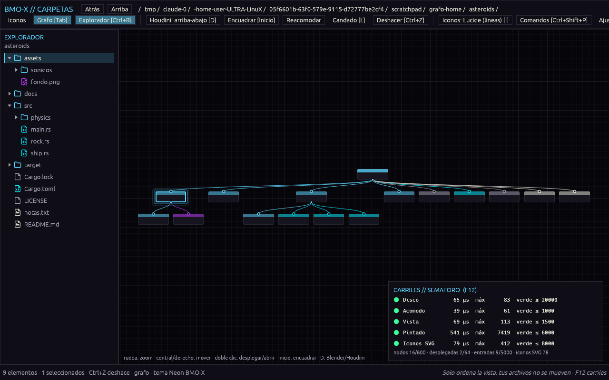

## Play y terminal (como VS Code)

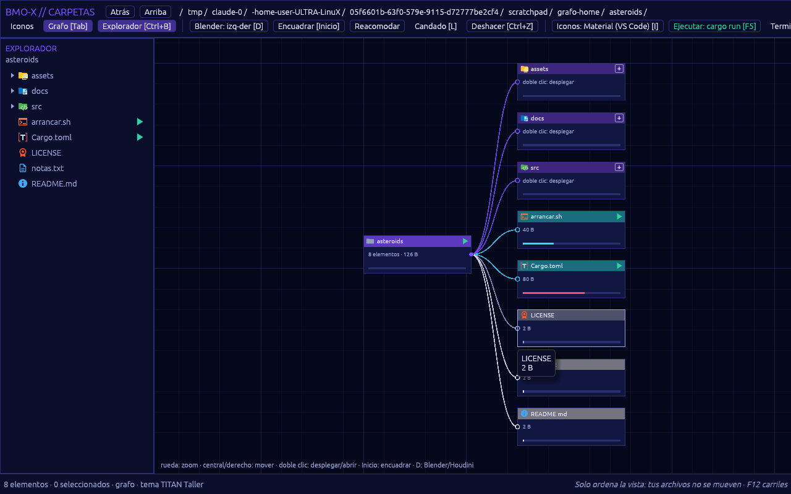

Los nodos que arrancan algo llevan un **▶ verde**: en el grafo, en el explorador, en
los iconos y, para la carpeta abierta, en la barra («Ejecutar: cargo run [F5]»).

| Nodo | Qué ejecuta |
| --- | --- |
| Carpeta con `Cargo.toml`, `Cargo.toml` o `src/main.rs` de un proyecto | `cargo run` en la carpeta del proyecto |
| Carpeta con `Makefile`, o el propio `Makefile` | `make` |
| `*.py` | `python3 archivo.py` |
| `*.sh` | `bash archivo.sh` |

**F5** ejecuta lo seleccionado o, si no hay nada, el proyecto abierto.
**Ctrl+`** muestra u oculta la **terminal** de abajo:

- salida en vivo, con lo grave de stderr en rojo y el progreso en ámbar;
- **Detener**, que para también a los hijos (cargo → rustc → tu programa);
- **Limpiar**;
- una línea para escribir comandos (`cargo build`, `git status`, `ls -la`…).

**Reglas de seguridad:**

- Nada arranca solo: siempre hace falta tu clic o tu tecla.
- Los ▶ usan una lista cerrada de programas (`cargo`, `make`, `python3`, `bash`).
- Nada pasa por una shell, tampoco la línea de comandos: son palabras sueltas, sin
  tuberías, `;`, comodines ni sustituciones. `ls ; rm -rf ~` es `ls` con argumentos
  raros, y no borra nada.
- La carpeta de trabajo se valida igual que las del disco: sin `..` ni enlaces.
- El proceso no recibe entrada (stdin cerrado) y corre en su propio grupo.
- Se ve sin colores ANSI (`NO_COLOR`, `CARGO_TERM_COLOR=never`). La terminal limpia
  los códigos de control.
- Un proceso a la vez, como mucho 512 líneas por cuadro y 2000 guardadas.

Esto no es un emulador de terminal completo: no hay programas interactivos (`vim`,
`htop`) ni tuberías. Para eso sigue `foot`.

## En vivo: procesos, errores atrapados en los nodos y editor (clic derecho)

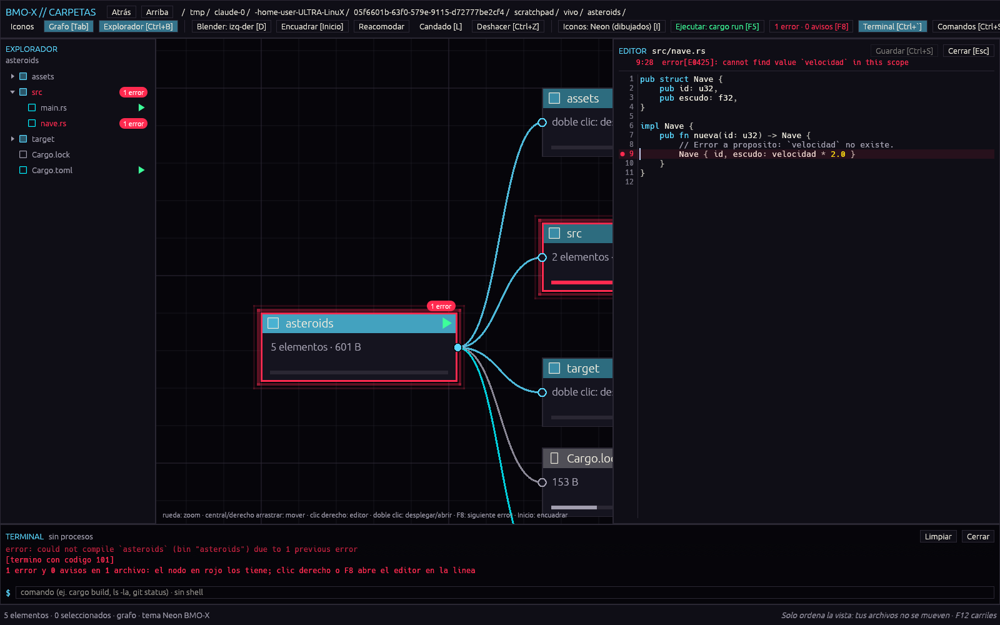

Las tres capturas son del programa real en la pantalla virtual (Vulkan por software),
con ratón y teclado simulados. Primero se ejecutó `cargo run` en un proyecto con un
error a propósito. Después, clic derecho en el nodo rojo, corregir la línea en el
editor, Ctrl+S y F5. Al final, otro proyecto que gasta CPU, para ver sus procesos.

**Errores atrapados en los nodos, sin buscar números.** Mientras corre el proceso se
lee su salida línea a línea:

- rustc y cargo (`error[E0425]` y su `--> src/nave.rs:9:28`);
- los panics de Rust (`thread 'main' panicked at src/nave.rs:42:13:`);
- gcc y clang (`main.c:12:7: error:`);
- los tracebacks de Python (`File "juego.py", line 8`).

Cada error se pinta en el **nodo de su archivo**:

- anillo rojo en la GPU (amarillo si es solo un aviso);
- una insignia con la cuenta ("2 errores");
- el mismo color y la insignia en el explorador y en el modo iconos;
- las carpetas de encima cuentan lo que tienen dentro, así que el rojo sube hasta
  la raíz;
- si el archivo estaba dentro de una carpeta plegada, el camino **se despliega
  solo** (una vez: si lo vuelves a plegar, se respeta).

Pasa el ratón sobre un nodo para ver el primer mensaje.

| Cómo | Qué hace |
| --- | --- |
| **Clic derecho** en un nodo, fila o icono | Abre el **editor** en la línea del error (en una carpeta, en su primer error) |
| **F8** o el botón rojo de la barra | Va al siguiente error y lo abre en el editor |
| Clic en una línea de la terminal | Las que apuntan a un archivo (`--> src/main.rs:3:5`) son enlaces |
| **Ctrl+S** / **Esc** | Guardar / cerrar el editor (con cambios sin guardar, avisa y hay que pulsar Esc otra vez) |
| Ajustes > Errores | **Parar el proceso en el primer error atrapado** (como «break on error») |

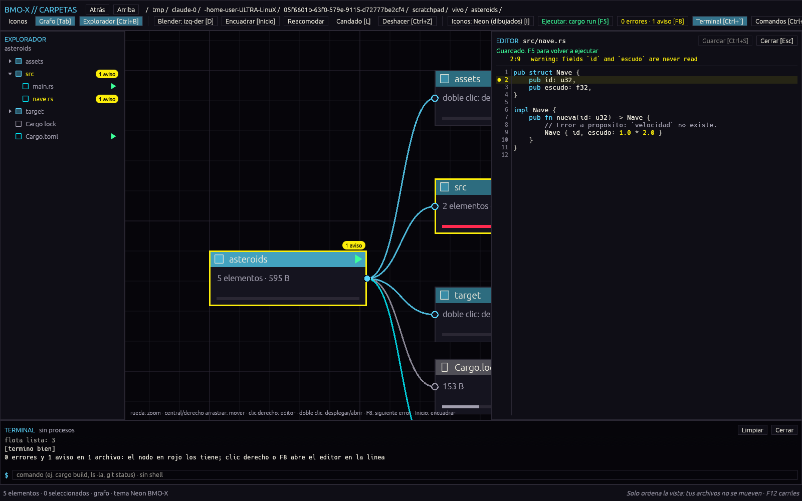

**El editor** colorea el código con los colores de tu tema: Rust, C/C++/JS/WGSL,
Python, shell y TOML. Muestra números de línea; las líneas con error llevan una
franja roja y un punto, y el mensaje sale al pasar el ratón. Arriba está la lista
de errores del archivo, con clic para saltar. Al volver a ejecutar, la lista se
actualiza sola.

**Reglas del editor:**

- Abre solo archivos que el disco listó, de hasta 2 MiB y solo texto UTF-8 (un byte
  NUL = binario, no se abre).
- Ninguna ruta pasa por un enlace simbólico, ni en las carpetas de encima.
- Se comprueba que el archivo abierto es el que se miró (dispositivo + inodo).
- Guardar es atómico (temporal + `rename`) y conserva los permisos.
- **Si el archivo cambió en disco** desde que lo abriste (otro editor, `git
  checkout`), no lo pisa y te avisa.
- Nunca guarda solo: solo con Ctrl+S o con el botón.

### Pestañas y buscar y reemplazar

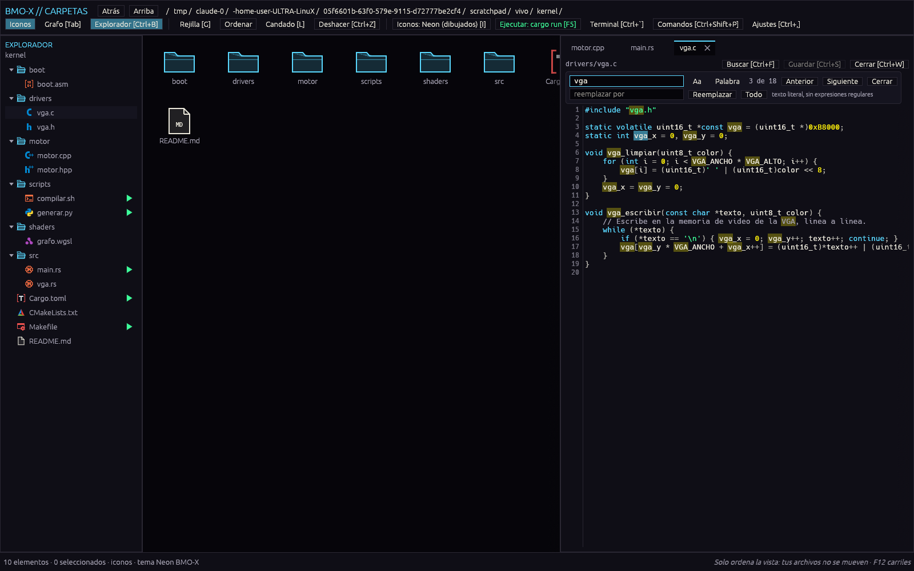

| Tecla | Qué hace |
| --- | --- |
| Clic derecho, F8 o un enlace de la terminal | Abre el archivo en **una pestaña nueva**, o trae al frente la que ya lo tiene |
| **Ctrl+Tab** / **Ctrl+Shift+Tab** | Siguiente / anterior pestaña |
| **Ctrl+W**, la X o clic central | Cerrar la pestaña (si tiene cambios, avisa la primera vez) |
| **Ctrl+F** | Buscar; vuelve a poner lo último que buscaste |
| **Ctrl+H** | Buscar y reemplazar |
| **Enter** / **Shift+Enter**, **F3** / **Shift+F3** | Siguiente / anterior coincidencia |
| **Aa** / **Palabra** | Distinguir mayúsculas / solo palabras enteras |
| Reemplazar / **Todo** | Esta coincidencia / todas de una vez (Ctrl+Z en el editor lo deshace en un paso) |
| **Esc** | Cierra la búsqueda; otra vez, la pestaña |

**Pestañas:**

- Cada una lleva el logo de su lenguaje y una insignia roja si tiene errores.
- Si tiene cambios sin guardar, muestra un punto amarillo, como VS Code. El punto
  se va solo si deshaces hasta lo que hay en disco: se compara con una huella de lo
  guardado.
- Caben 12. Al abrir la 13.ª se recicla la más vieja **sin cambios**; si todas
  tienen cambios, no se abre y te avisa. Nunca se pierde nada.
- Cada pestaña guarda su propia huella de disco, así que guardar una nunca pisa un
  archivo que otro programa cambió.

**Búsqueda:**

- Marca todas las coincidencias, y la actual más fuerte.
- Elegir una coincidencia la selecciona y la centra sin quitarte el foco del cuadro
  de buscar.
- Sin «Aa» también encuentra ñ y tildes (`ñandú` = `ÑANDÚ`).
- Es texto literal, sin expresiones regulares, y marca como mucho 10 000
  coincidencias (si hay más, lo indica con un «+»).
- Vuelve a buscar sola cuando tecleas o cambias de pestaña.
- Reemplazar no deja pasar el límite de 2 MiB.
- Todo está en el núcleo `no_std`, con pruebas.

El coloreado conoce C++ (`class`, `template`, `namespace`, `constexpr`,
`nullptr`…) y las directivas `#include`, `#define` y `#pragma`.

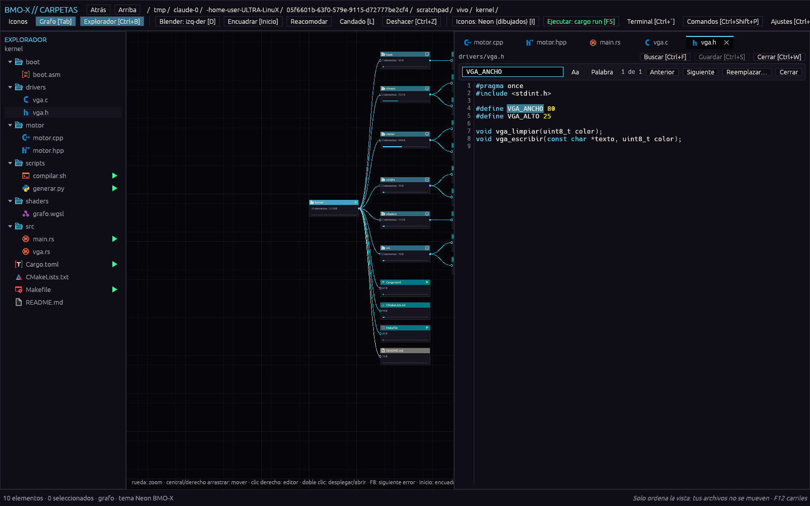

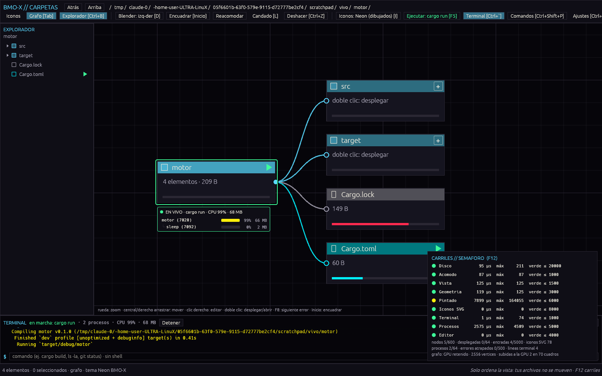

**Procesos en vivo.** Al darle a play, el nodo que se ejecuta lleva un borde verde y
una tarjeta **EN VIVO**:

- el árbol real de procesos (cargo → rustc → tu programa → sus hijos);
- la CPU de cada uno, donde 100 % es un núcleo lleno y amarillo pasa del 90 %;
- su memoria (RSS).

Lo lee de `/proc` un hilo propio cada 500 ms. Solo mira el grupo de procesos del
play (el mismo que para «Detener»), y como mucho 64 procesos. No es un monitor de
todo el sistema: es tu programa y lo que lanza.

`cargo run` no aparece como padre en la captura porque cargo, en Linux, se reemplaza
por tu programa (`exec`); mientras compila, se ven cargo y sus rustc.

**Sin rehacer nada de más.** La salida de la terminal, las muestras de `/proc` y
teclear en el editor no rehacen la geometría del grafo. Solo un error nuevo en un
nodo la rehace, porque el nodo cambia de color. En la captura hay 2 subidas a la GPU
en 70 cuadros, con la terminal escribiendo y `/proc` muestreando.

La terminal solo dibuja las filas que se ven (hasta 2000 guardadas). El texto
coloreado del editor se guarda en caché por huella: un cuadro sin teclear no vuelve
a colorear nada. Los archivos de más de 256 KiB se editan sin colores, para que el
carril Editor siga en verde.

## Todo el proyecto: Ctrl+P, buscar en el proyecto y enfocar

Hasta ahora solo se veía lo desplegado. Ahora un hilo propio **indexa la carpeta
abierta entera** al abrirla:
- sin seguir enlaces;
- saltando `.git`, `node_modules` y las carpetas de build generadas (las que tienen
  `CACHEDIR.TAG`, `build.ninja` o `CMakeCache.txt`).

Con eso se puede buscar en todo, no solo en lo abierto. Se probó con la estructura
**real de Chromium** (commit `4f4983c8c934`): **509 418 archivos y 46 035
carpetas en ~1 s**.

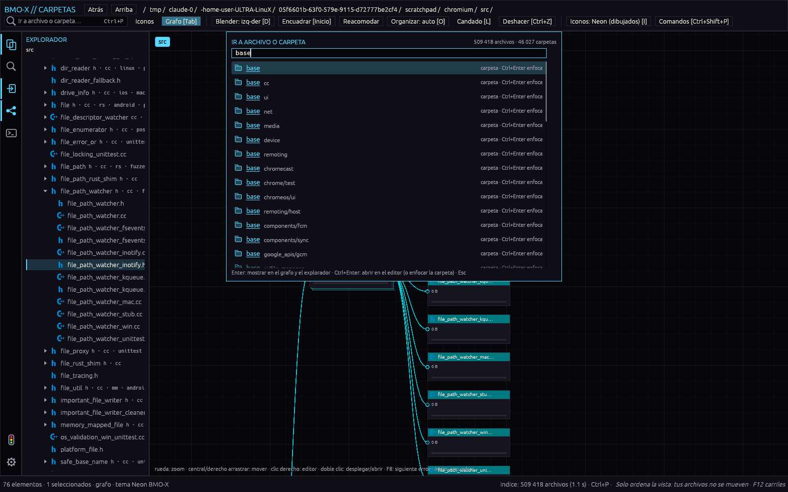

**Ir a archivo o carpeta (Ctrl+P, o el cuadro de arriba a la izquierda).**

- Búsqueda difusa por nombre:
  - escribe un trozo (`file_path`);
  - o las iniciales: `fpw` encuentra `file_path_watcher`;
  - o una ruta con `/`: `core/dom/node` encuentra
    `third_party/blink/renderer/core/dom/node.h`.
- La búsqueda se reparte entre los núcleos. Sobre Chromium, una consulta tarda
  ~70 ms en un núcleo.
- **Enter** lo muestra **en las dos vistas a la vez**:
  1. despliega el camino (también los grupos del organizador);
  2. lo selecciona en el explorador y lo lleva a la vista;
  3. centra el grafo o la ciudad en él.
- **Ctrl+Enter** abre el archivo en el editor; en una carpeta, la **enfoca**.
- Si pulsas Enter antes de que lleguen los resultados, espera y elige el primero.

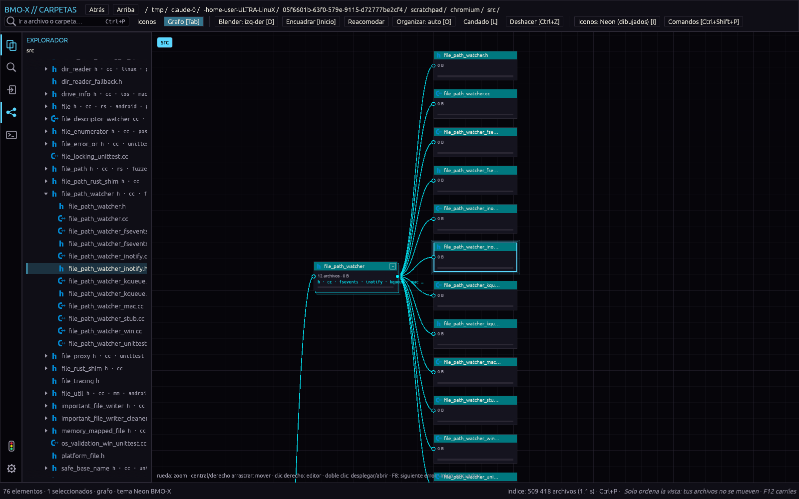

**Buscar en el proyecto (Ctrl+Shift+F, la lupa de la barra de actividad).**

- Busca texto dentro de los archivos, mientras escribes (desde 2 letras).
- Corre en un hilo propio: una búsqueda nueva cancela la anterior.
- **Aa** distingue mayúsculas; **ab** busca solo palabras enteras.
- Filtro de archivos: `*.cc, *.h`, `src/` o `!third_party/` para excluir.
- Resultados agrupados por archivo, con la coincidencia marcada.
  - Clic en una línea: la revela en el grafo y el explorador y abre el editor con la
    coincidencia seleccionada.
  - Los nodos y las carpetas que tienen resultados llevan una insignia («10
    resultados»).
- Se salta lo binario sin leerlo entero: imágenes, audio, comprimidos, o un byte NUL
  en los primeros 8 KB. Sobre este repositorio (2 418 rutas) busca en ~40 ms.
- Con una carpeta enfocada, busca solo dentro de ella.

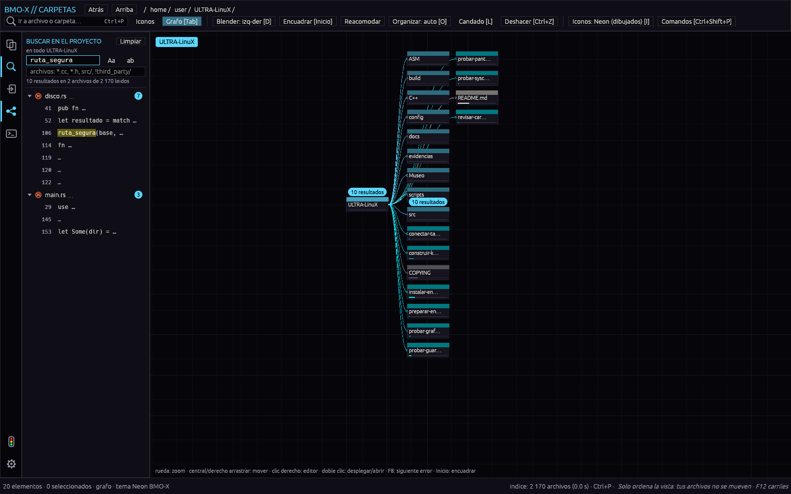

**Enfocar** (**E**, la diana de una carpeta, o Ctrl+Enter en Ctrl+P):

- La carpeta pasa a ser **la raíz** del grafo, del explorador, de la búsqueda y de
  la ciudad, así que ya no hay que mirar desde la raíz del proyecto.
- Arriba aparecen **migas de pan** (`src › base`). Clic en una para volver a ella, o
  **U** / Subir para subir un nivel.
- Se guarda por carpeta: al volver a abrirla, sigue enfocada.

## Organizar como Chromium (solo la vista)

Se midió sobre los nombres reales de Chromium cómo está organizado un proyecto
enorme, y el organizador (**O**: automático, siempre o nunca) aplica esas reglas.
Las carpetas con más de 24 archivos se agrupan en la vista; **en el disco no se
mueve nada**:

- **Unidades:** `foo.h`, `foo.cc`, `foo_unittest.cc`, `foo_win.cc`, `foo_mac.mm`…
  son una sola pieza de código, así que forman un nodo `foo` con sus piezas
  («h · cc · unittest · win»). Por ejemplo, `base_paths` reúne 15 archivos y
  `file_path_watcher` 12 (inotify, kqueue, fsevents…).
- **Build y metadatos:** `BUILD.gn`, `*.gni`, `DEPS`, `OWNERS`, `DIR_METADATA` y
  README, en un grupo al final.
- **Prefijos:** las carpetas generadas gigantes, como `generated_resources_grd` con
  3 514 archivos `IDS_*.png.sha1`, se agrupan por el comienzo del nombre en niveles.
  Si los nombres no comparten prefijos, se agrupan en rangos alfabéticos.
- **Rejilla:** cuando una carpeta tiene muchos hijos cerrados, van en columnas de 16
  en vez de una columna interminable. La raíz de Chromium (77 nodos) queda en 5
  columnas.

| Carpeta de Chromium | Archivos | Nodos organizados |
| --- | --- | --- |
| `base/files` | 93 | 28 |
| `net/http` | 294 | 109 |
| `third_party/blink/renderer/core/dom` | 383 | 198 |

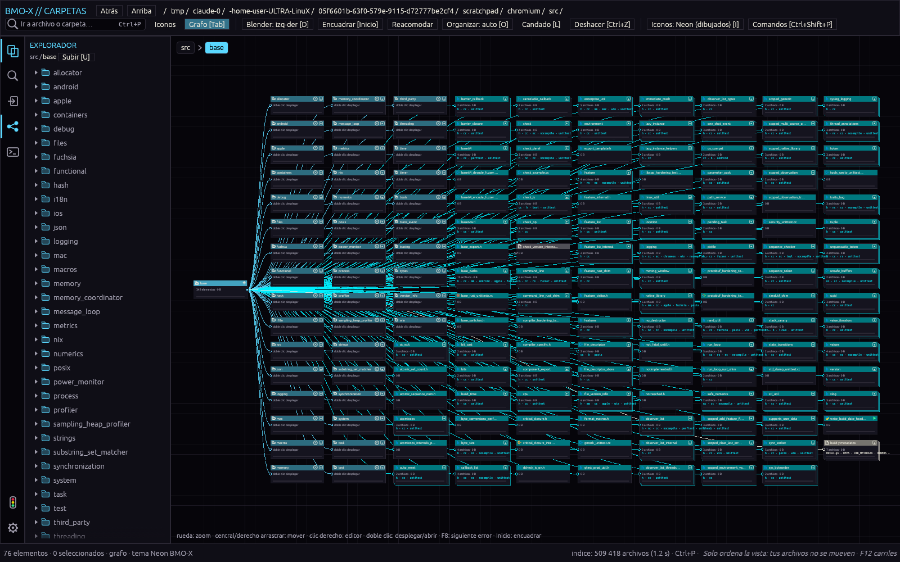

## Vista Ciudad (inspirada en CodeCity)

La tercera vista (**Tab**, o el icono de edificios de la barra de actividad) muestra
el proyecto como una ciudad en 3D: **los distritos son carpetas y los edificios
archivos**.

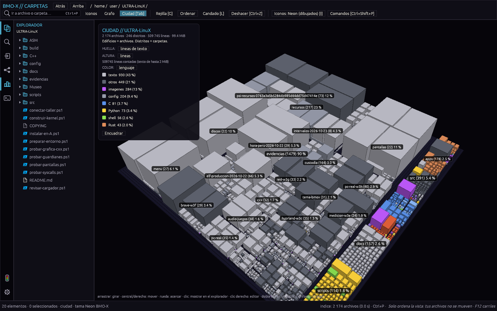

| | Qué dice | Opciones (clic en la leyenda) |
| --- | --- | --- |
| **Huella** (el área) | Cuánto ocupa | bytes, o líneas de texto (como CodeCity) |
| **Altura** | Cuánto código | líneas, cambios en git, errores y avisos, resultados de búsqueda, o plana (mapa) |
| **Color** | Qué es | lenguaje (Rust, C, cabeceras `.h`, C++, `.hpp`, Python…), calor (cambios en git), edad (último cambio), salud (rojo: errores; amarillo: avisos; verde: sin errores conocidos) o búsqueda |
| **Distritos** | Carpetas anidadas | en terrazas, con su nombre, archivos y **% del total** |

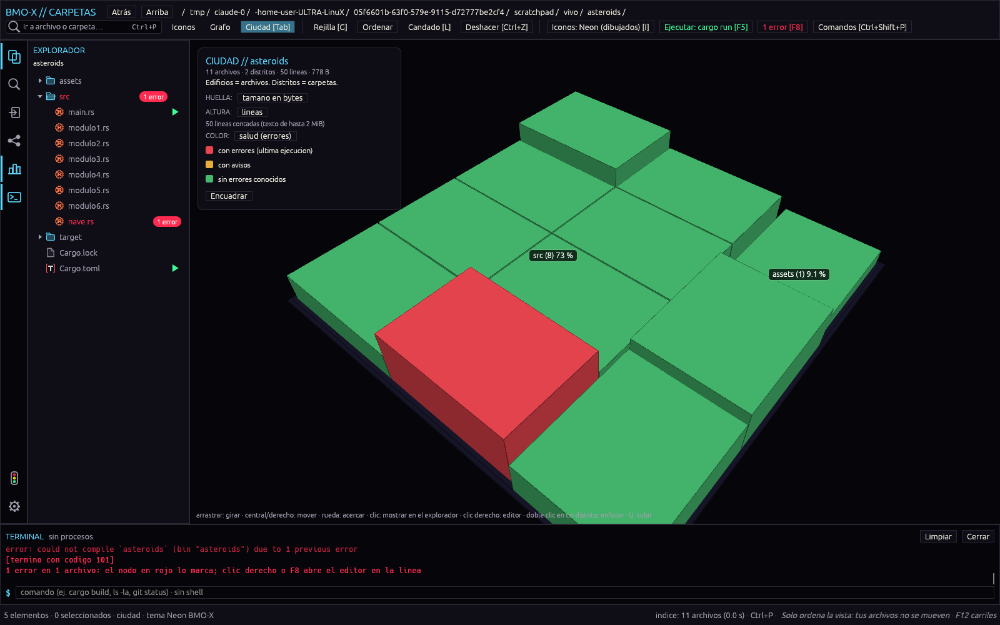

**Cómo se arma:**

- **Treemap squarified** (Bruls et al., 2000) en el núcleo `no_std`: las áreas son
  proporcionales y nada se pisa, y hay pruebas que lo comprueban. La raíz cuadrada
  es de Newton, porque `no_std` no tiene biblioteca matemática.
- Las **líneas** se cuentan en otro hilo, en los archivos de texto de hasta 2 MiB,
  con un presupuesto de 1 GiB o 20 s. Hasta que terminan, se estiman por tamaño y la
  ficha lo dice. Las imágenes y los binarios no tienen líneas, así que quedan bajitos
  y no parecen código.
- **Proyectos enormes:** las carpetas hondas se juntan en **bloques** grises (clic:
  entrar) hasta que caben 60 000 edificios, sin perder ningún archivo en la cuenta.
  Chromium entero son 43 416 edificios y 1 489 distritos.
  - Juntarlos tarda 0,26 s: rutas en orden alfabético y búsqueda binaria de la
    profundidad, antes 3,3 s.
  - El treemap tarda ~55 ms y solo se rehace al cambiar los datos.

**En la GPU** (wgpu/Vulkan, con búfer de profundidad):

- Cada edificio es una **instancia de 40 bytes**. El cubo lo arma el shader con el
  número de vértice: 36 por caja.
- Girar, acercar o mover la cámara solo manda **80 bytes**.
- Los bordes de cada cara se oscurecen un poco, así que edificios iguales y pegados
  se distinguen.

**Ratón:**

| Acción | Qué hace |
| --- | --- |
| Arrastrar | Girar la cámara |
| Botón central o derecho, arrastrando | Mover la cámara |
| Rueda | Acercar o alejar |
| Pasar por encima | **Ficha**: tamaño, líneas, % del distrito y de toda la ciudad, errores y resultados |
| Clic | Mostrar el archivo en el explorador (y en el grafo) |
| Clic derecho | Abrirlo en el editor |
| Doble clic en un distrito | Enfocarlo: la ciudad pasa a ser esa carpeta |
| Ctrl+P | Además de revelar el archivo, lleva la cámara a su edificio |

### Historia de git: puntos calientes

En un proyecto gigante nadie lee todo, pero **git ya sabe dónde se trabaja**. Un
archivo **grande** que **cambia mucho** es un *punto caliente*: ahí se concentran el
trabajo y los fallos, y es lo primero que conviene mirar para optimizar o partir.
La idea es de Adam Tornhill, *Your Code as a Crime Scene*.

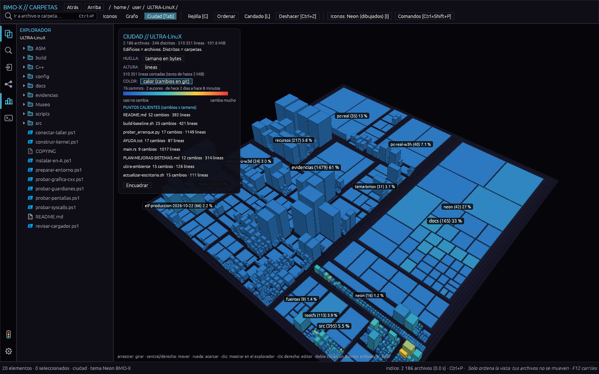

- **Color: calor.** De azul (casi no cambia) a rojo (cambia todo el rato).
  - La leyenda lista los **puntos calientes**: cambios × tamaño. Mandan los cambios;
    el tamaño pesa con su raíz cuarta, así que un archivo enorme que cambió una vez
    no tapa a uno mediano que cambia siempre.
  - Clic en uno: se revela en el explorador y la cámara va a su edificio.
- **Color: edad.** El último cambio en el color del acento si es reciente; apagado
  si hace tiempo que nadie lo toca.
- **Altura: cambios en git.** Lo que nunca se tocó queda plano y lo que se trabaja
  sube.
- La **ficha** de cada edificio añade, por ejemplo, «3 cambios en git · último hace
  4 horas · 1 autor». Una carpeta o un bloque suman lo de dentro.

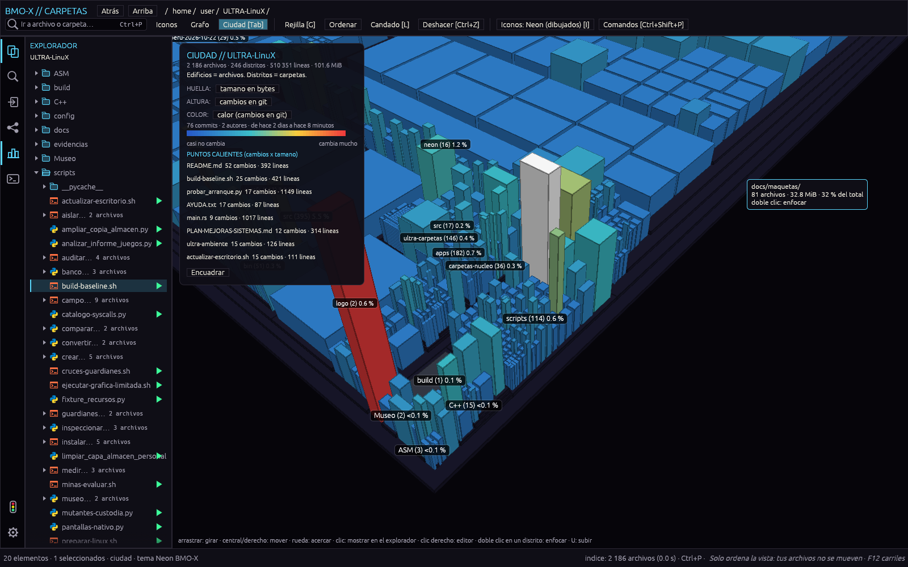

**Seguridad y límites** (carril **Git**, en su propio hilo):

- Ejecuta `git log` sin shell y **solo lee**:
  - nunca pide claves (`GIT_TERMINAL_PROMPT=0`);
  - no toma bloqueos ni reescribe el índice de git (`GIT_OPTIONAL_LOCKS=0`);
  - con las firmas y `core.fsmonitor` apagados, un repositorio ajeno no puede hacer
    que se ejecute otro programa al leer su historia.
- Lee como mucho los últimos 20 000 commits (Chromium tiene ~1,5 millones), 30 s y
  256 MiB de salida. Si corta, la leyenda dice «solo los últimos».
- Las rutas son relativas a la carpeta abierta (`--relative`). Se descartan las
  absolutas o con `..`, y los commits de fusión.
- Si la carpeta no es un repositorio, o git no confía en ella (`safe.directory`), la
  leyenda lo dice en vez de inventar datos.

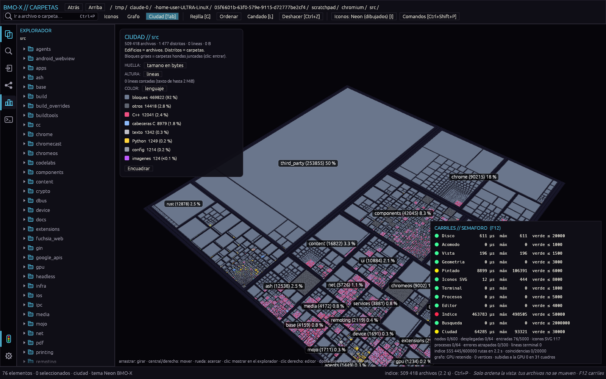

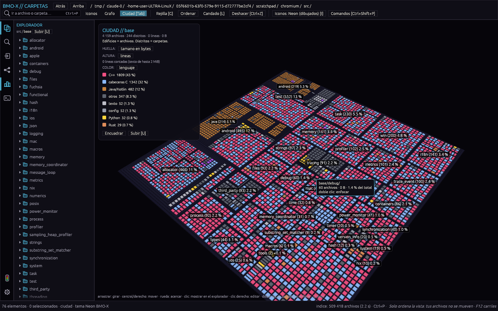

La copia de Chromium de estas capturas tiene la estructura real con archivos vacíos,
así que todas las alturas son iguales. Los nombres, carpetas, porcentajes de archivos
y lenguajes son los de verdad. En un Chromium completo, las alturas y huellas
saldrían de sus líneas y bytes reales.

## SUPER GRAFO: el museo en tu código y el fallo conectado

Con un proyecto gigante el problema no es ver un error, es saber **de dónde viene** y
**hasta dónde llega**. El SUPER GRAFO junta tres cosas:

1. **El museo en tu código.** Las fichas del [museo de C, C++ y ASM](../Museo/README.md) y del
   [banco de C](MUSEO-UB.md) (43 fichas, generadas desde sus catálogos con
   `scripts/fichas-carpetas.py`; `--comprobar` falla si se desfasan) buscan su patrón en el
   código del proyecto. Hay 32 con detector:
   - **C:** `free(p + 1)`, VLA.
   - **C++:** `string_view` sobre un temporal, referencia a un `vector` que crece, `new[]`
     con `delete`, `volatile` entre hilos, `f(i++, i++)`.
   - **UB:** `INT_MAX + 1`, `/ 0`, `1 << 31` en C, `a[4]` y `for (i = 0; i <= N; …)`,
     devolver `&local`, alias y alineación, `i = i++`, `isdigit(*s)`, `va_arg(ap, char)`,
     `setjmp`, `*(int *)0`, `strncpy` sin el cero final, `memcpy` solapado,
     `volatile` con hilos.
   - **ASM:** pila desalineada al `call`, registros de la ABI sin guardar, clobbers que
     faltan (`cpuid` sin rbx), `asm("" ::: "memory")` como si fuera una barrera de la
     CPU, `div` sin preparar rdx.
2. **Quién usa a quién.** `#include`, `mod`/`use` de Rust, `import` de Python y
   `%include`/`.include` de ASM, resueltos contra el índice del proyecto.
3. **El fallo conectado.** Con los errores del compilador y las sospechas del museo:
   - **Causa probable:** falla y nada de lo que usa falla. Rojo neón en tres capas con
     borde blanco dentro.
   - **Falla:** consecuencia probable, porque usa algo que también falla. Rojo y blanco.
   - **Arrastra:** usa algo que falla y se puede romper con él. Rojo suave.
   - Una sospecha del museo está escrita en el propio archivo: ese archivo siempre es
     causa propia. Solo un error del compilador puede ser consecuencia de otro archivo.
   - **Cables rojos con un hilo blanco** van de lo que falla a quien lo usa.

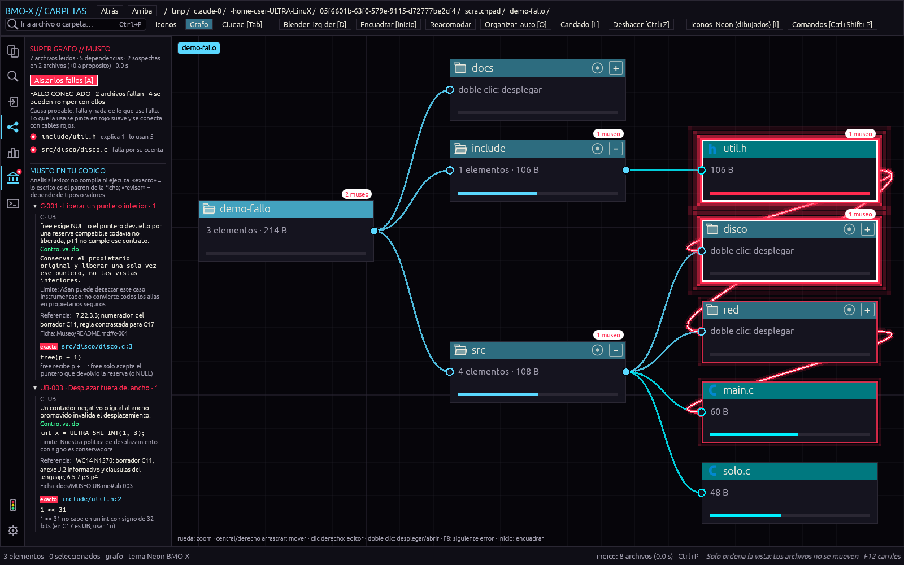

**Aislar (A o el botón del panel).** Apaga todo lo que no está conectado con los
fallos. Con algo seleccionado, aísla ese archivo, grupo o carpeta: lo que usa en blanco y
quien lo usa en rojo suave. En la Ciudad pasa lo mismo: la causa en blanco, lo que falla en
rojo neón y lo que arrastra en rojo oscuro.

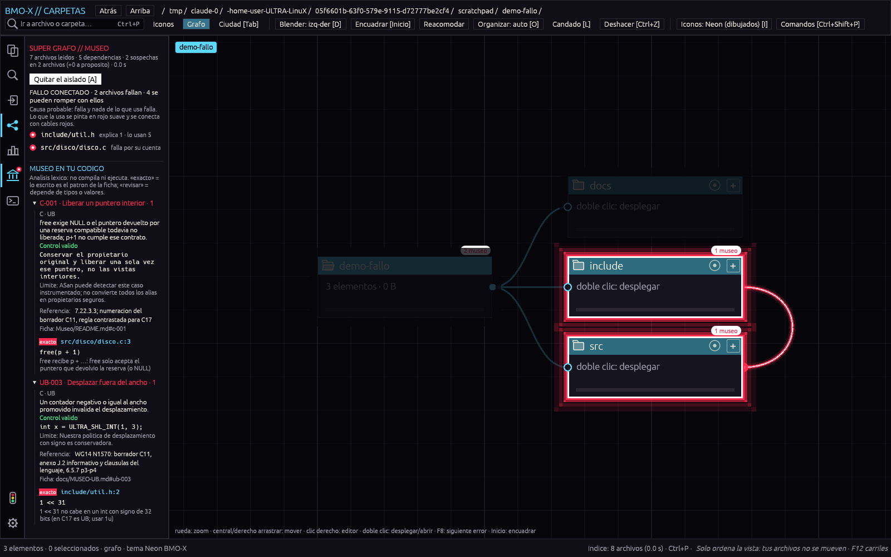
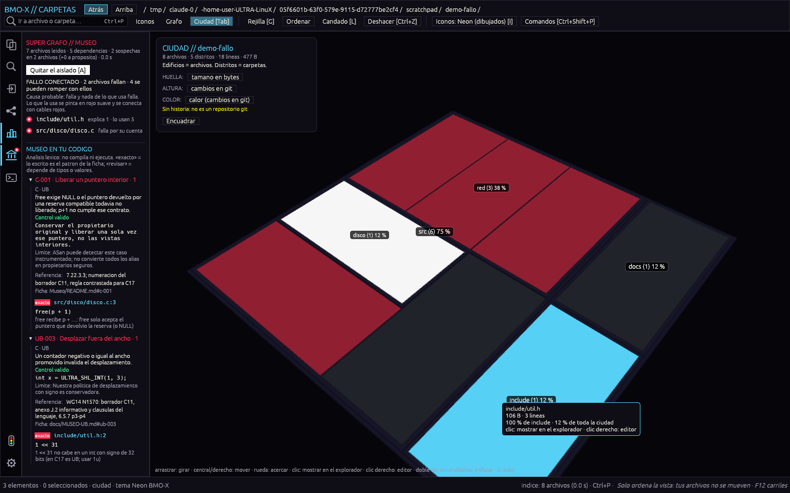

**Panel Museo** (el icono del museo en la barra de la izquierda; lleva un punto rojo si
algo falla):

- Arriba, las causas probables: «explica N» dice cuántos de los que fallan dependen de
  ella y «lo usan M», a cuántos archivos llega.
- Debajo, cada ficha con su **regla**, su **control válido**, su **límite** y su
  **referencia**, y los sitios exactos. Clic en un sitio: se abre el editor en esa línea.
- Las insignias blancas con letras rojas («3 museo») salen en los nodos y en el
  explorador.

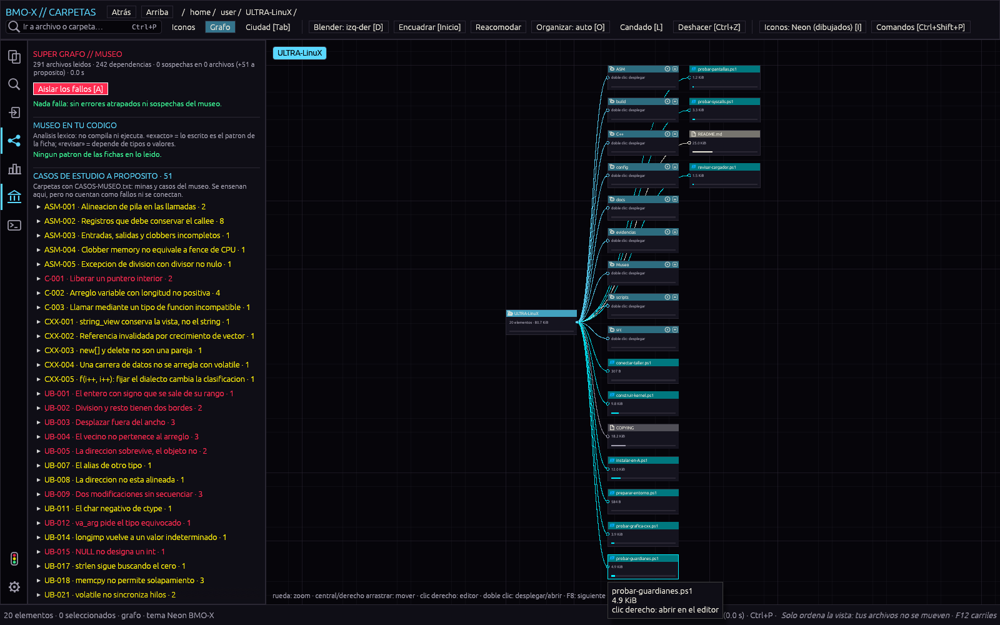

**Casos de estudio a propósito.** Una carpeta con `CASOS-MUSEO.txt` (aquí: el
laboratorio del guardián, `ASM/laboratorio` y los casos de prueba del museo) tiene código
malo **a propósito**. Sus sospechas se enseñan aparte, en «Casos de estudio», pero no
cuentan como fallos ni se conectan. Borrar el archivo hace que vuelvan a contar.

**Cómo se comprobó que detecta bien:**

- Cada ficha con detector tiene su carpeta en `carpetas-nucleo/tests/datos/museo/` con
  `mal.*`, el patrón más corto, y `bien.*`, el control válido de la ficha. La prueba exige
  que `mal` salte con esa ficha y que `bien` no salte con ninguna.
- **Este repositorio:** salta en las minas a propósito del laboratorio (`minas.c`,
  `minas-compilacion/`) y en las tres funciones malas de `ASM/laboratorio/abi.S`
  (`ultra_abi_bad`, `ultra_abi_bad_alignment`). No salta en las buenas
  (`ultra_abi_probe`, `ultra_abi_good`).
- **Chromium real** (`base/` y `third_party/zlib`: 3 179 archivos de C, C++ y ASM, 25 MiB):
  - Revisé a mano cada sospecha y corregí los falsos positivos que salieron: nombres
    repetidos entre funciones, `CheckedNumeric % 0`, el `cpuid` que guarda rbx con
    `xchg`, `it = v.erase(it)`, ramas `if`/`else`, `volatile` local y `std::set`.
  - Quedan 15 sospechas. Entre ellas hay aciertos, como el iterador invalidado que
    Chromium prueba a propósito con `EXPECT_DCHECK_DEATH` o `isdigit(argv[..][0])`.
- **Carril Museo en Chromium `base/`:** 3 324 archivos (25,7 MiB) en 1,6 s en su hilo y
  16 268 dependencias resueltas. Conectar los fallos tarda 7 ms. La causa número 1 es
  `base/numerics/safe_conversions_impl.h` (`*(volatile char*)0`, un fallo provocado a
  propósito): «explica 7 · lo usan 1 993».
  - Antes eran 16 312 dependencias y «lo usan 2 524». El **camino** (más abajo)
    destapó la diferencia: `#include <features.h>` (la de la libc) se resolvía como
    `base/features.h` por el final de la ruta. Ahora un `<x.h>` sin carpeta no se busca
    por el nombre: salen 44 aristas falsas, y unos 530 archivos ya no «arrastran» el fallo.

### El triángulo: Seguridad, Rendimiento y Elegancia

Cada ficha tiene un **eje** y el motivo de ese eje. Sale de
[`Museo/triangulo.json`](../Museo/triangulo.json): las fichas son de Seguridad salvo las
que ese archivo cambia, con su motivo (NOUB-002 y NOUB-003 son Elegancia; ASM-006,
Rendimiento).

- **Solo la Seguridad es un fallo.** Rendimiento y Elegancia son guías para revisar: no
  se conectan, no encienden el punto rojo y no cuentan en «Aislar». Lo comprueba
  `tests/triangulo.rs`.
- **Cuatro fichas nuevas**, cada una con su caso `mal`/`bien` aislado:

| Ficha | Eje | Qué marca | Referencia |
|---|---|---|---|
| R-001 | Rendimiento | `strlen` en la condición de un bucle (lineal pasa a cuadrático) | ISO C 7.24.6.3 |
| R-002 | Rendimiento | `std::string`/`std::vector` por valor en una definición que no lo mueve | C++ Core Guidelines F.16 |
| E-001 | Elegancia | Función de más de 100 líneas | Linux kernel coding style, 6 |
| E-002 | Elegancia | Cuatro bloques con llaves uno dentro de otro en una función (la guía pide no pasar de 3) | Linux kernel coding style, 1 |

- **En el panel Museo:** el glifo del triángulo y tres botones con su cuenta. Un clic
  filtra por ese eje (y atenúa en el grafo los nodos que no tienen nada de él); las
  fichas se agrupan por eje, con su color.
- **En los nodos:** cuando hay Rendimiento o Elegancia, un triángulo pequeño junto a la
  insignia enciende cada vértice que tiene algo (arriba Seguridad, abajo a la izquierda
  Rendimiento, abajo a la derecha Elegancia).
- **En la Ciudad:** COLOR → «triangulo». Cada edificio toma el color de su eje
  dominante (Seguridad manda); los que no tienen nada del museo quedan en gris.

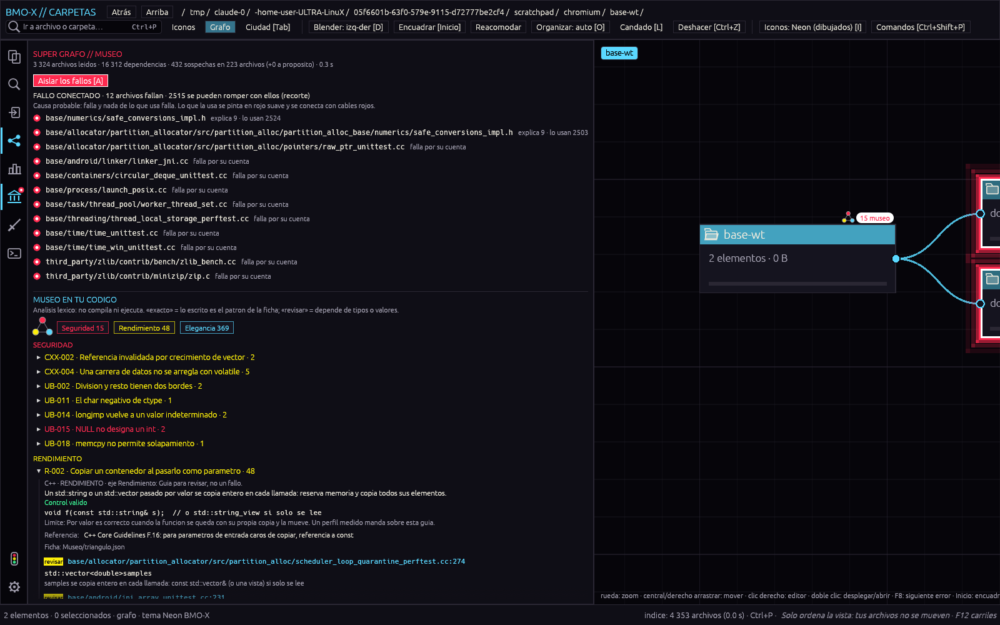
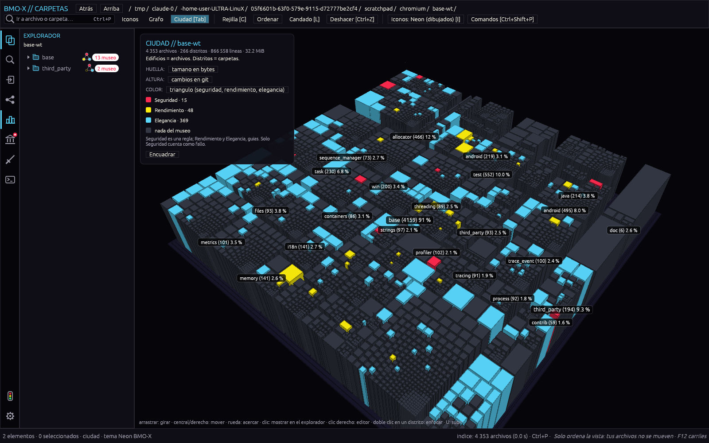

**Medido en Chromium `base/` y `third_party/zlib`:**

- Seguridad sigue en 15 sospechas y el fallo conectado en los mismos 12 archivos: las
  fichas nuevas no cambiaron nada de lo que cuenta como fallo.
- Rendimiento 48 (todas R-002) y Elegancia 369 (E-001 226 y E-002 143).
- Ajustes que salieron al revisarlo a mano:
  - R-002 empezó con 117 avisos: casi todos eran declaraciones o parámetros que se mueven
    (`std::move`). Ahora solo se mira una definición sin `move` de ese nombre.
  - `class X final {` contaba como función: los calificadores (`const`, `final`…) solo
    abren una función si van tras `)`. E-001 bajó de 237 a 226.
- **No comprobado:** que R-002 sea más lento de verdad en cada sitio (no hay perfil
  medido) ni el umbral de 100 líneas contra otro criterio. Son guías, no fallos.

### Combinar: la selección grupal en vivo

Varios edificios de la Ciudad se juntan en un **grupo**, y el panel **Combinar** (icono de
tres nodos en la barra de la izquierda; lleva el número de miembros) dibuja cómo se
conectan. Se rehace al momento, cada vez que el grupo cambia.

- **Elegir en la Ciudad:**
  - **Ctrl+clic** mete o saca un edificio (también un bloque juntado: cuenta con todos sus
    archivos).
  - **Shift+arrastrar** hace una banda: entran los edificios cuya azotea cae dentro.
  - Al juntar el segundo, el panel se abre solo.
- **En el grafo** vale la selección de siempre (la banda). Si el grupo de la Ciudad está
  vacío, el panel usa esa selección.
- **En el panel**, de un vistazo:
  - **Cable blanco con flecha:** uno del grupo usa a otro (`#include`, `use`, `import`,
    `%include`).
  - **Abajo, en el acento:** lo que **comparten**, es decir, archivos de fuera que usan dos
    o más del grupo.
  - **Arriba, en verde:** **quién los junta**, es decir, archivos de fuera que usan a dos o
    más del grupo.
  - **Sueltos:** no se tocan con ningún otro del grupo. **Piezas:** cuántos bloques
    separados forman.
  - Cada miembro lleva su **triángulo**, y el borde rojo neón si tiene algo de Seguridad.
  - Con más de 12 miembros son puntos, y solo se rotulan los más unidos.
  - Pasar el ratón enciende sus cables y apaga el resto. Clic: la Ciudad lleva la cámara
    allí. Ctrl+clic en algo compartido: entra al grupo. Clic derecho en un miembro: sale.
- **En la Ciudad**, los mismos cables encima de los edificios:
  - Los miembros, en blanco.
  - Lo compartido, en el acento; quien los junta, en verde.
  - Arcos blancos con flecha entre los que se usan.

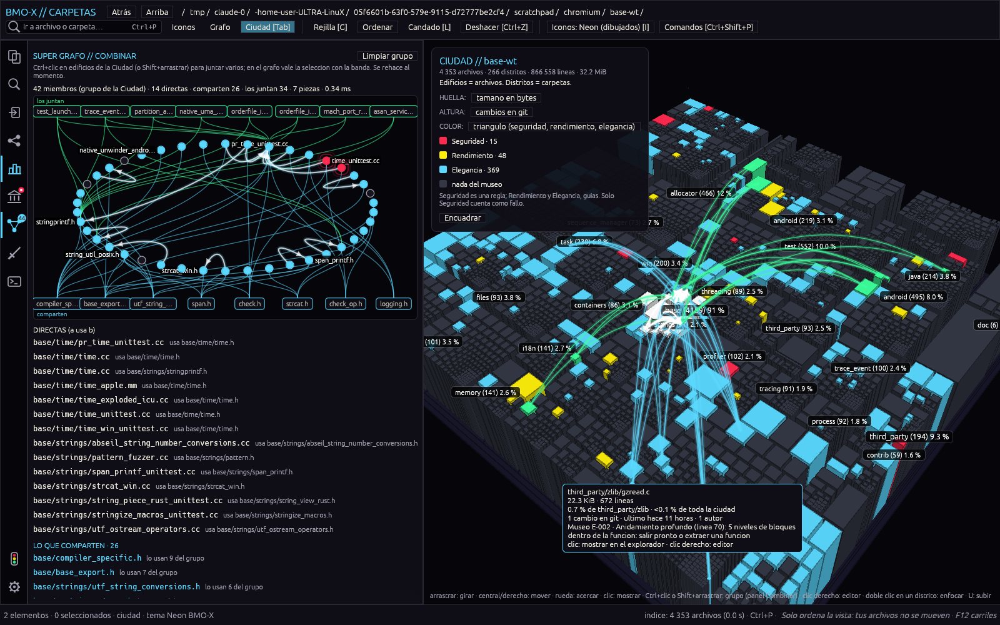
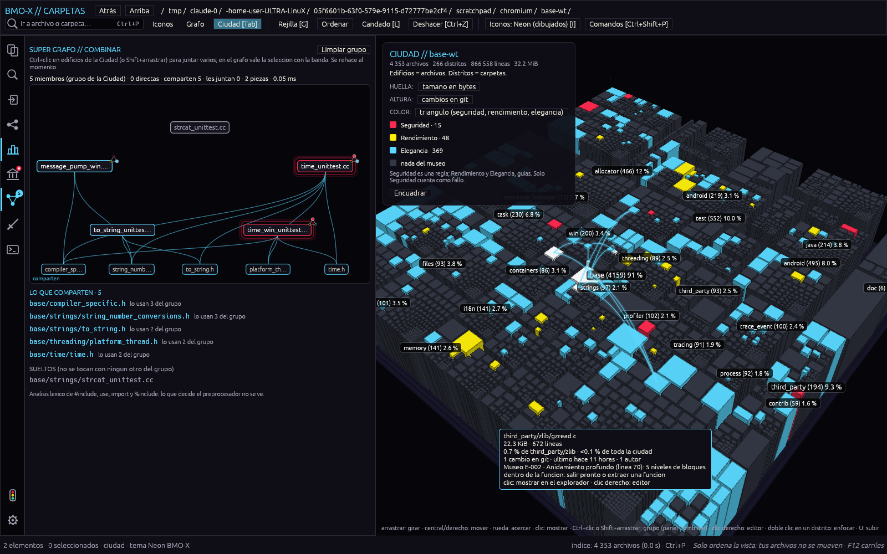

**Medido** (Chromium `base/`, 16 268 dependencias):

- Combinar 42 miembros tarda **0,34 ms**; 5 miembros, 0,05 ms. El panel enseña el tiempo
  de cada vez.
- La lógica está en el núcleo (`carpetas-nucleo/src/combinar.rs`, `no_std`). Lo comprueba
  `tests/combinar.rs`: directas, compartidos, quién los junta, carpetas, sueltos, piezas
  y el reductor del grupo.

**Límites:**

- Como mucho 64 miembros, y 8 de cada clase de puente (el total sí se cuenta entero).
- Las dependencias son las del análisis léxico: lo que decide el preprocesador
  (`#ifdef`, rutas `-I`) no se ve.
- Si un archivo y su carpeta están los dos, el archivo cuenta para el primero que entró.

### El camino entre dos elegidos: motivos, onda y dónde cortar

Con dos en el grupo (o eligiendo **A** y **B** entre los del grupo), el panel Combinar
busca **por dónde se unen** y lo explica:

- **Elegir:**
  - Ctrl+clic en la Ciudad.
  - O por nombre: **Ctrl+P, escribir y Alt+Enter** mete el archivo en el grupo sin
    moverse. Sirve para unir dos archivos que están lejos en la Ciudad.
  - Con más de dos, dos selectores eligen A y B. **Invertir** los cambia.
- **La unión más fuerte**, en este orden:
  1. **A usa B** (directa o a través de otros): si cambia B, A se recompila.
  2. **B usa A.**
  3. **Comparten X:** ninguno usa al otro, pero los dos usan X. Se elige el X más
     cercano a los dos.
  4. **Los junta X:** X usa a los dos.
  5. **Nada:** no se tocan, y el panel lo dice.
- **Por qué se ve así:** una frase con la unión, cuántos archivos hay en medio, y cuántos
  caminos igual de cortos existen (este es uno de ellos).
- **Motivos:** cada paso lleva la línea exacta que lo crea, por ejemplo
  `raw_ptr.h:52 #include "…/raw_ptr_backup_ref_impl.h"`. Clic en el paso: el editor se
  abre en esa línea.
- **Dónde cortar (para optimizar):** cada paso se quita y se vuelve a buscar.
  - **Imprescindible** (rojo neón, con marca de corte): sin él, A y B se separan.
  - Si no, el panel dice el desvío: otro camino de N saltos.
  - Cada paso dice también cuántos archivos usan al incluido (su peso). La pista final
    propone el paso imprescindible con menos peso.
  - Es una pista, no una prueba: hay que compilar para comprobarlo.
- **La animación es la onda de recompilación.** Sale de lo que cambiaría y viaja hacia
  quien lo usa, paso a paso:
  - A usa B: va de B hacia A.
  - Comparten X: sale de X y se abre hacia los dos.
  - Los junta X: entra en X desde los dos.

  El punto de encuentro late con un anillo verde, y lo imprescindible late en rojo.
  La casilla «onda» la para: entonces no se redibuja nada de más.
- **En la Ciudad:** los mismos pasos son arcos de azotea a azotea, con la flecha en el
  usado, los imprescindibles en rojo con su marca, la onda viajando, y A y B rotulados.

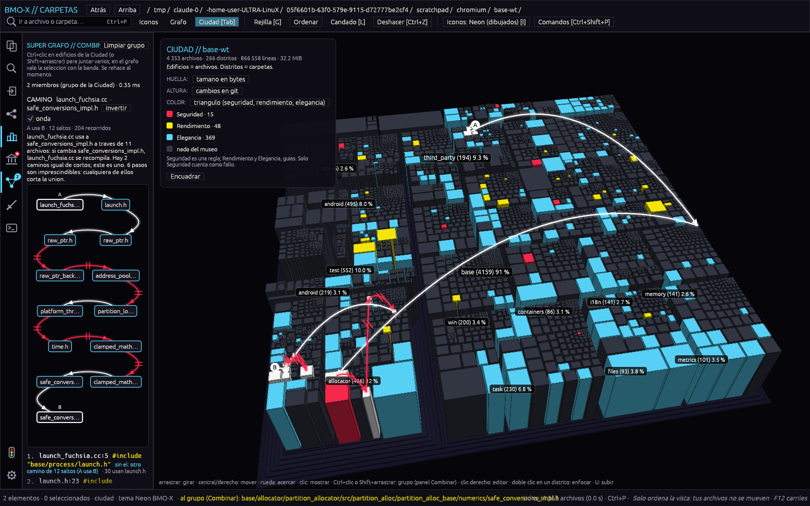
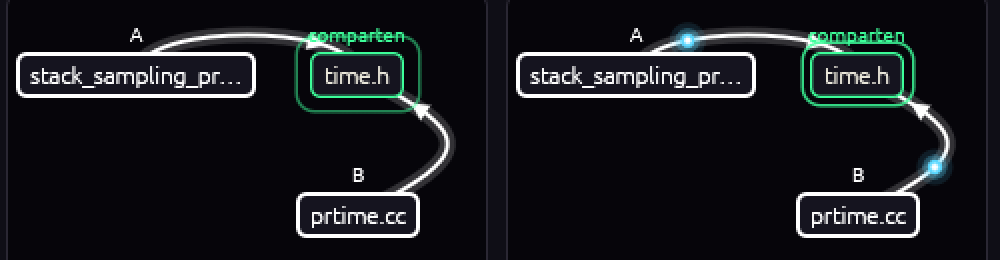

**Medido** (Chromium `base/`, prueba `medir_en_carpeta`):

- 300 pares repartidos por todo el proyecto en 32 ms; el peor, 0,53 ms (con el análisis de
  cada paso).
- Por clase de unión: usa 7, es usado 9, comparten 218, los junta 4, nada 62.
- 81 de los 300 pares tienen al menos un paso imprescindible.
- El camino más largo de la muestra tiene 12 saltos, de `launch_fuchsia.cc` a
  `partition_alloc_base/numerics/safe_conversions_impl.h`.
- Ese análisis destapó una arista falsa (`<features.h>` resuelta como `base/features.h`)
  y se corrigió en el resolvedor.

**Comprobado:**

- `tests/camino.rs` cubre las cinco uniones, el conteo de caminos igual de cortos, la
  dirección real de cada paso, los motivos, y lo imprescindible frente al desvío.
- `analiza_este_repositorio` comprueba que el motivo de `main.rs → analisis.rs` es su
  línea real (`mod analisis;`).

**Límites:**

- Es el camino más corto por número de saltos, no por coste de compilación.
- Desvío o imprescindible se miden quitando **un** paso cada vez.
- Se analizan los 16 primeros pasos; el resto sale «sin analizar».

### Ciclos de cabeceras (E-003, eje Elegancia)

`a.h` incluye `b.h` y `b.h`, por el camino que sea, vuelve a incluir `a.h`. **Compila**
(las guardas `#ifndef` lo permiten; GCC acepta los dos casos de prueba), pero ninguno se
entiende ni se prueba sin el otro. Por eso es **Elegancia, nunca un fallo de Seguridad**.

- **Dónde:** panel Museo, al principio de ELEGANCIA. La ficha **E-003** enseña qué es,
  el control válido (`struct a;` en vez de incluir, si basta un puntero), su límite y
  su referencia (C++ Core Guidelines SF.9).
- **Cómo se buscan:**
  - Las componentes fuertes del grafo (Tarjan, sin recursión: 200 000 archivos en
    cadena no desbordan la pila).
  - De cada una, la **vuelta más corta**.
  - Solo entre C, C++ y ASM: en Rust los módulos de un crate se usan entre sí sin
    problema.
- **Cada paso con su motivo** (`string_util.h:663 #include "…/string_util_win.h"`); clic,
  y el editor se abre en esa línea.
- **Dónde cortar:** el paso cuyo incluido usan menos archivos, en rojo con su marca.
- **La animación:** la onda da vueltas por el anillo sin salida, como un `#include` que
  vuelve a empezar.
- **Ver en Combinar:** mete la vuelta en el grupo. El camino dice entonces «y la vuelta
  también existe: forman un ciclo», y la Ciudad marca A y B.

**El SUPER GRAFO aprendió a leer los `#if`.** Cada `#include` guarda el `#if`, `#ifdef`,
`#elif` o `#else` dentro del que está, sin contar la guarda de la cabecera
(`#ifndef X_H` seguido de `#define X_H`). En el panel sale como «solo si #if …». Un ciclo
con un paso condicional dice «depende de un #if» y va al final. El consejo cambia: suele
ser un patrón a propósito (la parte de una plataforma al final de la cabecera).

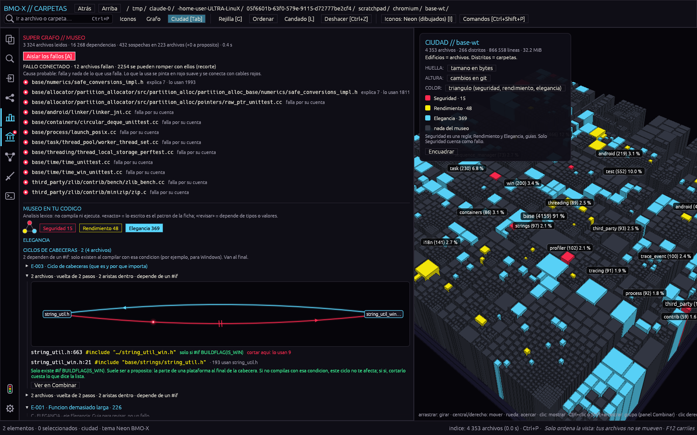
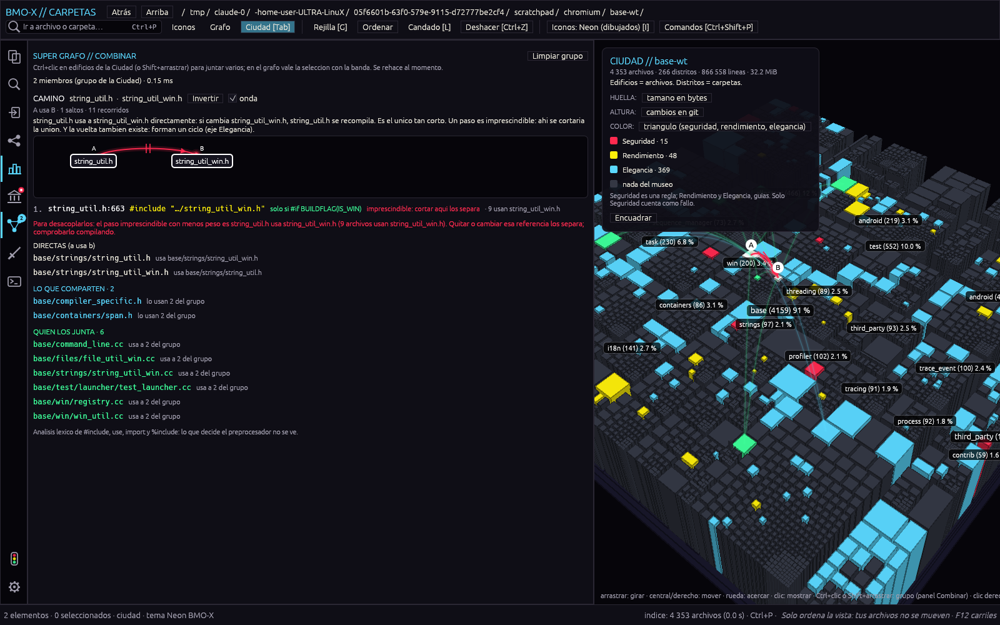

**Medido en Chromium `base/`:**

- 2 ciclos (4 archivos), en 0,4 a 0,6 ms: `string_util.h` ↔ `string_util_win.h` y
  `string_split.h` ↔ `string_split_win.h`.
- **Los dos están dentro de `#if BUILDFLAG(IS_WIN)`.** Al compilar para Linux con GCC no
  existen: Chromium `base/` no tiene ningún ciclo de cabeceras incondicional.
- 874 de las 16 268 dependencias (5,4 %) están dentro de un `#if`.

**Comprobado:** `tests/ciclos.rs`, con casos aislados en `tests/datos/ciclos/`, leídos y
resueltos como en la aplicación:

- `mal` tiene una vuelta de 3; `bien` la rompe con `struct a;`; `condicional` solo vuelve
  dentro de `#if defined(_WIN32)`. Los tres compilan con GCC (`-std=c17 -Wall -Werror`).
- Hay pruebas de varios ciclos, de Rust ignorado y de la cadena de 200 000 archivos.
- `tests/dependencias.rs` comprueba la lectura de los `#if`: la guarda, `#elif`, `#else`,
  `#ifdef`, `#pragma once`, y un `#ifndef` con código antes.

**Límites:**

- La vuelta es la más corta desde los 24 archivos más conectados de la componente; en
  una de más de 2 000, desde uno solo.
- Se calculan los 100 ciclos más grandes; el resto solo se cuenta.
- Los `#if` se leen como texto: no se evalúan (no se sabe si `BUILDFLAG(IS_WIN)` es
  cierto).
- En este repositorio salen los ciclos de los casos de prueba (`tests/datos/ciclos/`):
  `CASOS-MUSEO.txt` aparta las sospechas de las fichas, pero todavía no los ciclos.

### Del grupo a los nodos y al editor: lo que señalan, cómo arreglarlo y por dónde llega

Con un grupo elegido en la Ciudad (Ctrl+clic, Shift+arrastrar o Ctrl+P y Alt+Enter), el
panel Combinar sirve para **arreglar** y para **aprender**:

- **Lo que señalan:** todas las sospechas del museo y los errores del compilador de los
  archivos del grupo (de una carpeta, lo de dentro). Van **en el orden para arreglar**:
  1. errores del compilador;
  2. Seguridad exacta;
  3. Seguridad a revisar;
  4. avisos;
  5. Rendimiento;
  6. Elegancia.

  Cada una lleva su ficha y «qué enseña y cómo se arregla»: la regla, el control válido,
  el límite y la referencia. Clic: el editor se abre en esa línea.
- **Siguiente señal (n/total):** abre el editor en la siguiente, de la primera a la
  última, para ir arreglando una a una.
- **Por dónde le llega:** a un archivo que no falla pero se puede romper (o que falla
  por otro) se le enseña la cadena de `#include` hasta la causa probable, cada paso con
  su línea. Por ejemplo, `time.h:78 › clamped_math.h:11 › safe_conversions.h:15 ›
  safe_conversions_impl.h`.
- **Ver en el grafo:** pasa al grafo de nodos y despliega el camino de cada archivo del
  grupo, uno detrás de otro (pidiendo al disco las carpetas que falten). Los deja todos
  seleccionados, dibuja los **cables del grupo** en el acento (quién usa a quién) y
  encuadra solo lo seleccionado.
- **En la Ciudad:** los del grupo con algo de Seguridad se resaltan en rojo neón; el
  resto, en blanco.
- **Aislar el grupo:** deja solo lo conectado con los del grupo, en el grafo y en la
  Ciudad: lo que usan (blanco) y quien los usa (rojo suave), con cables de dependencia.
  En el grafo, la **A** con varios seleccionados aísla a todos juntos. El panel Museo dice
  «AISLADO · 4 elegidos · usa 109 archivos · lo usan 1 990».

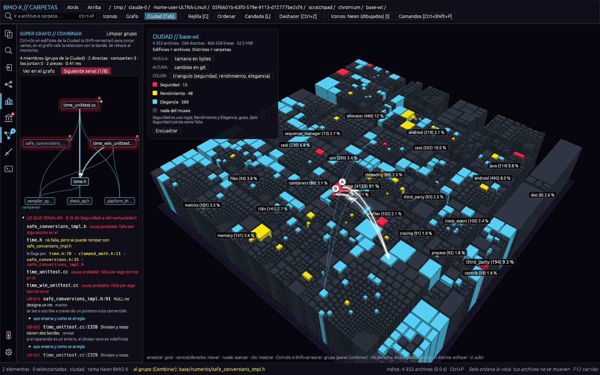
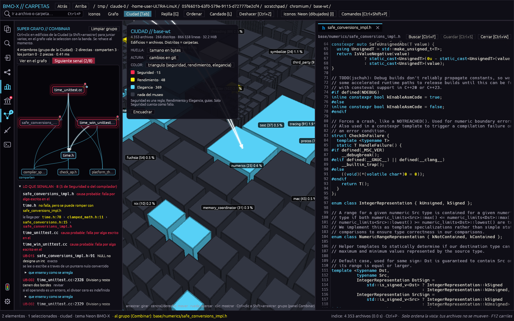
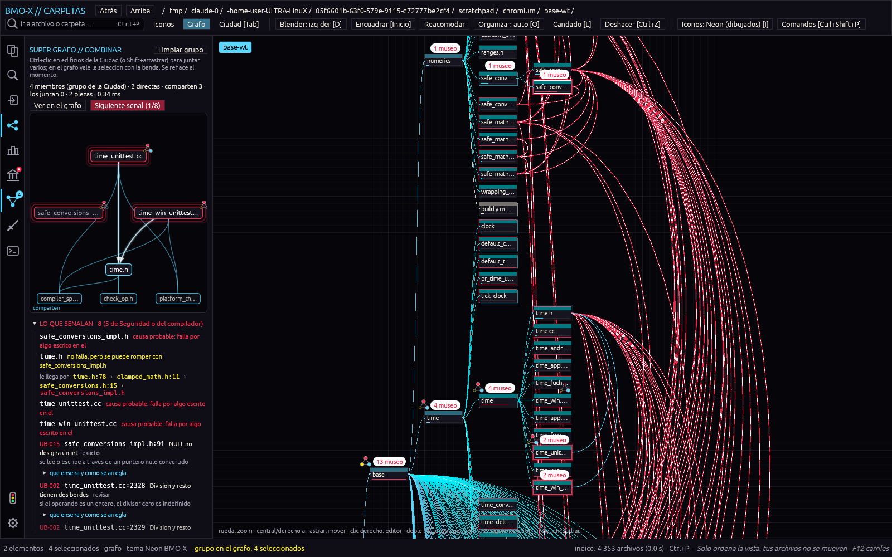
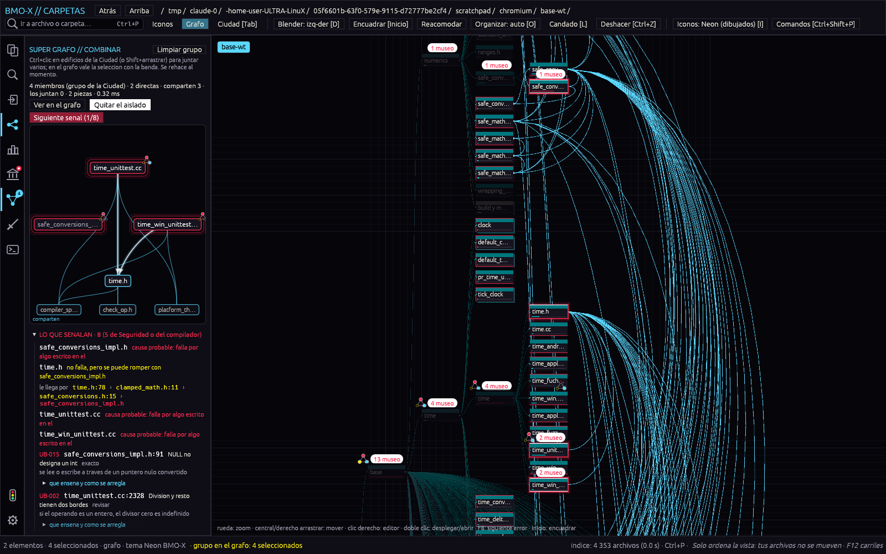

**Comprobado:**

- `tests/senales.rs`: el orden (Seguridad antes que Elegancia), el papel de cada uno y la
  cadena hasta la causa con sus líneas.
- `tests/proyecto.rs`: desde la Ciudad, «Ver en el grafo» con tres archivos en carpetas
  sin desplegar. Pide las carpetas al disco, selecciona a los tres y dibuja dos cables del
  grupo.
- La misma prueba aísla el grupo: los tres son centro, se apaga lo que no los toca, no
  queda ningún cable de fallo, y la **A** con los tres seleccionados aísla lo mismo.

**Límites:**

- Como mucho 400 señales por grupo (se dice cuántas hay) y 40 en la lista; «Siguiente»
  recorre las 400.
- Al aislar varios se calcula lo que usa y lo que usa a cada uno, y se juntan (como mucho
  20 000 archivos; si no caben, el panel dice «recorte»).

**Un fallo viejo que salió aquí:** cuando un botón de un panel lateral (Aislar, el filtro
del triángulo…) cambiaba el grafo, la geometría de la GPU se marcaba con la versión nueva
pero seguía con el dibujo viejo, y no se rehacía. Se veían los cables rojos del fallo
estando aislado. Ahora la geometría lleva la versión de la vista de la que sale.

## El SUPER GRAFO sin ventana: consultas en JSON y servidor MCP

El mismo mapa contesta preguntas sin abrir la ventana, con respuestas **exactas y con
tope**: primero las cifras y lo peor; las listas llevan `limite` (10 por defecto, como
mucho 100) y dicen cuántos quedan. Así un proyecto de 4 000 archivos y uno gigante
cuestan casi lo mismo a quien pregunta (una persona, un script o una IA).

```bash
ultra-carpetas --consulta resumen  <carpeta>
ultra-carpetas --consulta camino   <carpeta> '{"a": "base/time/time.h", "b": "base/numerics/safe_conversions_impl.h"}'
ultra-carpetas --consulta peso     <carpeta> '{"ruta": "base/time/time.h", "limite": 3}'
ultra-carpetas --mcp <carpeta>     # servidor MCP por stdio (JSON-RPC 2.0)
```

**Herramientas** (las mismas en `--consulta` y en MCP):

| Herramienta | Qué contesta |
|---|---|
| `resumen` | Archivos, dependencias, sospechas por eje, fallo conectado y ciclos |
| `buscar` | Rutas por nombre, como Ctrl+P |
| `archivo` | Lo que usa y quien lo usa (con la línea de cada `#include`), sus sospechas y su papel |
| `fallos` | Las causas probables del fallo conectado: cuánto explica cada una y a cuántos llega |
| `senales` | Lo que señalan unos archivos, en el orden para arreglar, con su ficha y por dónde les llega |
| `camino` | Por dónde se unen dos archivos, con la línea de cada paso y lo imprescindible |
| `ciclos` | Los ciclos de cabeceras, su vuelta y dónde cortar |
| `peso` | Si cambia este archivo, cuántos se recompilan y por dónde se reparte |
| `combinar` | Cómo se combinan varios: directas, compartidos, quién los junta |
| `ficha` | Una ficha del museo entera |
| `gcc_diagnosticos` | La opinión de GCC sobre un archivo, en SARIF (con `-fanalyzer` si se pide) |
| `gcc_deps` | Cuánto acierta el mapa léxico frente a `gcc -MM -MG` |
| `exportar_sarif` | El museo (y lo de GCC) en un archivo SARIF 2.1.0 |
| `reanalizar` | Volver a leer la carpeta |

**MCP (Model Context Protocol)** es el protocolo abierto con el que una IA llama a
herramientas y recibe datos, no imágenes. `.mcp.json` en la raíz registra el servidor
`super-grafo` (`scripts/super-grafo-mcp.sh`, que compila el binario la primera vez). Un
cliente como Claude Code lo ofrece al abrir el repositorio, y pide permiso antes de usarlo.

- Se habla **JSON-RPC 2.0 por stdio**: `initialize` (versiones 2025-06-18, 2025-03-26 y
  2024-11-05), `tools/list`, `tools/call` y `ping`.
- stdout es solo del protocolo. Un error de una herramienta va dentro del resultado
  (`isError`); una herramienta que no existe es un error JSON-RPC.
- El análisis arranca en otro hilo: `initialize` contesta al momento.

**GCC habla en datos** (sin LLVM):

- **`gcc_diagnosticos`** compila con `-Wall -Wextra -O2 -c -o /dev/null` (no escribe nada)
  y `-fdiagnostics-format=sarif-stderr`. Con `analizador: true` añade **`-fanalyzer`**, con
  el camino paso a paso de cada problema.
  - Sus errores entran en las señales y en el fallo conectado.
  - Solo acepta flags que no escriben ni ejecutan nada: `-I` relativas, `-D`, `-std=` y `-W`.
- **En la terminal de la aplicación**, si compilas con
  `-fdiagnostics-format=sarif-stderr`, el bloque SARIF se convierte en diagnósticos de
  siempre y se marcan en sus nodos.
- **`exportar_sarif`:** las sospechas del museo, con su ficha como regla, en SARIF 2.1.0.
  - Seguridad exacta → `error`; Seguridad a revisar → `warning`; Rendimiento y Elegancia
    → `note`.
  - Lo leen GitHub y los editores sin adaptadores.

**Medido:**

- **Respuestas MCP en Chromium `base/`**, desde un cliente JSON-RPC de prueba contra el
  binario real:
  - `initialize`, 2 ms;
  - `resumen`, 197 ms (la primera espera al análisis), unos 143 tokens;
  - `camino`, 0 ms, unos 169 tokens;
  - `peso`, 1 ms, unos 117 tokens;
  - `senales`, 0 ms, unos 302 tokens.

  Una captura de pantalla son unos 1 500 tokens: cada respuesta cuesta de 5 a 10 veces
  menos y es exacta.
- **`--consulta resumen`** completo (indexar, analizar y contestar): 0,2 s con la caché de
  disco caliente; la primera vez, 6,4 s, casi todo esperando al disco.
- **El mapa léxico frente a `gcc -MM -MG`** (15 archivos de Chromium `base/`, con
  `-Ibase/allocator/partition_allocator/src`):
  - cobertura **100 %**: todo lo que GCC incluye, el mapa también lo ve;
  - precisión 55 %;
  - **sin los `#include` que están dentro de un `#if`, la precisión sube al 94 %**
    (810 de 818 aciertos).

  Casi todo el desacuerdo son ramas de plataforma o de configuración (`PA_BUILDFLAG`, que
  Chromium genera al compilar), y el SUPER GRAFO ya las distingue.
- **GCC confirma el museo:** en el caso `C-001` (`free(p + 1)`), GCC dice `'free' called on
  pointer 'p' with nonzero offset 1` (`-Wfree-nonheap-object`). Con `-fanalyzer` añade la
  fuga de memoria con sus 5 pasos.
- **El SARIF del museo de Chromium:** 432 resultados en 10 reglas: 2 `error` y 13 `warning`
  (las 15 de Seguridad), y 417 `note`.

**Comprobado:**

- Pruebas de `consultas.rs`:
  - respuestas exactas y con tope;
  - rutas fuera de la carpeta y flags peligrosas, rechazadas;
  - lectura del SARIF de GCC;
  - GCC confirmando C-001;
  - el SARIF exportado.
- Pruebas de `mcp.rs`: `initialize`, notificaciones sin respuesta, `tools/list` con sus
  esquemas, `tools/call`, errores dentro del resultado y métodos desconocidos.

**Límites:**

- Las rutas se resuelven por texto (léxico); para la verdad de una compilación concreta
  están `gcc_deps` y `gcc_diagnosticos`.
- `gcc_deps` no conoce los flags reales del proyecto: hay que pasarle sus `-I`, y sin las
  cabeceras generadas en la compilación algunas ramas `#if` no se pueden evaluar.
- Una línea SARIF de más de 64 KiB en la terminal se queda como texto.
- El servidor MCP carga el análisis en memoria al arrancar; para leer cambios, `reanalizar`.

Decisiones (triángulo Seguridad, Rendimiento y Elegancia; C con GCC en x86-64; referencias sin LLVM) y siguiente camino: [SUPER-GRAFO.md](SUPER-GRAFO.md).

**Límites:**

- Es análisis **léxico**: no compila, no evalúa `#ifdef` ni macros y no ve tipos.
  «Exacto» quiere decir que lo escrito es el patrón de la ficha; «revisar», que depende
  de tipos, valores o dialecto.
- Fichas sin detector, porque sin compilar no se verían con honestidad: UB-006, UB-010,
  UB-013, UB-016, UB-019, UB-020, ASM-006 y las NOUB.
- Las rutas de `-I` del compilador no se conocen: un `#include <x.h>` se resuelve por la
  raíz o por el final de la ruta (el más cercano a quien lo incluye).
- El ASM de 16 o 32 bits (arranque) no se juzga con la ABI de 64 bits. Una función sin
  `ret` ni salto de cola, como `_start`, tampoco.
- Presupuesto: archivos de hasta 2 MiB, 2 GiB o 60 s en total. Si corta, el panel y F12
  lo dicen.

## Taller CASM: cómo nace el .hex (SUPER GRAFO)

[CASM](../CASM/README.md) es el lenguaje propio que prepara y exporta `.hex` exacto para
x86-64 ([su rumbo de samurái](../CASM/SAMURAI.md)). El SUPER GRAFO lo entiende y se
organiza solo con lo que hay en el disco, sin listas escritas a mano:

- **Panel Taller CASM** (icono de la katana):
  - la **cadena** fuente → frontend → IR → codificador x86-64 → HEX → verificador →
    `INICIO.X86`, en verde, o con el paso donde cortó la última compilación en rojo;
  - el resumen: bytes de cuerpo, tamaño del paquete y huella;
  - las **katanas**, cada regla que corta, leída de las fuentes de CASM, con su archivo
    y línea (clic: editor) y el caso de `test.py` que la demuestra, o «sin caso aislado»;
  - las **compilaciones** de `build/CASM/run-*`.
- **Editor:** a la derecha de cada línea de un `.casm`, sus bytes y su desplazamiento
  (`metal_puts(greeting);` → `+00  48 8D 35 05 00 00 00 41 FF 57 10`). Sale **solo** si hay
  una compilación verificada de ese texto exacto, y el mapa se vuelve a comprobar
  (cuerpo completo, tramos contiguos, `LEA`/`CALL`/`RET`). Si editas sin recompilar, lo dice
  en vez de enseñar bytes viejos.
- **Play** en cada `.casm` y botón «Compilar el ejemplo»: `bash compilar.sh`, sin shell.

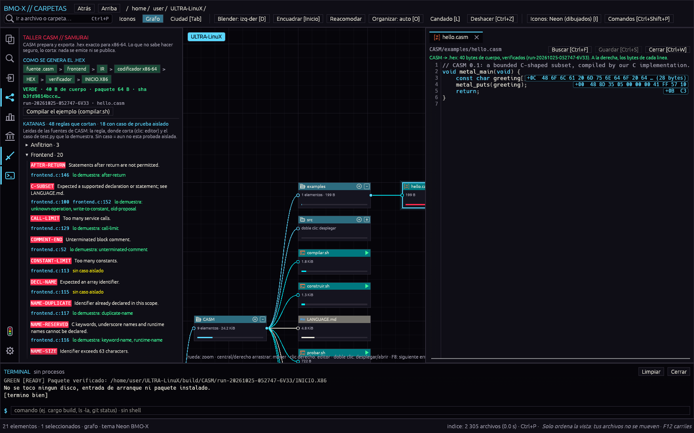

Las **katanas de CASM tienen todas su caso aislado** (61 reglas y 108 casos en `CASM/probar.sh` desde la 0.2). Cada
caso exige que corte **su** regla, también en el verificador, alterando una sola cosa de
una emisión buena.

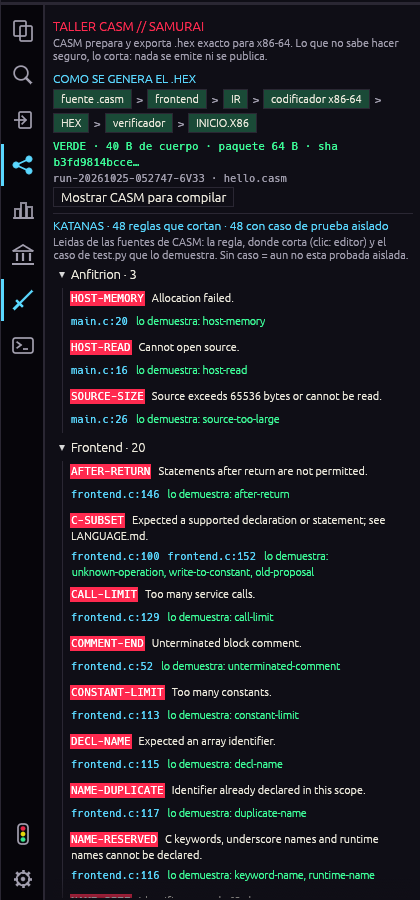

**CASM 0.2, enteros exactos:** en la línea de cada entero, el editor muestra su valor y
su tipo (`= -14 : int64_t`), calculados por el compilador y recalculados por el
verificador, y, si se imprime, los bytes de su decimal (`+4C  2D 31 34 00`). La caja de
bytes nunca tapa el código: si no cabe a la derecha, va después de la línea.

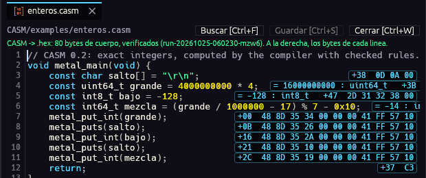

## Dibujo retenido en la GPU: la CPU enseña una vez y la GPU redibuja sola

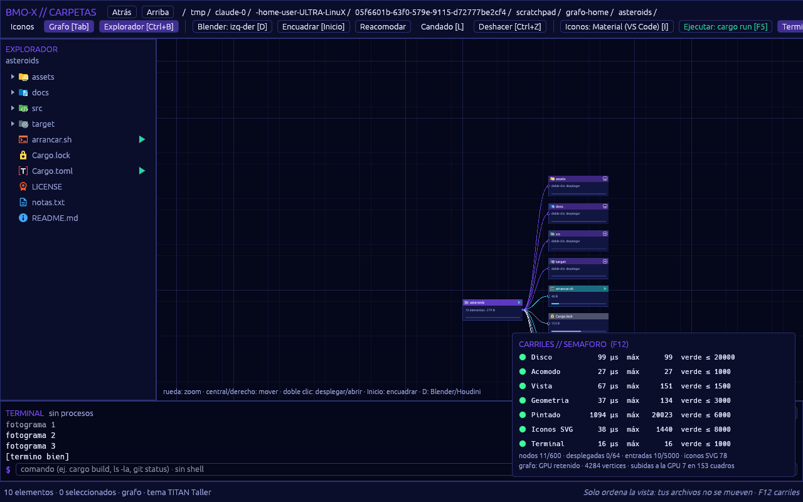

egui es de **modo inmediato**: en cada cuadro la CPU vuelve a calcular todos los
triángulos y los manda a la GPU. Para el grafo hay un camino **retenido**, como el de
Blender y los juegos:

1. **La CPU arma la geometría una sola vez**, en coordenadas del mundo: rejilla,
   cables Bézier en 24 tramos, cuerpos, cabeceras, conectores y barras de peso
   (`gpu.rs`, función pura con pruebas).
2. **La sube a un búfer de la GPU**, y ahí se queda.
3. **Cada cuadro solo viaja la cámara:** 16 bytes (escala y desplazamiento). El
   *shader* `grafo.wgsl`, el «libreto» de la GPU, recoloca todos los vértices.
4. La geometría solo se rehace cuando **cambia el contenido** (`version_contenido`
   del núcleo). Mover y hacer zoom no lo cambian, así que no se rehace.
5. Textos, iconos y botones siguen en egui por encima. Sus letras e iconos ya son
   texturas en la GPU.

**En la prueba:**

- 4284 vértices;
- **7 subidas a la GPU en 153 cuadros**, con la cámara moviéndose y haciendo zoom una
  y otra vez;
- carril de geometría de unos 37 µs, y solo cuando algo cambia.

Lo comprobado y lo que falta:

- **Comprobado:** que la cámara no rehace la geometría, en la prueba
  `mover_la_camara_no_rehace_la_geometria` y en el contador de subidas.
- **No medido todavía:** la diferencia de FPS frente al camino CPU en tu NVIDIA. Se
  puede comparar en Ajustes > Dibujo (GPU retenido o CPU cada cuadro) mirando el
  carril Pintado en F12.

Si no hay wgpu (por ejemplo, en el modo de recuperación), se dibuja en la CPU como antes.

## Iconos (I o Ajustes)

| Estilo | Qué es |
| --- | --- |
| Neón | Carpetas (abiertas o cerradas) y páginas dibujadas con formas; **los archivos de código llevan su logo** (ver abajo) |
| **Material** | Los iconos de archivos de VS Code ([Material Icon Theme](https://github.com/material-extensions/vscode-material-icon-theme), MIT): logos de Rust, C, Python, TOML…, y carpetas especiales (`src`, `docs`, Imágenes, Música, Descargas…) |
| **Lucide** | Iconos de líneas ([Lucide](https://github.com/lucide-icons/lucide), ISC) teñidos con los colores del tema |

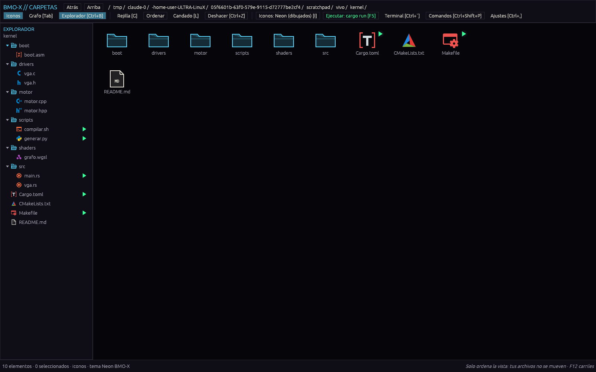

**Logos reconocibles también en Neón.** Un engranaje de Rust o una C azul se
reconocen de un vistazo, así que los archivos de código llevan el logo de su
lenguaje en los tres sitios: el explorador, el grafo y las pestañas del editor.
Lo demás (carpetas, documentos, imágenes) sigue dibujado. Toda la familia de C y
C++ está cubierta:

| Archivos | Icono |
| --- | --- |
| `.c` | C |
| `.h` | cabecera de C |
| `.cpp` `.cc` `.cxx` `.c++` `.cppm` `.ixx` | C++ |
| `.hpp` `.hh` `.hxx` `.h++` `.inl` `.ipp` `.tpp` | cabecera de C++ |
| `.cu` `.cuh` | CUDA |
| `.m` / `.mm` | Objective-C / Objective-C++ |
| `.s` `.asm` `.nasm` | ensamblador |
| `CMakeLists.txt` `.cmake` | CMake |
| `Makefile` `GNUmakefile` | Make |
| `meson.build` | Meson |
| `.clang-format` `.clangd` `.clang-tidy` `compile_commands.json` | clangd |

También están Rust, Zig, Go, Python, Java, Kotlin, C#, Swift, Ruby, PHP, Haskell,
OCaml, Elixir, Erlang, Scala, Julia, R, Dart, JS/TS, React, Vue, Svelte, Lua,
shell, PowerShell, Verilog, WebAssembly, shaders (`.wgsl` `.glsl` `.hlsl` `.vert`
`.frag`…), Nix, Terraform, Protobuf, GraphQL, SQL, Markdown, JSON, TOML, YAML y diff.

Una sola tabla en el núcleo decide el icono, si el archivo es código (su color y su
botón de play) y cómo se colorea en el editor. Así no pueden desencajarse.
Un archivo oculto sin nombre (`.rs`) no cuenta como Rust.

Son 117 SVG incrustados en el programa, con sus licencias en
`src/apps/ultra-carpetas/iconos/`. El programa nunca abre un SVG de fuera, así que
el lector SVG (resvg) solo ve archivos conocidos. Una prueba comprueba que ninguno
lleva scripts, enlaces externos ni imágenes incrustadas, y otra que cada icono que
pide el núcleo existe.

## Carriles con semáforo (F12)

Cada parte del programa va en su carril, con presupuesto y límites, para que ninguna
choque con otra ni haya que pelear después con la optimización. F12 muestra el
último tiempo y el máximo de cada carril con su luz.

| Carril | Verde hasta | Amarillo hasta | Qué consume y cómo se contiene |
| --- | --- | --- | --- |
| **Disco** | 20 ms | 200 ms | E/S, en **su propio hilo**: la interfaz nunca espera al disco. Respuestas viejas (de otra carpeta) se descartan por generación |
| **Acomodo** | 1 ms | 4 ms | CPU, O(n log n) con n ≤ 600 nodos; solo se calcula si cambió el estado |
| **Vista** | 1,5 ms | 5 ms | CPU y memoria: en caché por versión del estado |
| **Geometría** | 3 ms | 10 ms | CPU solo cuando cambia el grafo; mover y zoom solo mandan 16 bytes de cámara a la GPU |
| **Terminal** | 1 ms | 5 ms | Líneas de procesos y lector de errores: como mucho 512 por cuadro, 2000 guardadas y 500 errores |
| **Procesos** | 5 ms | 50 ms | Leer `/proc` cada 500 ms en **su propio hilo**; solo el grupo del play, como mucho 64; no rehace la geometría |
| **Editor** | 4 ms | 10 ms | CPU (egui): texto coloreado en caché por huella; sin colores por encima de 256 KiB; teclear no rehace el grafo |
| **Pintado** | 6 ms | 12 ms | CPU (egui): solo se pinta lo que cae en pantalla; con poco zoom se omiten textos e iconos; solo se repinta con eventos |
| **Iconos SVG** | 8 ms | 30 ms | CPU una vez por icono y tamaño; después es textura en la GPU |
| **Índice** | 50 ms | 300 ms | Ctrl+P: puntuar nombres en su hilo, repartido entre los núcleos; recorrer el disco (1 s en Chromium) va aparte, solo al abrir |
| **Búsqueda** | 2 s | 10 s | Texto dentro de los archivos en su hilo, cancelable; lotes cada 100 ms; se salta lo binario |
| **Git** | 2 s | 15 s | `git log` en su hilo, solo lectura; como mucho 20 000 commits, 30 s y 256 MiB |
| **Museo** | 3 s | 20 s | Museo y dependencias en su hilo (todos los núcleos), solo lectura: archivos de hasta 2 MiB, como mucho 2 GiB o 60 s |
| **Ciudad** | 30 ms | 150 ms | Treemap e instancias solo al cambiar los datos; girar la cámara manda 80 bytes. Los datos salen del hilo del índice (F12 muestra cuánto) |

**Límites duros** (por diseño, no por suerte):

- 5000 entradas por carpeta;
- 600 nodos en el grafo;
- 64 carpetas desplegadas, que son las que se vigilan;
- 1 MiB por archivo de orden y 64 KiB de ajustes;
- 2 MiB por archivo en el editor, 500 errores atrapados por ejecución y 64 procesos
  en vivo.

**Seguridad en el carril de disco:**

- Las rutas son relativas a la carpeta abierta y se validan dos veces: el núcleo solo
  pide lo que leyó, y el hilo rechaza tramos vacíos, `.`, `..`, rutas absolutas y enlaces.
- No se despliega a través de un enlace, para no salir de la carpeta ni entrar en bucles.
- Nada pasa por una shell.

Las primeras medidas en la pantalla virtual (no en tu PC) quedaron todas en verde:

- disco, unos 65 µs;
- acomodo, unos 40 µs;
- vista, unos 70 µs;
- pintado, unos 0,5 ms (el primer cuadro, con texturas, unos 7 ms).

## Seguridad

- **Solo ordena la vista.** No mueve, renombra ni borra archivos. Lo único que
  escribe es el orden, en `~/.config/ultra/carpetas/disposicion/<huella>.json`
  (un archivo por carpeta, permisos 0600, escritura atómica).
- Un orden dañado, enorme (más de 1 MiB), enlazado o con números absurdos (NaN,
  negativos, gigantes) se ignora y los iconos se recolocan solos.
- Lee las carpetas sin seguir enlaces: un enlace roto se muestra como enlace, y uno
  a una carpeta se abre como carpeta. Lee como mucho 5000 entradas por carpeta.
- Si algo aparece o desaparece en la carpeta, lo nuevo va a la primera celda libre
  sin mover lo que ya ordenaste, y lo borrado se olvida.
- El SUPER GRAFO solo lee: abre archivos regulares (nunca enlaces) de hasta 2 MiB, no
  compila ni ejecuta nada, y una referencia con `..` que sale de la carpeta abierta se
  descarta.

## Cómo está hecho: como React, con el núcleo listo para BMO-X

```text
  evento (clic, tecla, arrastre)
       │  Linux lo traduce
       ▼
    Accion ──► reducir(&mut Estado, Accion) ──► Vec<Efecto>   (guardar, abrir, entrar, releer)
                      │                              │
                      ▼                              ▼
               vista(&Estado) ──► Vista       Linux los ejecuta (disco, xdg-open)
               (lo que hay que dibujar)        y dibuja la Vista con egui/wgpu
```

- **Como React + Redux:** el `Estado` es la única verdad. Todo lo que pasa es
  una `Accion`, y `reducir` calcula el estado nuevo sin tocar disco ni pantalla.
  Lo que hay que hacer fuera (guardar el orden, abrir un archivo, entrar en una
  carpeta) sale como `Efecto`. `vista` describe qué dibujar, como un render de
  React, pero como una lista de nodos y no como píxeles.
- **Como VS Code:** comandos con id, título y atajo; una paleta con búsqueda difusa;
  y un mapa de teclas (`atajo`) igual para cualquier plataforma.
- **Núcleo `no_std`** (`src/apps/carpetas-nucleo/`): solo `core` y `alloc`, sin
  archivos, hilos, reloj ni GPU, y sin `unsafe` (`#![forbid(unsafe_code)]`).
  Compila para **`x86_64-unknown-none`**, el objetivo bare-metal. En BMO-X solo
  hay que escribir la capa fina: leer su sistema de archivos, ejecutar los
  `Efecto` y pintar los `Nodo` en su framebuffer.
- **Capa Linux** (`src/apps/ultra-carpetas/`): lee carpetas, guarda el JSON, abre
  con `xdg-open` y dibuja con egui sobre wgpu. Es un programa normal, no va
  dentro del kernel.
- **egui** dibuja la interfaz y **wgpu** habla con la GPU: **Vulkan** en Linux y
  Windows, Metal en macOS. Es el mismo código en todas partes, en Rust seguro y
  sin Vulkan crudo.
- **Pruebas:** en el núcleo, además de las de abajo, las de errores (rustc, panics,
  gcc, Python, rutas que salen de la carpeta, parar en el primer error), editor
  (clic derecho, cambios sin guardar, F8), procesos en árbol y colores de código.
  En la capa Linux: leer y guardar del editor (enlaces, binarios, permisos, cambios
  de fuera), `/proc` con un grupo real y el anillo rojo en la geometría de la GPU.
  Las de siempre: 9 en el núcleo, al estilo Redux (acción → estado + efectos): arrastre,
  rejilla, candado, deshacer, banda, abrir, paleta, JSON raro y vista. Hay 2 más en
  la capa Linux (listar carpetas y guardar en disco).
- Toma tu acento de Personalizar y la letra Chakra Petch si está instalada. Cada
  tipo de archivo tiene su color: imágenes violeta, video rojo, audio amarillo,
  código cyan, comprimidos coral, programas verde.

## Build

`scripts/instalar-carpetas.sh`:

1. prueba el núcleo y lo compila para `x86_64-unknown-none`: si deja de ser
   `no_std`, el build falla en rojo;
2. compila la app con Rust 1.97.0 (fijado en `rust-toolchain.toml`) y `Cargo.lock`
   (`--locked`), y pasa sus pruebas;
3. instala `/usr/local/bin/ultra-carpetas`;
4. comprueba con `ldd` que no falta ninguna biblioteca en la imagen.

Si no hay Rust o no compila, avisa en amarillo y sigue Thunar. Corre desde
`build-baseline.sh` y desde `actualizar-escritorio.sh`.

## Pendiente

- Probarlo en Hyprland real con NVIDIA (aquí se probó con Vulkan por software). Los
  tiempos de los carriles en la pantalla virtual no valen como medida de tu PC.
- Editor: expresiones regulares en la búsqueda y comentarios `/* */` de varias
  líneas coloreados enteros (ahora solo su primera línea).
- Ciudad: el treemap de Chromium entero (~55 ms) queda en amarillo; partirlo en
  trozos o en un hilo lo dejaría en verde. Altura por complejidad (como CodeCity).
- SUPER GRAFO: leer `compile_commands.json` para las rutas `-I` reales y conectar los
  errores de cada unidad; más fichas con detector cuando haya forma honesta de verlas.
- El índice se rehace al abrir la carpeta, con H u «Volver a indexar». Cambios
  posteriores en carpetas plegadas no se ven en Ctrl+P hasta reindexar.
- Miniaturas de imágenes, renombrar y mover archivos de verdad (con confirmación y
  deshacer), varias ventanas y arrastrar entre carpetas.
