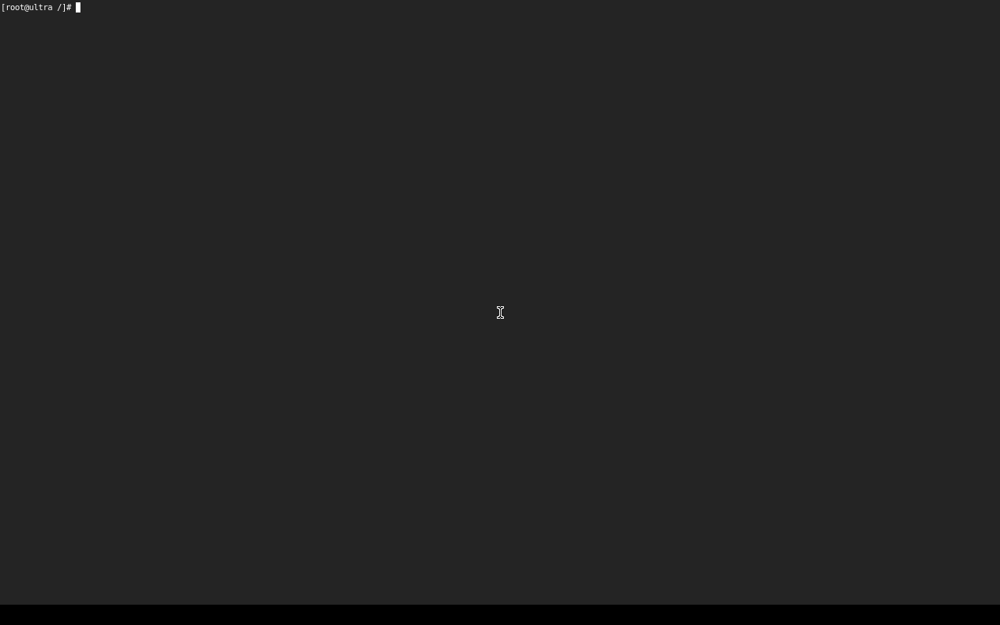

# Camino a Wayland

Wayland en sí es un protocolo pequeño. Lo grande es lo que tiene debajo: un espacio de usuario dinámico con glibc, dispositivos, sesión, bibliotecas gráficas y un compositor. ULTRA lo construye por etapas, cada una probada en QEMU antes de llegar al PC, con el método del [PLAN](PLAN.md#enfoque-compatible-no-copia-18-10-2026): abrir, medir, vigilar con guardianes y documentar.

**Medida de partida:** un Wayland mínimo (`cage` + `foot` + `seatd`) son **122 paquetes de Arch y 128 MiB de descarga**. Mesa con LLVM, para dibujar por software, es lo más pesado.

| Etapa | Qué | Estado |
|---|---|---|
| **W1** | Sistema base de Arch en EROFS, montado por el init como raíz en `/arch` | **Hecha** |
| W1b | La raíz por defecto pasa a ser Arch | Pendiente: antes, `caja` necesita reglas medidas para programas dinámicos |
| **W2** | `udevd` (de Arch, sin systemd) + `seatd`, y `cage` + `foot` sobre `simpledrm` | **Hecha: la primera ventana** (en QEMU) |
| W2b | Escritorio: labwc (ventanas flotantes) + panel + lanzador | Pendiente |
| W3 | RTX 3060: `nvidia-open`, Vulkan, gamescope | Pendiente |

## W1: el sistema base de Arch dentro de ULTRA

**Construcción** (`scripts/build-baseline.sh`): el `pacman` de Arch instala en una raíz aparte `filesystem glibc bash coreutils grep sed less`. Son 47 paquetes con sus dependencias (`evidencias/sistema-arch-paquetes.txt`), sin cambiar nada: compatible con Arch, no una copia. Quedan fuera la documentación, las páginas de manual, las traducciones y las cabeceras de desarrollo, que un arranque no necesita. Se añaden los módulos del kernel y se comprime todo en EROFS con lz4hc: **70 MiB**, uno por kernel (`sistema-<versión>.erofs`).

**Guardián de la construcción:** `libc.so.6`, `bash` y `ls` deben traer la marca CET (`IBT, SHSTK`); si falta, la construcción se para. Los binarios de Arch la traen, así que **la pila sombra de ULTRA también protege a los programas de Arch**.

**Arranque** (`src/sistema.c`): el init monta en `/arch` una raíz completa con overlayfs:
- debajo, la imagen EROFS, de solo lectura, que nunca cambia;
- encima, una capa en memoria (tmpfs) que recibe toda escritura, así que cada arranque empieza limpio;
- dentro, `/dev`, `/proc`, `/sys`, `/tmp` y `/datos` enlazados, para ver la máquina real y los datos que sobreviven.

Al apagar suelta `/arch` antes de desmontar los discos, para que `A:` quede limpio.

**Uso:** `ultra-entrar` entra en el `bash` de Arch. `ultra-entrar programa args` ejecuta un solo programa de Arch y vuelve a la shell de ULTRA.

**Por qué todavía no es la raíz por defecto:** `caja` ejecuta todo desde `/bin` con reglas de Landlock y seccomp medidas para BusyBox. Si `/bin` pasara a ser Arch, sus programas dinámicos necesitarían leer `/usr/lib` y llamadas al sistema que la lista no declara, y `caja` los bloquearía. W1b llega cuando `caja` tenga sus reglas medidas para el ecosistema de Arch.

**Probado en QEMU** (`evidencias/w1-sistema-arch-qemu.log`): `generico --bmo` 57/57, `pc --bmo` 58/58, `--disco` 51/51, y `--auto` y `--auto-falla` en VERDE. Entre las comprobaciones:
- `VERDE [SISTEMA]: base Arch en /arch (47 paquetes, glibc 2.44; …)`;
- el `bash` de Arch (`ARCH-5.3…`) y `ls` de GNU coreutils;
- `grep` de Arch leyendo su propio `/proc/self/status` ve `shstk`: CET activo en un programa dinámico de Arch;
- `/datos` visible desde dentro;
- una escritura en `/etc` de Arch va a la capa en memoria, y la imagen `/sistema` no cambia.

**Tamaño:** cada imagen de sistema pasa de 2 MiB a 70 MiB. La partición `ULTRA-SISTEMA-A` del USB pasa a 160 MiB, y `BMO` en el disco de prueba a 320 MiB. En `A:` sobran 31 GB.

## W2: la primera ventana

**Paquetes:** a la base de W1 se suman `cage foot seatd systemd ttf-dejavu`. De `systemd` solo se usa su `udevd`, sin systemd como PID 1. Con dependencias son **142 paquetes**, 563 MiB instalados y **282 MiB en EROFS** (Mesa con LLVM es lo más pesado). La partición de sistema del USB pasa a 400 MiB, y `BMO` en el disco de prueba a 800 MiB.

**Uso:** `ultra-escritorio` (o `ultra-escritorio programa args`). Dentro de `/arch`:
1. arranca `udevd`, que encuentra pantalla, teclado y ratón para libinput;
2. `seatd-launch` le entrega la sesión a `cage`;
3. `cage` muestra `foot` en toda la pantalla, dibujado por la CPU (`WLR_RENDERER=pixman`) sobre `simpledrm`.

Escribir `exit` en la terminal cierra `cage` y devuelve la consola de texto de ULTRA.

**Lo que hubo que resolver**, con el registro de cada intento:
- `udevadm trigger` decía `Running in chroot, ignoring request` y libinput no veía el teclado. Arreglo: `SYSTEMD_IGNORE_CHROOT=1`.
- `Failed to allocate shm file for keymap` y `foot: failed to open PTY`: el init de ULTRA nunca había montado `/dev/shm` ni `/dev/pts`, porque BusyBox no los necesitaba. Ahora los monta, como cualquier Linux.
- La base de datos de hardware de udev salía casi vacía (105 bytes) al instalarla fuera de un sistema arrancado. La construcción la regenera con `systemd-hwdb --root`: 14 MiB.
- `Cannot find Xwayland`: inofensivo; es para aplicaciones X11 antiguas y `cage` sigue sin él.

**Probado en QEMU** (`evidencias/w2-primera-ventana-qemu.log` y la captura):
- la prueba lanza `ultra-escritorio` desde el puerto serie y captura la pantalla emulada: **`foot` cubre el 97 %** (su fondo `#242424`);
- escribe `exit` con el teclado emulado, que recorre udev, libinput, cage y foot;
- exige `cage termino (salida 0)`.

Resultados: `generico --bmo` 61/61, `pc --bmo` 62/62, `--disco` 55/55, `--auto` y `--auto-falla` en VERDE.

**Siguiente (W2b):** un escritorio de verdad, con labwc (ventanas flotantes, usa `seatd`), un panel y un lanzador. Plasma necesita `logind` y D-Bus, y llega después.
