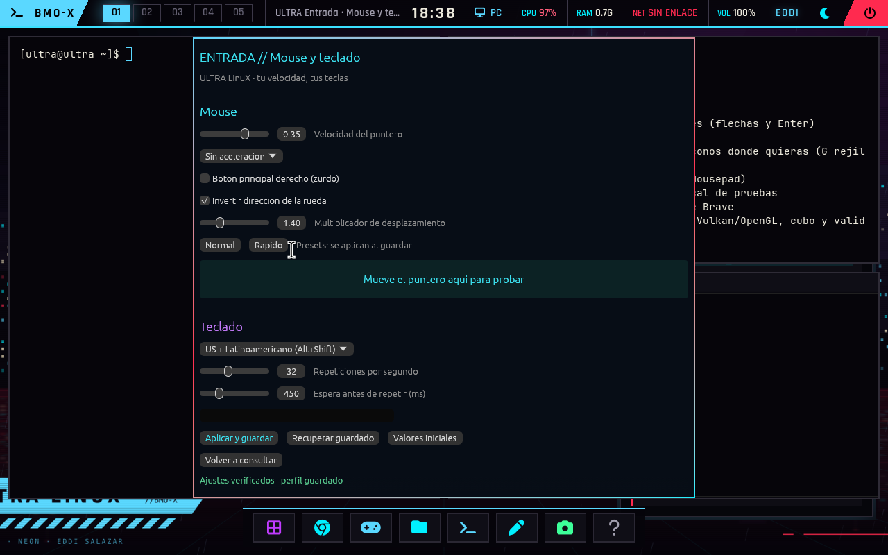
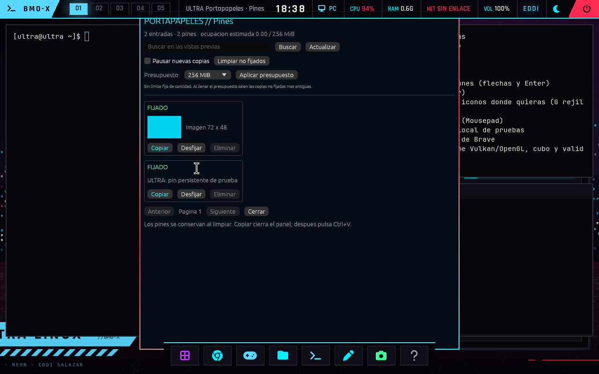

# Entrada y portapapeles persistente

Entrega PC del 31 de octubre de 2026. Banco QEMU desechable, WHPX,
3072 MiB, renderizado por software y sin red ni discos fisicos.

- 6 pruebas de entrada, 6 de SUPER y 9 de historial SQLite: correctas.
- Rust release con Cargo.lock, sin dependencias nuevas; bibliotecas resueltas.
- Banco completo: 203 comprobaciones verdes, cero rojas, salida 0.
- Entrada: nueve opciones reales de Hyprland, perfil 0600 y recuperacion tras
  recargar; Super+Ctrl+M abre la ventana nativa.
- Portapapeles: copias Wayland de texto/PNG exactas, pines tras limpiar y
  reabrir, pausa persistente, permisos 0600 y Super+V con tarjetas nativas.
- Regresion: SUPER, capturas, Heronite, carga MangoHud, recursos e informes;
  segundo arranque y desmontaje limpio.
- SHA-256 de entrega y seis ELF propios auditados. `instalacion.json`
  registra los hashes instalados en A: y la preservacion de datos.ext4.

La primera prueba encontro que el observador generico no registraba el PNG.
Se sustituyo por dos observadores explicitos de texto e imagen, supervisados
y terminados con la sesion. El banco completo se repitio con la imagen final.

No hay limite fijo de entradas, pero si presupuesto configurable: 256 MiB
iniciales, de 32 a 4096 MiB. Los pines no se eliminan por limpieza ni por cuota.
La prueba de mas de 200 entradas verifica paginacion; no demuestra espacio
infinito. El historial real del usuario no se incluye en estas evidencias.

Las capturas muestran datos sinteticos. La carga CPU del renderizador QEMU
no mide el consumo del equipo real. DPI, entrada cruda en juegos y comodidad
del raton fisico requieren comprobacion en el PC.

