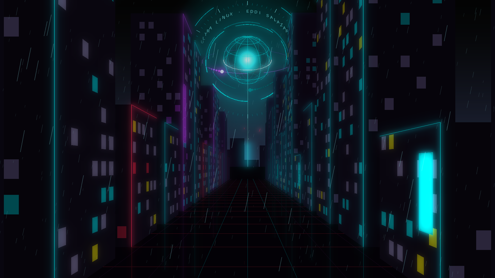
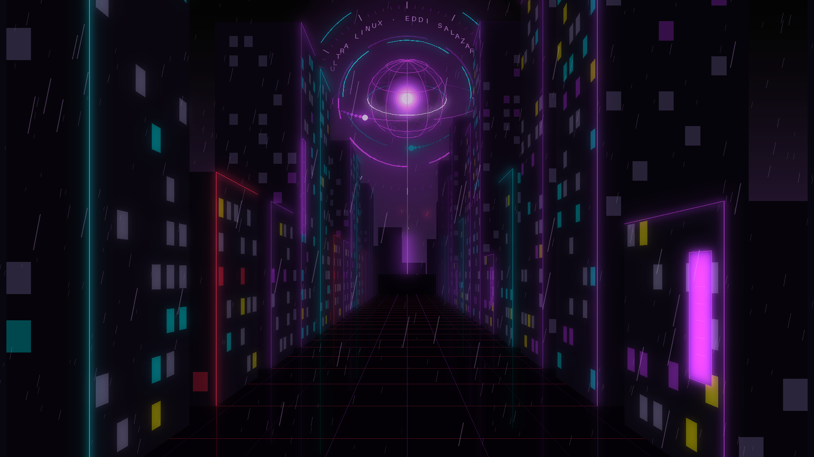
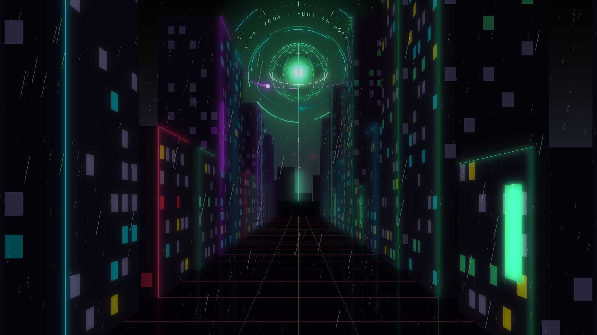

# Escritorios numerados y fondos preparados

Entrega PC, 31 de octubre de 2026, America/Lima.

- Waybar 0.15.0 oficial, archivo fuente fijado por SHA-256. Dos rutas de clic
  numerico adaptadas al despacho Lua; compilacion release con fortificacion,
  stack protector, CET de compilacion y RELRO/NOW. No demuestra que todas las
  dependencias tengan las mismas protecciones ni una prueba de ausencia de UB.
- 7 pruebas del menu SUPER y suite de personalizacion correctas. La prueba
  de rasterizacion verifica que pedir otra vez el mismo PNG conserva su mtime.
- QEMU desechable, WHPX, 3072 MiB, renderizado software, sin NIC ni discos
  fisicos: 204 comprobaciones verdes, cero rojas, salida 0, dos arranques.
- Clics reales de raton en 02, 09 y 01: escritorio activo verificado por IPC.
  Super+9 y Super+Tab tambien comprobados; nueve botones visibles.
- Los tres perfiles cargan sus PNG mediante Swaybg dentro de Wayland.
- Regresion de capturas, controles de entrada, portapapeles/pines e informes.
- Auditoria de seis ELF propios y hashes de entrega correctos. La instalacion
  en A: coincide y datos.ext4 conserva su hash; ver instalacion.json.

La primera copia al disco virtual antiguo fallo por capacidad de su FAT32.
Se conservo EROFS, se creo un disco virtual nuevo dimensionado al contenido
con 256 MiB de margen y se verifico la copia completa. No se formateo ni se
amplio ninguna particion fisica. crear-disco-bmo-pruebas.sh rechaza dispositivos
y destinos fuera de build; solo crea archivos de imagen nuevos.

Las capturas y registros proceden de datos sinteticos del banco. La RAM y CPU
que muestran no son medidas del equipo fisico ni una comparacion de rendimiento.
El pre-render evita generar la escena durante la sesion, no elimina la memoria
de una imagen decodificada ni acredita una ganancia de FPS.

## Fondos originales generados

Los tres PNG de 1920x1080 suman 1.29 MiB. Se dibujaron con el generador de
ciudad existente del proyecto, sin descargar imagenes de terceros.

[Guia y siguientes ideas](../../../docs/ESCRITORIOS-Y-FONDOS.md).
