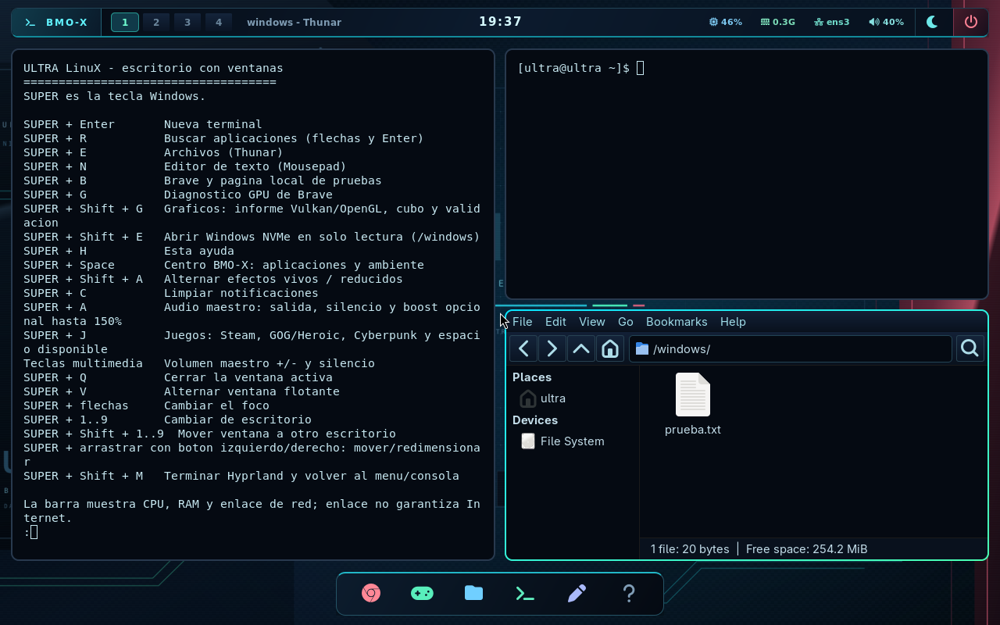

# Gráficos y NVMe: validación del 21 de octubre de 2026

**283 comprobaciones aprobadas en las imágenes finales.** Ambos perfiles se
instalaron en A: con hashes verificados y los datos de arranque conservados.
Los horarios UTC de las últimas pruebas pertenecen al 22 de octubre; en Lima
la ronda sigue siendo del 21. `resumen.json` registra la fecha local y zona.

| Perfil | Kernel | Arranque, escritorio, gráficos y guardianes | Audio, juegos y Windows NVMe |
|---|---:|---:|---:|
| Genérico | #46 | 113 | 28 |
| PC | #32 | 114 | 28 |

Diseño, uso y límites: [Gráficos y NVMe](../../docs/GRAFICA-Y-NVME.md).

## Qué cambió

- Diagnóstico de EGL/Wayland, OpenGL/GLX y Vulkan con versiones del manifiesto
  instalado, proveedores reales, tiempos acotados y salida exportada al informe.
- Cubo Vulkan normal o con validación Khronos por proceso, limitado a doce segundos.
- Activación D-Bus con las variables de Wayland correctas antes de abrir apps.
  El portal Settings respondió realmente en ambos perfiles.
- /windows identifica C: por UUID, protege su dispositivo contra escritura y
  monta NTFS con ro,nosuid,nodev,noexec. El usuario autorizó leer todo C:.
- Teclado: Super+Shift+G abre gráficos y Super+Shift+E abre Windows en Thunar.
- El init desmonta Windows antes de liberar el sistema al reiniciar/apagar.

Se reconstruyeron los kernels y después se reempaquetaron los diagnósticos
corregidos conservando esos kernels. Se verificaron los 11 artefactos descargados.
`artefactos-verificados.json` identifica tamaños y SHA256; los manifiestos de
cada perfil conservan versiones y procedencia de los archivos probados.

## Qué acreditan las pruebas

En genérico, EGL/Wayland y OpenGL/GLX respondieron con Mesa/llvmpipe; Vulkan
identificó el dispositivo CPU y presentó el cubo Wayland con validación activa.
El perfil PC usa también render software en QEMU: no se le conecta la RTX, y
su consulta Vulkan conserva el error de dispositivo ausente. Steam sí abrió
su formulario renderizado. No se presenta ese error como Vulkan NVIDIA probado.

Los dos clientes Steam se instalaron desde almacenamiento ficticio limpio y
actualizaron su cliente antes de mostrar acceso a cuenta. Heroic abrió en Wayland.
Se comprobaron UID1000, capacidades cero, NoNewPrivs, USB Audio emulado,
volumen, boost, silencio y señal PCM. Persistencia y escrituras de la capa del
juego sobreviven al reinicio sin modificar el ejecutable ficticio original.

La imagen Windows ficticia de 256 MiB se conectó a un controlador NVMe virtual.
El usuario leyó su marca de texto y abrió Thunar desde el teclado. Las escrituras
por archivo y por dispositivo fueron rechazadas; el intento root devolvió EPERM
y cero bytes escritos. El dispositivo reportó modo de solo lectura. Se comprobó
el desmontaje limpio y el SHA256 del archivo completo quedó idéntico tras dos
arranques. Se conserva en ambos JSON de audio/juegos. No se pasó ningún disco
físico a QEMU. Las capturas de /windows muestran un banco ficticio, no C: real.

Estas pruebas no miden FPS en la RTX, calidad/latencia del USB físico ni el
montaje del C: real tras apagar Windows. El aviso SRSO de NVIDIA sigue en amarillo,
registrado en pc/nvidia-guardian.txt; no se eliminaron mitigaciones para construir.
El almacenamiento personal de 16 GiB de D: no se montó ni modificó en las pruebas.

## Investigación C++

`laboratorio/` conserva resultados EGL y Vulkan normales y con ASan/UBSan.
La sonda EGL pasó sus nueve controles por construcción. Vulkan crea un buffer
válido y exige que la capa de validación bloquee tamaño cero con el VUID
VkBufferCreateInfo-size-00912. El callback usa estado atómico. Todo se ejecutó
con lavapipe/llvmpipe, sin /dev/dri, red ni socket del escritorio, con límites de
memoria, tareas y tiempo; esas sondas no se instalaron en la imagen de producción.

El primer Vulkan con LSan informó 512 bytes al descargar bibliotecas. Se conserva
el intento y se repite con VK_LOADER_DISABLE_DYNAMIC_LIBRARY_UNLOADING=1, opción
oficial que mantiene las bibliotecas mapeadas. El ensayo posterior pasó con
LSan activado y sin supresiones. Cambia la alcanzabilidad de datos globales;
no demuestra ausencia general de fugas del cargador, capa o driver.

## Prevalidaciones y reproducción

registros.zip contiene compilación, reempaquetado y consolas completas. También
conserva los intentos anteriores separados: el cubo se veía pero no tenía class,
por lo que el primer comprobador debía consultar también title; el rechazo de
escritura root fue EPERM y el primer comprobador esperaba únicamente EROFS.
Se corrigieron esas condiciones. El informe pasó a consultar el manifiesto,
porque pacman no forma parte del sistema de usuario instalado.

La actualización Steam llenó el banco viejo de 6 GiB con caché previa. Ese intento
se interrumpió y no se cuenta como aprobado. Se envió poweroff a su VM y QEMU
terminó; no se conserva una transcripción completa de ese cierre y no se
certifica el desmontaje de ese intento. Los ensayos finales sí validan reinicio.
La fábrica creó un banco nuevo de 12 GiB ext4 dentro de NTFS de 14 GiB. Los dos
perfiles arrancaron copias limpias distintas; --banco-grafica selecciona ese banco
y --windows agrega el NVMe ficticio. No se inyectaron ejecutables o bibliotecas
en las imágenes finales. La configuración de juegos se adapta al UUID/tamaño
del NTFS de laboratorio mediante el mecanismo existente de la prueba.

bancos/ conserva identidades, hashes y registro de la fábrica. No contiene las
imágenes grandes. La advertencia futura de Pillow sobre getdata no impidió la
verificación de las capturas. El taller se apagó al terminar; las VMs finales
se apagaron y no se deja un servicio nuevo ejecutándose.

instalacion-A.json conserva la comprobación de ambos kernels, ambos EROFS y
datos.ext4, además de la ruta del respaldo principal de Windows. Se reutilizan
las entradas F11 y se conserva el orden de arranque del firmware.

Las copias legibles normalizan finales de línea y espacios finales; los informes GPU originales permanecen en registros.zip.
